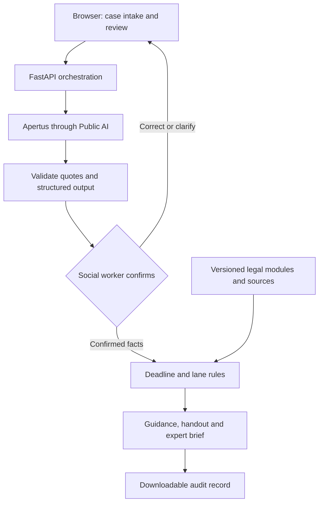

# LIITmus test — AI Tenancy Assistant for Social Workers

**Technical report and README | 8 November 2026**  
**Version:** v4, powered by Apertus through Public AI  
**Demo:** https://liit.bouveng.org/  
**Repository:** [pink-carp/lextec-tenancy-assistant](https://github.com/pink-carp/lextec-tenancy-assistant)  
**Release commit:** application code as of [`aafee91`](https://github.com/pink-carp/lextec-tenancy-assistant/commit/aafee91); later commits on `main` change this README only  
**Team:** Benjamin Bouveng, Shanaya Harjai, Malin Da Ros and Dong Hui Ryu

> Responsible AI for tenant housing rights in Switzerland: LIITmus test helps social workers identify the right next step for tenants. AI supports, social workers oversee, lawyers step in. The tool provides legal information, not legal advice.

## Contents

1. [Purpose and legal problem](#1-purpose-and-legal-problem)
2. [Scope and capabilities](#2-scope-and-capabilities)
3. [Key design decisions](#3-key-design-decisions)
4. [User workflow](#4-user-workflow)
5. [Technical architecture](#5-technical-architecture)
6. [How legal rules shape the system](#6-how-legal-rules-shape-the-system)
7. [Evaluation and lessons learned](#7-evaluation-and-lessons-learned)
8. [Installation and verification](#8-installation-and-verification)
9. [Legal, regulatory and ethical framework](#9-legal-regulatory-and-ethical-framework)
10. [Next steps](#10-next-steps)
11. [Team contributions, external resources and AI disclosure](#11-team-contributions-external-resources-and-ai-disclosure)
12. [Sources and documentation](#12-sources-and-documentation)

**Appendices**

- [Appendix A. The five escalation indices](#appendix-a-the-five-escalation-indices)
- [Appendix B. Output guideline](#appendix-b-output-guideline)
- [Appendix C. Legal reasoning guideline](#appendix-c-legal-reasoning-guideline)
- [Appendix D. Data protection and AI Act related questions](#appendix-d-data-protection-and-ai-act-related-questions)
- [Appendix E. Example cases](#appendix-e-example-cases)

## 1. Purpose and legal problem

Social workers support people, but they are not legal experts. They regularly meet legal problems embedded in wider difficulties: a client cannot pay rent after losing employment, receives a notice they do not understand, or lives with unresolved defects. Effective help requires identifying the relevant facts, preserving documents, recognising urgency and knowing when a lawyer is needed, often across a language barrier.

LIITmus test supports this first encounter. It helps the social worker structure the client's account, ask the relevant questions, identify deadlines, explain next steps and prepare a referral where necessary. The social worker remains the operator and confirms the information the system acts on. The client receives an accessible handout in their own language; a specialist can receive a structured expert brief.

The prototype focuses on **residential tenancy problems in the canton of Zurich**. Swiss tenancy law is a demanding testing ground, because factual distinctions, formal requirements and deadlines often decide the outcome. The architecture is built to extend to further legal fields and social-work situations.

The intended function is initial legal information and triage. The tool does not represent clients, file applications, contact a lawyer automatically, determine benefit eligibility or make binding decisions.

## 2. Scope and capabilities

V4 covers nine tenancy situations, each with its own checked legal module:

| Module | Situation covered |
|---|---|
| `payment_demand.json` | Unpaid rent and a payment demand |
| `termination_by_landlord.json` | Termination by the landlord |
| `tenant_notice.json` | Tenant notice or early departure |
| `defects.json` | Defects such as mould, failed heating or damp |
| `rent_increase.json` | A rent-increase notice |
| `pets_house_rules.json` | Pets and house rules |
| `deposit_return.json` | Return of the rent deposit |
| `co_tenant_leaves.json` | A co-tenant leaves or stops paying |
| `family_home_protection.json` | Protection of a marital family home |

Cases outside these situations receive no module-based legal guidance and are assigned at least Lane 2, with suitable contacts.

| Capability | Status |
|---|---|
| Narrative intake and structured fact extraction, each fact linked to the client's own words | Implemented |
| Human confirmation of facts, situation and deciding events | Implemented |
| Targeted follow-up questions and three-lane routing | Implemented |
| Deadline calculations with step-by-step explanation | Implemented for the main tenancy deadlines (Section 6.3) |
| Client handout with translation into 13 languages, and expert brief | Implemented |
| Downloadable JSON audit trail of every model call | Implemented |
| Document text extraction and photo transcription | Implemented |
| Input in German, French, Italian or English | Implemented; tested with German, French and Italian accounts |

### How LIITmus test addresses the LexTec challenge

| Challenge element | Where it is addressed |
|---|---|
| Turn a plain-language question in German, French, Italian or English into a structured case | Narrative intake, fact extraction and confirmation (Sections 4, 5.1) |
| Recognise missing information instead of assuming it | Three-valued answers, where “unknown” is never treated as “no”; targeted questions; information-uncertainty index (Sections 4, 6.2) |
| Identify the area of law, extract key facts, detect missing, ambiguous or contradictory information | Situation and scope calls, quotation-checked facts, disputed points, deciding events (Section 5.1) |
| Flag urgency signals such as deadlines | Code-based deadline calculation and urgency index (Sections 6.2, 6.3) |
| Estimate complexity and risk; proceed, ask or refer | Five escalation indices and three lanes (Section 6.2) |
| Explainable recommendations with verifiable Swiss sources | Every legal point links to its official Fedlex provision (Section 6.4) |
| Two-minute expert briefing with remaining uncertainties | Expert brief with open questions (Section 4) |
| Bonus: citation checking | Every extracted fact is checked against the client's words; module legal points cite the provisions they were checked against; the AI summary is cleaned of article references not in the case (Sections 3.3, 5.1) |
| Bonus: questions that mix several legal areas | Several tenancy modules can apply to one case; other areas of law raise complexity, and migration, debt-enforcement or criminal matters lead to referral (Sections 5.1, 6.2) |
| Escalation criteria for human review | Escalation indices and hard referral triggers (Section 6.2) |
| At least 10 realistic Swiss scenarios with route and justification | 11 scenarios, each with a recommended lane and justification (Section 7) |
| Regulatory questions: revDSG, confidentiality, liability, transparency, EU AI Act | Section 9 |
| Plain-language user disclosure | Section 9.8 |

## 3. Key design decisions

### 3.1 A custom harness around an open model

We first explored OpenJustice, where the workflow required every question to be written in advance. We chose to build our own **harness**, the software around the language model, so we could control how the client's account, interview questions, legal rules and referral decisions work together. It manages intake, model calls, validation, human confirmation, legal modules, deadlines, referrals and outputs. Legal modules are maintained separately from model calls, referral rules can be inspected, and case information is reused across the social worker's screen, the client handout and the expert brief.

### 3.2 Apertus and Public AI

We use `swiss-ai/apertus-v1.5-70b` through Public AI's OpenAI-compatible endpoint, with an older Apertus model as a fallback. We chose Apertus for its open foundation and transparency: the 1.5 70B release is available under Apache 2.0 [S4]. Public AI Switzerland's cooperative model fits our interest in publicly accessible AI infrastructure [S6], and its privacy notice states that services and data are hosted in Switzerland and processed under the revised Swiss Data Protection Act [S6a].

The web application itself runs on Vercel (Frankfurt region) purely to make the hackathon demonstration easy to access. A deployment for real cases would run on Swiss infrastructure, in line with our Swiss-hosted inference.

### 3.3 Checked legal modules for reliable guidance

Our experiments showed that legal guidance written freely by the model was not reliable enough for social workers to act on. V4 therefore assembles legal points, actions and questions from checked modules, each linked to the statutory paragraphs it relies on. The AI reads the narrative, suggests the situation, prefills answers for confirmation, writes a short neutral summary and translates the handout. Deadlines and lane routing are calculated by code, so every step is repeatable and inspectable. This moves responsibility to module design, correct fact confirmation and selection logic: a correct paragraph is only appropriate if its display conditions match the confirmed facts, which is why every module item carries explicit `show_if` conditions and is covered by automated tests.

| Choice | Intended benefit | Cost we accepted |
|---|---|---|
| Custom harness | Direct control over workflow, rules and outputs | More engineering and maintenance responsibility |
| Hosted Apertus | Open, Swiss model without operating inference hardware | Dependence on an external inference provider |
| Narrow tenancy scope | Legal coverage we could define and test | Other social-work issues are referred rather than answered |
| Checked legal modules | Consistent, inspectable guidance linked to official sources | Each new situation needs its own module |
| Human confirmation | The social worker corrects misunderstandings before the assessment | Adds a step to the social worker's workload |
| Social-worker-only vulnerability rating | Professional, contextual judgement is not anchored by an AI score | Requires shared criteria across social workers |
| Code-based routing and deadlines | Repeatable, explainable results | Rules must be maintained as the law changes |
| Browser-held case state | No central case database | Retention by hosting and inference services is governed separately (Section 9) |

### 3.4 Next step: guided AI generation

Checked content gives the most reliable results today. In our blind comparison (Section 7), v4 scored a mean usefulness of 4.6 out of 5, against 2.8 for a fully generative version on a strong commercial model (OpenAI) and 1.8 for a fully generative version on Apertus. Checked content, however, only covers the situations it was written for. We are therefore developing versions in which the AI does the legal work itself inside a guided structure:

- **`v3-generative` (Apertus) and `v5-openai` (OpenAI):** the social worker confirms the deciding facts; code determines which statutory provisions can apply and calculates deadlines; the AI writes the questions and actions; every legal statement must cite an official source, and automated checks remove what the sources do not support.
- **`v6-pruefungskern` (Apertus):** built on our own legal examination framework (`LIIT_Pruefungskern_v2.0.0`, stored on that branch: core 2.0.0 with nine rule modules). The AI works through the framework's eight steps and assesses each legal requirement against the client's own sentences. Code combines the requirements with the framework's AND/OR logic, so unknown facts stay unknown and become the questions for the client. The AI writes a result for a remedy where the combined conditions support it, and a conditional “If …” result where they are still open.

Guided generation could extend the assistant to new situations, and eventually to other areas of social work, without writing new content for each one.

## 4. User workflow

1. **Describe the situation.** The social worker enters the client's account, selects the client's language and confirms that the client has been informed about the AI tool and has signed the data processing form. The interface asks users not to enter names or ID numbers.
2. **Check what the system understood.** The social worker reviews extracted facts with their source quotations, dates, the suggested situation, warning signs and deciding events, and rates the client's vulnerability from 1 to 10.
3. **Clarify gaps.** The system asks the questions from the confirmed modules. “Unknown” is always a valid answer and never treated as “no”.
4. **Assess.** Code calculates deadlines, applies the lane rules and selects contacts. The system assembles the relevant module content and a brief AI-written factual summary.
5. **Review and hand over.** The social worker checks the result, can override the lane (the reason is recorded), generates the client handout or expert brief, and can download the audit trail.
6. **End the case.** The interface clears the case from the browser.

The expert brief supports a roughly two-minute initial review by a lawyer, following our output specification (`legal-team-materials/output-specification.md`).

## 5. Technical architecture

The backend uses Python and FastAPI (`app/server.py`); the frontend is a single HTML application (`app/static/index.html`).



| Component | Responsibility |
|---|---|
| `app/pipeline.py` | Orchestrates intake, understanding, confirmation, assessment and output |
| `app/llm.py` | Calls Public AI, handles retries and records model-call traces |
| `app/events.py` | Prefills and cross-checks the legally deciding events |
| `app/modules.py` | Selects module questions and assembles conditional content |
| `app/dates.py`, `app/deadlines.py` | Parse dates and calculate deadlines |
| `app/scoring.py` | Applies the lane rules |
| `app/contacts.py` | Selects contacts from our maintained resource list |
| `app/outputs.py` | Assembles handouts and expert briefs; requests translations |
| `corpus/modules/` | Questions, legal points, actions and display conditions |
| `corpus/article_requirements.json` | Maps 161 statutory paragraphs to 21 deciding events |
| `corpus/law_paragraphs.jsonl` | Official legal paragraphs with version metadata and source links |

### 5.1 Model calls and validation

Every model call goes to `swiss-ai/apertus-v1.5-70b` at temperature 0 with a fixed seed; failed calls are retried, finally with the fallback model. The model answers in JSON, which code parses and checks.

| Call | What the AI does | What code does with the answer |
|---|---|---|
| **Facts** (reading, in parallel with the next four) | Lists up to ten facts and any disputed points, each with the client's exact words | Keeps a fact as “reported” only if its quotation is found in the account |
| **Documents** | Finds letters and notices mentioned, picks their type from a fixed list, and notes the household and the client's plans | Drops documents whose words are not in the account; code turns phrases such as “last week” into dates |
| **Situation and scope** | Identifies the tenancy situations, whether the client cannot pay, whether the case is residential and in Zurich, and other areas of law | Same quotation check; other areas of law raise complexity |
| **Safety signs** | Lists the vulnerability indicators of our escalation framework that the account explicitly states, and whether anyone is in immediate danger | Keeps only violence or threats and exploitation or dependency, as warning signs that count only while the social worker keeps them ticked; immediate danger leads to Lane 3 |
| **Legal issues** | Reads the tenancy provisions (Art. 253–274g OR) and names the relevant articles | Adds a fixed set of core articles per situation and sets aside articles whose triggering event has not occurred |
| **Deciding events** (one small call each) | Answers yes, no or not stated for statements such as “the landlord has terminated the lease”, citing a sentence | Without a valid sentence the answer becomes “not stated”; a threat (“will terminate”) is never read as a termination |
| **Situation pick** | Chooses the matching situation modules, each pick citing a sentence | Rule-based triggers take over if the call fails |
| **Answer prefill** (one per question) | Checks whether the account already answers a date, number or free-text question | Yes/no questions are never prefilled; the social worker confirms every prefilled answer |
| **Situation summary** | Writes two neutral sentences about the situation and the client's goal | Removes article references and dates that are not in the case |
| **Translation** (if needed) | Translates the handout into the client's language | Checks that every number and date survives; the English version stays alongside |
| **Transcription** (uploads) | Transcribes a photographed document | Text PDFs are read by code; the social worker confirms the text |

A typical case needs 15–20 calls and costs about USD 0.02. Accounts in German, French or Italian are processed the same way. The model writes extracted facts in English, so a fact whose quotation cannot be matched to the original wording is marked “inferred – please check” for the social worker.

A genuine quotation does not guarantee a correct reading: “the landlord will terminate the lease” is a warning, not a termination. That is why threat wording is checked in code and the social worker confirms every deciding event before the assessment.

### 5.2 Case storage and audit trail

The browser holds the case and sends it with each request; the application keeps no case database. The audit export contains facts, answers, events, calculated dates, referral reasons and every model call with its prompt and response, so a reviewer can trace each output back to its inputs.

## 6. How legal rules shape the system

### 6.1 Legal reasoning structure

The system follows our legal workflow (`legal-team-materials/legal-workflow.md`): the applicable protections, each party's obligations, the legally relevant event, the requirements for a remedy, form and deadlines, and the legal consequences, with urgent deadlines checked first. Each module item links to its statutory paragraphs and is shown only when its `show_if` conditions hold on the confirmed facts.

### 6.2 Referral lanes

| Lane | Function |
|---|---|
| 1 | AI information may be sufficient to proceed |
| 2 | Further clarification and information is required |
| 3 | Urgent human legal referral is necessary |

The lane follows from five indices defined in our escalation framework (`legal-team-materials/escalation-indices.md`): urgency, severity, complexity, vulnerability and information uncertainty. Code checks them in order: high urgency, high complexity, high severity together with medium urgency or vulnerability, and high vulnerability together with medium urgency or severity each lead to Lane 3; open or disputed information leads to Lane 2 (`app/scoring.py`). Violence or threats, exploitation or dependency, immediate danger and migration-law matters always lead to Lane 3.

**The social worker rates vulnerability, without an AI-suggested score.** A rating of 7–10 counts as high and 4–6 as medium. This keeps a contextual, professional judgement with the professional. These thresholds are project policy choices, not statutory standards.

The framework's assessment rules also shape the code: a statement is attributed to the person it concerns, current events are distinguished from threatened or past ones, missing information is never treated as proof that no risk exists, and vulnerability lowers the threshold for support without determining legal rights.

### 6.3 Deadline calculations

The calculator covers the payment period after a payment demand (Art. 257d OR), challenging a termination and requesting an extension (Art. 273 OR), challenging a rent increase (Art. 270b OR) and the tenant's own notice cut-off, counted backwards from the chosen end date. Final days are moved past weekends and Zurich public holidays. A date from the client's account is not automatically the legally effective receipt date, so vague dates produce a labelled estimate and a question about when and how the document arrived. Every deadline shows the triggering event, the rule and each calculation step. Court and conciliation documents are flagged for same-day professional review. Our full deadline rules are in `legal-team-materials/deadline-calculation-rules.md`.

### 6.4 Legal sources

Our local corpus contains official German-language texts from Fedlex: OR, ZPO, ZGB, VMWG and the federal Saturday legislation, with 6,951 paragraphs, version metadata and official links, plus 235 plain-English paragraph summaries. Every legal point on the result screen opens its official source.

## 7. Evaluation and lessons learned

We compared three versions on 11 cases: our nine example cases (`legal-team-materials/example-cases/`) and two further scenarios (`docs/scenarios.md`), each with a recommended lane and justification. The outputs were anonymised and shuffled per case and assessed by a blind AI reviewer (Claude Opus 5.5) against the official law texts, using a fixed rubric (`bench/results/evaluation_2026-11-08/three_way_review_instructions.md`). An AI reviewer allowed a consistent, repeatable comparison within the hackathon; review by tenancy-law experts is the next step (Section 10). The v4 runs used the code on branch `v4-scoped` (commit `eedebb1`); since then, vulnerability rating has moved fully to the social worker.

| Measure | v4 (checked modules, Apertus) | Generative, OpenAI | Generative, Apertus |
|---|---|---|---|
| Mean usefulness (1–5) | **4.6** | 2.8 | 1.8 |
| Cases with a clear error | **4 / 11** | 10 / 11 | 11 / 11 |
| Legal statements wrong or inapplicable | **0 of 55** | 3 of 65 | not shown |
| Actions wrong or inapplicable | **0 of 49** | 0 of 26 | 5 of 49 |
| Appropriate lane | **11 / 11** | 10 / 11 | 9 / 11 |
| Model cost per case | **~USD 0.02** | ~USD 0.30 | ~USD 0.03 |

The results support our use of checked legal modules. Because these cases were developed alongside the tool, the next stage is testing on new cases with social workers and tenancy-law experts (Section 10). The evaluation artefacts (rubric, blinded outputs, mapping key and reviews) are in `bench/results/evaluation_2026-11-08/`, and the results page is at `/benchmark`. In addition, 400 automated tests check dates, deadlines, module structure, references and conditions without model calls; all pass.

### 7.1 What we learned about the risks of legal automation

| Finding | Our response |
|---|---|
| **Freely generated legal text is unreliable.** Even with confirmed facts, rule filters and two automatic checks, about one in four legal sentences that Apertus wrote freely was wrong. | Legal guidance comes from checked modules; guided generation continues on separate branches (Section 3.4). |
| **Automatic verification cuts both ways.** On 174 AI-written legal sentences, our two automatic checks removed about two thirds of the harmful sentences, but also about half of the correct ones (`writer_levels_after_checks.json`). | We do not rely on AI checking AI for the legal content shown to social workers. |
| **A genuine quotation can still be misread.** “The landlord will terminate the lease” is a warning, not a termination. | Code flags threat wording, and the social worker confirms every deciding event. |
| **Missing facts tempt a system to assume.** An unanswered question can silently become a “no”. | Answers are three-valued; “unknown” keeps conditions open and raises information uncertainty. |
| **AI scores can anchor professional judgement** (automation bias). | Vulnerability is rated only by the social worker; AI warning signs count only while the social worker keeps them ticked. |
| **Reliability and reach pull in opposite directions.** Checked content covers only the situations it was written for. | Cases outside the modules go to at least Lane 2 with suitable contacts; guided generation aims to extend reach. |
| **Translation can shift meaning.** | Code checks that numbers and dates survive, the English version stays alongside, and consequential communications call for human language review. |

## 8. Installation and verification

### 8.1 Setup

You need Git, Python 3.12 and a Public AI API key.

```bash
git clone https://github.com/pink-carp/lextec-tenancy-assistant.git
cd lextec-tenancy-assistant
python3.12 -m venv .venv
.venv/bin/python -m pip install -r requirements.txt
# Create .env containing PUBLICAI_API_KEY=<your key>
.venv/bin/python -m uvicorn app.server:app --port 8000
```

On Windows, use `py -3.12 -m venv .venv` and `.\.venv\Scripts\python.exe` in place of `.venv/bin/python`. Open `http://localhost:8000`; the evaluation page is `http://localhost:8000/benchmark`. The key is read from the environment or from `.env` and stays server-side. The release was tested with Python 3.12.2, FastAPI 0.162.2, Uvicorn 0.54.0, Pydantic 2.14.3, httpx 0.27.0, pdfplumber 0.11.10 and Pillow 11.3.0.

### 8.2 Automated tests

```bash
.venv/bin/python -m pip install pytest
.venv/bin/python -m pytest tests
```

The tests make no AI calls. The comparison versions are on the branches `v3-generative`, `v5-openai` (set `LLM_PROVIDER=openai` and `OPENAI_API_KEY`) and `v6-pruefungskern`.

### 8.3 Verifying a result step by step

Load example case 1 from the drop-down on the start page (mould in a Zurich flat; the property manager blames ventilation; the client is considering paying 30% less rent) and check:

1. Each extracted fact shows the client's own words, and the disputed cause of the mould is recorded as disputed, not as fact.
2. The social worker can correct the facts and confirm the defects module.
3. The questions address the open points, and “unknown” remains a valid answer.
4. The result does not recommend a unilateral rent deduction.
5. Every legal point opens its official source.
6. The handout and expert brief show the same facts.
7. Adding a termination notice to the account raises urgency and leads to a referral.
8. The downloaded audit trail shows the model calls and rules behind the result.

### 8.4 Auditing a result

| To check | Where to look |
|---|---|
| A legal point | Click its provision: the official German text opens, with its version date and a link to Fedlex |
| A deadline | “How this was calculated” under the deadline: triggering event, rule and each step |
| The lane | The index table on the result screen: the level of each of the five indices and the reasons behind it, plus the lane rule that applied |
| The whole case | “Download audit trail”: a JSON file with the facts and their quotations, the confirmed events and answers, the deadlines with their steps, the lane rule and any override reason, and every model call with its prompt, reply, model, tokens and cost |
| The evaluation | `bench/results/evaluation_2026-11-08/`: reviewer instructions, blinded inputs, mapping key and review |

## 9. Legal, regulatory and ethical framework

Our regulatory analysis takes the perspective of a Zurich state social service using the tool supplied by LexTec, a private start-up. It distinguishes the authority's responsibilities from the supplier's obligations, and treats the proposed safeguards as internal operating rules rather than implying that every safeguard is expressly required by statute. The full guideline is in `legal-team-materials/regulatory-questions-and-user-disclosure.md`.

### 9.1 Purpose and permitted use

The tool is a **decision-support system, not a decision-maker**. It supports social workers in collecting relevant facts, identifying questions and recommending a referral lane. It must not determine entitlement to social assistance, deny access to services, close a case or issue a legally binding decision. Cases that require legal interpretation are referred to a qualified person. A disclaimer does not replace lawful data processing, effective human oversight or quality assurance.

### 9.2 Data protection and confidentiality

- **Legal basis.** The social service's processing is governed principally by Zurich's Information and Data Protection Act (IDG): § 8 on lawful processing, § 6 on outsourcing, § 7 on information security and § 10 on impact assessment and prior review. The authority remains responsible even where the supplier processes data on its behalf. Federal data protection law (revDSG) applies to the supplier's processing where relevant, particularly for any processing for its own purposes. Official guidance stresses transparency and the assessment of AI-related risks [S7–S8].
- **Special personal data.** Information about health, mental health and social-assistance measures is special personal data. Its processing requires a sufficiently specific basis in a formal statute; a signed consent form is not a substitute. Where consent is relied on for an optional activity, it must be informed, specific and genuinely voluntary, taking the person's dependence on the social service into account, and refusal must not disadvantage them.
- **Official secrecy.** Disclosure to the supplier must be legally permissible and limited to the approved purpose; confidentiality clauses alone do not make an otherwise prohibited disclosure lawful. Ordinary chatbot use does not attract lawyer–client privilege, and the tool does not promise it.
- **Supplier role.** Whether LexTec is a processor depends on the actual deployment: supplying software without access to case data differs from hosting the tool or accessing data through support and logs, which the authority must regulate as outsourcing. Case data must not be used for the supplier's product development or model training.
- **Data minimisation.** Social workers use a case reference rather than a name, omit addresses, identification numbers and other identifiers unless necessary, and avoid unnecessary intimate or medical detail. Pseudonymised information remains personal data while the person can still be identified.
- **Records and retention.** The official case record, temporary AI inputs and outputs, access logs, diagnostic records, caches and backups are distinguished. The final referral decision and its reasons belong in the official record; AI output is labelled as such and is not stored as established fact. Temporary AI data is deleted on an approved schedule that also covers the supplier's logs, caches and backups.

**How the prototype applies this.** Code masks e-mail addresses, phone numbers, IBANs and AHV numbers in the typed account before it is sent to the model. The interface asks users not to enter names or ID numbers and to give the municipality instead of the street address. The case lives in the browser, with no case database, and is cleared when the case ends. Inference runs through Public AI, whose privacy notice states Swiss hosting and processing under the revDSG [S6a]; Vercel is used only for the hackathon demonstration (Section 3.2).

### 9.3 Conditions before use with real cases

1. The intended purpose, permitted functions and prohibited uses are documented.
2. The statutory basis for processing, including any special personal data, is identified.
3. A data protection impact assessment is completed, with any required prior review by the supervisory authority.
4. Hosting, data flows, external interfaces, remote access, logs and subprocessors are documented and approved, in an environment with access controls, secure authentication and protection of data in storage and transmission.
5. The authority and the supplier agree contractual safeguards: processing instructions, a ban on unauthorised training or reuse, subprocessor approval, security controls, incident notification, audit rights, change control, and retention, deletion and exit arrangements.
6. Triage rules and legally relevant outputs are tested and approved by qualified reviewers.
7. Users are trained and have an escalation route.
8. Information notices, record-keeping rules and incident procedures are ready.

### 9.4 Human oversight and escalation

Every referral recommendation receives **substantive human review before it affects a person's access to support**. The social worker checks the factual summary, assesses whether the suggested lane matches the person's circumstances, checks for urgency, vulnerability and missing facts, overrides an unsuitable recommendation and records the final decision. A final confirmation click is not meaningful review.

Because social workers may lack legal training, escalation to a qualified reviewer is mandatory where the recommendation depends on a disputed legal interpretation, a deadline or eviction risk is involved, the recommendation would restrict or delay support, the facts are incomplete or outside the validated scope, or the social worker cannot assess the recommendation independently. Urgent protective action is never delayed while waiting for the tool. The tool does not infer emotions from voice, facial expressions or similar signals.

In the prototype, the social worker confirms the facts, situation and deciding events, rates vulnerability, reviews the result and can override the lane with a recorded reason. A provisional lane is shown before the follow-up questions, so an urgent referral does not have to wait for them.

### 9.5 Quality assurance and fairness

The tool is tested before launch and after any material change to the model, prompts, legal sources or triage rules. Testing covers typical and borderline cases, urgent and incomplete cases, incorrect or fabricated legal references, inappropriate reassurance, missed deadlines, discriminatory or inconsistent outcomes, and the risk of a person being placed in a lower-support lane. Staff training covers the tool's scope, hallucinations, automation bias, confidentiality, data minimisation, verification and escalation, and how to continue the service without the tool. Serious confidentiality risks or repeated harmful triage errors lead to suspension of the affected function, with a manual pathway always available.

Vulnerability is rated by the social worker, not inferred by the AI, and guides support rather than legal rights. Warning signs require the client's explicit words; the model is instructed never to infer them from a name, nationality or tone. The handout is offered in 13 languages. Code checks that numbers and dates survive translation; because meaning, negation and urgency can still shift, consequential communications call for human language review.

### 9.6 Liability and transparency

Describing the output as legal information does not remove responsibility for errors or settle the legal classification of the service. Outsourcing does not transfer the authority's statutory responsibility to the supplier; the supplier agreement allocates service continuity, liability and responsibility for defects.

Before personal information is entered, the social worker explains, in language adapted to the person: the use and purpose of AI-assisted triage, the categories of information processed, the responsible authority, which providers can access the information and where it is hosted, the limits of the tool and the human review process, retention, and how to request access, correction or review. A general legal disclaimer is not a substitute for a privacy notice, and the interface identifies AI-generated content to staff.

### 9.7 EU AI Act

For a tool used solely by a Zurich social service, with no relevant EU market or output-use connection, the EU AI Act will generally not be the directly applicable framework; the territorial assessment is documented and reassessed if deployment changes. A legal-information assistant is not high-risk merely because it concerns law. For an EU deployment, the assessment examines whether the tool evaluates eligibility for, or materially affects access to, essential public assistance benefits or services (Annex III) [S9]; describing the tool as “triage” or adding human approval does not by itself exclude high-risk classification. Prohibited practices, including exploitation of vulnerability, are assessed separately, and model openness alone does not establish application-level compliance. Regardless of direct applicability, transparency, staff competence, human oversight and documented risk management are mandatory internal safeguards.

### 9.8 User-facing disclosure

Our plain-language disclosure for clients:

> **What does the AI do?** We have created an AI-supported tenancy information tool designed to help social workers assist people experiencing residential housing problems in Switzerland. It can help to understand and organise the information you provide about your housing situation; identify possible tenancy-law issues and relevant Swiss legal rules; ask questions to clarify important facts; identify possible deadlines and explain why they may matter; prepare a summary of your situation and suggest possible next steps; identify when legal advice or other specialist support may be needed; and find relevant legal, social and support services. The tool is designed primarily for private residential tenancy matters in the Canton of Zurich.
>
> It places your case into one of three lanes:
> - **Lane 1 — AI information may be sufficient to proceed:** if your situation is relatively straightforward and there is enough information, the tool provides relevant tenancy information and potential next steps.
> - **Lane 2 — Further clarification and information is required:** if important details are missing or unclear, the tool identifies what further information is needed, and the social worker relays it.
> - **Lane 3 — Urgent human legal referral is necessary:** if your situation is urgent, particularly serious, or requires specialist legal judgement, the tool highlights that referral to a qualified lawyer or specialist service may be appropriate.
>
> The social worker oversees the process, reviews the tool's assessment and helps determine the next steps. If your situation requires urgent human support, the referral is not delayed while the tool gathers more information.
>
> **Disclaimer:** AI-generated information can contain inaccurate or outdated content, omit relevant legal requirements, or fail to identify important deadlines. LIITmus test is not a lawyer, law firm, court or public authority. It cannot provide legal representation or advice, and it cannot make binding legal decisions.
>
> **When does a human become involved?** A social worker uses the tool, reviews what it produces and gives their own vulnerability assessment (a score from 1 to 10). If your case involves a serious legal risk, an important deadline, a possible loss of your home or a complicated legal issue, the tool may recommend a qualified legal professional or specialist service. In an emergency, you should not wait for an AI-generated response. You can ask for human assistance at any time, even if the tool has not recommended it.

In the prototype, the social worker confirms before analysis that the client knows an AI tool is used and has signed the data processing form. Every client handout carries a short notice: the sheet was made with a computer tool and checked by the social worker, its legal texts were checked in advance and AI wrote the summary, it is general legal information rather than legal advice, and the information was sent to an AI service (Public AI).

## 10. Next steps

- **Test lane selection with social workers.**
- **Benchmark accuracy** on new cases, with review by tenancy-law experts.
- **Develop a secure social-worker app**, hosted in Switzerland, with login and access control.
- **Connect the prototype to legal platforms** for referral and handover.
- **Guided AI generation** (Section 3.4), to extend the assistant to further situations and legal fields.

## 11. Team contributions, external resources and AI disclosure

All four team members contributed to the legal work.

| Team member | Shared contribution | Additional area of focus |
|---|---|---|
| Benjamin Bouveng | Solution conceptualisation, design, and strategic development. | Technical lead, coding and implementation |
| Shanaya Harjai | Solution conceptualisation, design, and strategic development. | Legal expertise, Pitch development and presentation |
| Malin Da Ros | Solution conceptualisation, design, and strategic development. | Swiss legal expertise and case development |
| Dong Hui Ryu | Solution conceptualisation, design, and strategic development. | Swiss legal expertise and legal-reasoning framework |

Our legal materials are in `legal-team-materials/` [S1a].

**External resources and AI use:**

- **Apertus / Swiss AI Initiative:** inference model used in v4, under Apache 2.0.
- **Public AI:** hosted inference API.
- **Fedlex:** official statutory sources for our legal corpus.
- **OpenCaseLaw:** court-decision data used during development and evaluation.
- **OpenJustice:** platform explored at the start of the project; no OpenJustice code or content is used.
- **FastAPI, Uvicorn, pdfplumber and other packages:** see `requirements.txt`.
- **Claude (Anthropic), through Claude Code:** wrote the application code under the technical lead's direction; drafted the legal modules and the article-requirements table from the official German texts and cross-checked them in a separate pass; reviewed the paragraph summaries; and acted as the blind reviewer in the evaluation. These tasks used Claude Opus 5.5; bounded tasks such as source research and the first versions of the date and deadline code with their tests used Claude Sonnet 5.5.
- **OpenAI:** `gpt-5.6-sol`, used only in the `v5-openai` comparison branch.
- **ChatGPT/Codex:** assisted with drafting and editing this report using our project documents and public sources. We remain responsible for the final submission.

## 12. Sources and documentation

- **[S1] Team working document:** [hack the law](https://docs.google.com/document/d/1CPMh81fa_T7U3ELXTHhUgR0i6awTPp4umefUFyrn3Cg/edit): examples, legal workflow, output specifications, escalation, regulatory notes and pitch notes.
- **[S1a] Team legal materials in this repository:** [`legal-team-materials/`](legal-team-materials/). `legal-workflow.md`, `escalation-indices.md`, `output-specification.md` and `deadline-calculation-rules.md` are loaded into the AI prompts; `social-service-contacts.md` is the source of the contact list (`app/data/resources.json`); `regulatory-questions-and-user-disclosure.md` contains the user-facing disclosure, liability waiver and data-protection guideline; `example-cases/case-1.md` to `case-9.md` are our example cases (source of `bench/cases.json`).
- **[S2] Development documentation:** [README.md — v4 limited scope](https://drive.google.com/file/d/1Fqru4TuR5_rnl2cYjV5pbPTxLEW8JCN4/view).
- **[S3] OpenJustice:** [Product description](https://openjustice.ai/).
- **[S4] Apertus:** [Official documentation and model releases](https://www.apertus-ai.org/pages/documentation/).
- **[S5] Public AI:** [Developer documentation](https://platform.publicai.co/docs).
- **[S6] Public AI Switzerland:** [Organisation and service information](https://publicai.ch/).
- **[S6a] Public AI Switzerland:** [Privacy notice](https://publicai.ch/privacy.html), sections 2 and 6 on revDSG and Swiss hosting.
- **[S7] Federal Data Protection and Information Commissioner:** [AI and data protection](https://www.edoeb.admin.ch/de/ki-und-datenschutz).
- **[S8] Zurich Data Protection Commissioner:** [Guidance on AI use by public bodies](https://www.datenschutz.ch/mitteilungen/2025/neues-merkblatt-vorgehen-beim-einsatz-von-ki-bei-oeffentlichen-organen).
- **[S9] European Commission:** [AI Act, Annex III](https://ai-act-service-desk.ec.europa.eu/en/ai-act/annex-3).

Sources consulted on 8 November 2026.

## Appendix A. The five escalation indices

This appendix reproduces the escalation framework used to route cases (Section 6.2). The same text is kept in `legal-team-materials/escalation-indices.md`.

### A.1 Legal urgency

Identify statements suggesting:

- An appeal, objection or challenge deadline.
- A limitation period or statutory time limit.
- A termination, eviction or payment notice.
- Court proceedings, hearings, summonses or judgments.
- Enforcement action, bailiff involvement or imminent eviction.
- An approaching or potentially missed procedural deadline.

### A.2 Severity of consequences

Identify statements suggesting:

- Loss of housing or homelessness.
- Arrest, detention or loss of liberty.
- Loss of residence or immigration rights.
- Family separation or child custody consequences.
- Loss of social assistance, disability benefits or essential support.
- Inability to access food, medication, heating or other essential needs.

### A.3 Personal vulnerability

Identify circumstances involving:

- Children, minors, pregnancy or single-parent households.
- Domestic violence, threats, abuse or coercive control.
- Disability or difficulty accessing services.
- Exploitation, trafficking or dependency.
- Severe financial hardship, unemployment or debt.
- Language, literacy or communication barriers.

### A.4 Legal complexity

Identify circumstances involving:

- Multiple areas of law.
- Conflicting legal rules or decisions.
- Uncertainty about the responsible authority or jurisdiction.
- Immigration, asylum or residence issues connected to housing.
- Public-law and private-law overlap.
- Institutional, collective or supported accommodation.
- Specialist proceedings requiring qualified legal advice.

### A.5 Information uncertainty

Identify circumstances involving:

- Missing or unavailable documents.
- Unclear or uncertain dates.
- Contradictory accounts or evidence.
- Unclear contractual or legal status.
- Unverified events or incomplete procedural information.
- Insufficient facts to establish a reliable legal position.

### A.6 Assessment rules

1. Identify the person affected by the statement. Do not assume the client is describing themselves.
2. Distinguish current, historical, hypothetical and future events.
3. Do not assign a high escalation level based on an isolated keyword.
4. Reassess all five indices whenever new information is provided.
5. Preserve earlier indicators throughout the interview and update them when circumstances change.
6. A critical legal deadline or imminent serious consequence may independently justify human review, even if other indices are low.
7. Personal vulnerability should lower the threshold for offering support, but must not determine legal eligibility or legal rights.
8. Missing information must never be interpreted as proof that no risk exists.

## Appendix B. Output guideline

This appendix reproduces the output guideline that defines how cases are routed and what the social worker's screen, the client handout and the expert brief contain. The same text is kept in `legal-team-materials/output-specification.md`.

### B.1 Purpose

Assess each case using the five dimensions defined below:

- Information uncertainty.
- Legal urgency.
- Severity of consequences.
- Personal vulnerability.
- Legal complexity.

Assign the case to one of three lanes. Produce two separate outputs:

- A screen view for the social worker, containing action recommendations and a plain-language case summary with full source references.
- A client handout, containing a questionnaire where relevant, action recommendations and a concise plain-language case summary.

Both outputs must reflect the same facts, uncertainties and recommended actions.

### B.2 Lane selection

| Lane | When to use it | Required approach |
|---|---|---|
| Lane 1 — AI assistance | The case is straightforward and non-urgent, potential consequences are limited, personal vulnerability is low, and sufficient information is available for a reliable initial assessment. | Assess the case and provide supported recommendations. |
| Lane 2 — Assistance with clarification | Material information is missing, unclear or contradictory, but no identified concern requires Lane 3 referral. | Continue assessing the case wherever possible using the available information. Provide supported recommendations and request only the additional information needed to resolve outstanding questions. |
| Lane 3 — Human referral | Urgency, serious consequences, personal vulnerability or legal complexity requires human involvement under the escalation criteria. | Explain the referral, identify appropriate support and provide any immediate recommendations supported by the available information. |

### B.3 Rules for incomplete information and escalation

- Missing information must not automatically stop the assessment.
- Continue analysing issues that can be assessed independently of the missing information.
- Do not invent facts, fill gaps with assumptions or treat an unknown fact as a negative answer.
- Clearly distinguish what can already be concluded from what remains unresolved.
- Where useful, explain alternative outcomes conditionally: “If the notice was received on this date, …; if it was received later, …”. Do not select a scenario without evidence.
- Recommend actions that are justified by the available facts. Explain when an action depends on an unanswered question.
- Ask targeted questions about material gaps. Do not repeat questions already answered.
- Assess urgency at the beginning and whenever new information appears.
- Lane 3 takes priority over Lane 2. Do not delay a necessary referral while gathering information.
- If uncertainty prevents a serious, time-sensitive risk from being ruled out, apply the escalation criteria and explain that uncertainty.
- If the client cannot obtain information because of access barriers or vulnerability, identify suitable support instead of repeatedly requesting the same material.
- Reassess the lane when additional information becomes available.

### B.4 Assessment dimensions

The following indicators guide the assessment. Their significance depends on the circumstances; their presence does not automatically establish a legal conclusion.

| Dimension | Relevant indicators |
|---|---|
| Information uncertainty | Missing documents; uncertain dates; contradictory accounts or evidence; unclear contractual or legal status; unverified events; incomplete procedural information; insufficient facts for a particular conclusion. |
| Legal urgency | Appeal, objection or challenge deadlines; limitation periods; termination, eviction or payment notices; court proceedings, hearings, summonses or judgments; enforcement action; imminent eviction; approaching or potentially missed deadlines. |
| Severity of consequences | Loss of housing; detention or loss of liberty; loss of residence or immigration rights; family separation or child-custody consequences; loss of benefits or essential support; inability to access food, medication, heating or other essential needs. |
| Personal vulnerability | Children or minors; pregnancy or single-parent households; violence, abuse or coercive control; disability or access difficulties; exploitation or dependency; severe financial hardship; language, literacy or communication barriers. |
| Legal complexity | Multiple areas of law; conflicting rules or decisions; unclear authority or jurisdiction; immigration issues connected to housing; public-law and private-law overlap; institutional or supported accommodation; specialist proceedings. |

Assess how personal circumstances affect the client’s ability to understand the situation, protect their rights and access support. Do not infer incapacity solely from a personal characteristic.

### B.5 Social worker’s screen

Display the assigned lane and a brief explanation of the routing decision, followed by these two sections.

#### A. Action recommendations

Use short bullet points, ordered by urgency and importance. For each action, identify:

- What needs to be done.
- Who should do it: the client, social worker or relevant professional.
- When: a verified deadline, an appropriate timeframe or a clear indication that timing requires verification.
- Whom to contact, where relevant.
- Any dependency: whether the action requires an unanswered question to be resolved first.

For Lane 2, distinguish actions that can proceed now from actions requiring clarification.

For Lane 3, place the referral and any immediate action first. State why human involvement is needed, what type of professional or service is appropriate, and what information should accompany the referral.

#### B. Case summary and legal explanation

Use easy language while providing enough detail for the social worker to understand and check the assessment.

Include:

- The client’s situation and desired outcome.
- Relevant facts: distinguish the client’s account, document-supported information, disputed facts and unknowns.
- The legal issue or issues.
- Applicable legal rules: cite relevant articles and sources.
- Application to the case: explain how the rules relate to the available facts.
- Current assessment: identify what appears supported, unsupported or unresolved.
- Outstanding questions: explain how missing information affects particular conclusions.
- Reason for the recommended actions and assigned lane.

Cite all sources relied upon. Link factual statements to the relevant document, page, message or client statement where possible. Link legal propositions to identifiable legislation or other verified authorities.

Do not invent sources, dates, facts or conclusions. Clearly label any deadline calculation that remains provisional.

### B.6 Client handout

Produce a separate, self-contained handout in accessible language. It must contain the following sections. If immediate action is needed, display that prominently at the beginning.

#### A. Questionnaire — only where relevant

Include questions needed to resolve material gaps in the assessment. A questionnaire may accompany any lane; it must not delay an urgent referral.

For each question:

- Ask one clear, answerable question.
- Briefly explain why the answer matters where this is not obvious.
- Identify a document or other information that could help.
- Allow the client to answer “I don’t know” or “I cannot obtain this.”
- Provide space for the answer.

Ask about demographic, financial, legal or social circumstances only where relevant to the case or suitable support. Do not ask the client to make legal judgments.

Explain what the client should do with the completed questionnaire and which recommendations they can follow before answering it.

#### B. Action recommendations

Use short bullet points addressed directly to the client.

Specify:

- What to do next.
- When to do it.
- Whom to contact, where relevant.
- Which documents or information to bring.
- Whether an action depends on obtaining further information.

Include only actions relevant to the client. If the social worker will handle a task, say so clearly without implying it has already been completed.

#### C. Concise case summary

Briefly explain:

- What the main problem is.
- What can currently be said about the situation.
- Why the recommended next steps matter.
- What remains uncertain, if it affects the client’s actions.

Use everyday words, short sentences and explanations of unavoidable legal terms. Keep detailed legal analysis and the full source references in the social worker’s screen view.

Do not present a provisional assessment as a guaranteed result.

### B.7 Expert brief for the lawyer in case they are referred to by the social worker

```text
EXPERT BRIEF

Case reference: [Reference]
Prepared on: [Date and time]
Referring professional: [Name, organisation, contact]
Review status: [AI draft / checked by social worker / checked by legal professional]
Referral status: [Proposed / sent / accepted — receiving professional]

1. Immediate concern and reason for referral
Main issue: [One sentence describing the dispute.]
Escalation trigger: [Urgency, serious consequences, vulnerability or legal complexity; explain concretely.]
Potential deadline: [Date, required action and supporting document, or “not established”. Distinguish a date stated in a document from a legally verified deadline.]
Immediate risk: [For example, threatened loss of housing or an upcoming hearing.]

2. Client’s objective and essential context
[What the client wants to achieve. Identify the parties’ roles, property location, type of tenancy and procedural stage. Include personal circumstances only where relevant to protection, communication or practical support.]

3. Key facts and chronology
[Date] — [Material event; source.]
[Date] — [Material event; source.]
[Date] — [Material event; source.]
Identify each material fact as documented, reported by the client, disputed or unknown. For notices, distinguish the document date from the established or alleged receipt date.

4. Preliminary legal assessment
[Identify the main legal issues, potentially relevant provisions and possible remedies. Cite the sources. Distinguish a possible legal argument from an established conclusion.]

5. Evidence and outstanding questions
Available: [Key documents and what they support.]
Missing or contradictory: [Only information that could change the assessment or immediate action.]

6. Action already taken and decision needed
Already done: [Who did what and when, including submissions or contact with the other party.]
Lawyer asked to assess: [Specific question or protective action requiring attention.]
Handover: [Who currently owns the next step; client contact arrangements and relevant communication needs.]
```

### B.8 Overall consistency and completion

Before producing output, check that:

- The recommendations match the available facts and assigned lane.
- Missing information has not unnecessarily prevented useful assistance.
- Neither output contains unsupported assumptions.
- Dates, responsibilities and recommended actions are consistent across both outputs.
- The client handout remains understandable without access to the social worker’s screen.
- No referral, appointment, message or legal filing is described as completed unless it actually has been completed.

## Appendix C. Legal reasoning guideline

This appendix contains the updated integrated LIIT legal reasoning framework: **core 2.0.0 and all nine rule modules, each at version 1.0.0**. It replaces the earlier six-step guideline. The German wording of the supplied framework is retained below, including its sources and implementation notes. This is the framework specification associated with the development approach described in Section 3.4; its inclusion here does not establish which version is currently loaded into application prompts.

**Lesefassung · Prüfungskern 2.0.0 · Regelmodule jeweils 1.0.0 · Stand des Ausgangspakets: 8. November 2026**

Diese Datei führt den integrierten allgemeinen Prüfungskern, die Gesprächsanleitung und alle neun mietrechtlichen Regelmodule in einer lesbaren Markdown-Datei zusammen. Die bisherige «Legal Reasoning Guideline for bot.docx» ist in die Methode integriert. Geltungsbereich ist das Schweizer Wohnraummietrecht mit Fokus Kanton Zürich.

Die Zusammenstellung übernimmt die Inhalte und Quellen des bereits erstellten Pakets. Sie beinhaltet keine neue Rechtsrecherche und keine neue juristische Fachfreigabe. Die materiellen Module behalten den Status `research_release`, der Kern den Status `integration_reference`. Technische Tests ersetzen keine fachliche Freigabe. Für die maschinelle Verarbeitung bleiben die einzelnen JSON-Dateien, Bindungen, Schemata und die Referenzauswertung im Gesamtpaket massgeblich.

### Contents of Appendix C

- [C.1. Architektur und Integration der bisherigen Guidance](#appendix-c-architektur)
- [C.2. Allgemeiner Prüfungskern](#appendix-c-pruefungskern)
- [C.3. Gesprächsführung und Ausgabe](#appendix-c-gespraech)
- [C.4. Neun Regelmodule](#appendix-c-module)
- [M01 – Mietzinsrückstand und Zahlungsaufforderung](#appendix-c-m01)
- [M02 – Kündigung durch die vermietende Partei](#appendix-c-m02)
- [M03 – Kündigung durch die mietende Partei und vorzeitiger Auszug](#appendix-c-m03)
- [M04 – Mietzins und einseitige Vertragsänderungen](#appendix-c-m04)
- [M05 – Mängel an der Mietsache](#appendix-c-m05)
- [M06 – Mietkaution und Rückzahlung](#appendix-c-m06)
- [M07 – Mitmietende und Wohngemeinschaft](#appendix-c-m07)
- [M08 – Haustiere, Hausordnung und Sorgfaltspflichten](#appendix-c-m08)
- [M09 – Schutz der Familienwohnung](#appendix-c-m09)
- [C.5. Schnittstellen für bestehende Dienste](#appendix-c-schnittstellen)
- [C.6. Einbindung und Versionierung](#appendix-c-einbindung)
- [C.7. Quellenverzeichnis](#appendix-c-quellen)

<a id="appendix-c-architektur"></a>

### C.1. Architektur und Integration der bisherigen Guidance

| Bestandteil | Aufgabe |
| --- | --- |
| Prüfungskern | Methode, Zustandsbedeutung, Mindestbegründung, Teilprüfung und Ergebnisvertrag. |
| Regelmodule | Materielle Normen, Definitionen, Fristparameter, Rechtsfolgen und Quellen. |
| Gesprächsführung | Fragen, Reihenfolge im Gespräch, verständliche Erläuterung und Ausgabeform. |
| Bestehende Dienste | Fristenberechnung, Eskalationsentscheidung, Behördenauflösung und autorisierte Weiterleitung. |

#### Zuordnung der bisherigen Guidance

| Bisherige Guidance | Integrierter Schritt | Umsetzung |
| --- | --- | --- |
| Introduction | K01 | Ziel und Rollen vorläufig erfassen |
| 1 Property and applicable protections | K02 | Qualifikation und besondere Schutzregeln |
| 2 Contractual obligations | K03 | Eigenständige dokumentierte Pflichten-/Rechtspositionsprüfung |
| 3 Breach or other legally relevant event | K04 | Tatsache, Pflichtverletzung und Rechtsausübung auseinanderhalten |
| 4 Requirements for the remedy | K05 und K06 | Auswahl je Rechtsbehelf und Einzelmerkmalsprüfung |
| 5 Form and deadlines | K07 sowie laufende Ereignisverarbeitung | Form, Adressat, Reihenfolge, Belege; nur Fristenschnittstelle |
| 6 Legal consequences | K08 | Strukturierte konkrete Rechtsfolge und offene Angaben |

#### Bedeutung von «unveränderlich»

- Freigegebene Version, ihre Bedeutung und veröffentlichte Bytefolge.
- SHA-256 ausserhalb des Pakets pinnen; Signatur/Freigabestatus in eigener Releaseverwaltung führen.
- Methoden- oder Bedeutungsänderungen erhalten eine neue Major-Version. Alte Fassungen und Fallauswertungen bleiben nachvollziehbar.
- Gesprächsreihenfolge ist flexibel. Materielle Voraussetzungen und Abhängigkeiten dürfen weder übersprungen noch umgedeutet werden.
- Normen, Fristdauern, Rechtsprechung und materielle Ausnahmen bleiben in separat versionierten Modulen.

Die Gesprächsreihenfolge kann sich dem Fall anpassen. Die Bedeutung der Merkmale und ihre rechtlichen Abhängigkeiten bleiben verbindlich. Änderungen am veröffentlichten Prüfungskern werden als neue Version veröffentlicht; bereits dokumentierte Fallauswertungen behalten ihren ursprünglichen Versionsbezug.

<a id="appendix-c-pruefungskern"></a>

### C.2. Allgemeiner Prüfungskern

Version 2.0.0 · 8. November 2026

Dieser Kern verbindet die sechs Schritte der bisherigen Legal Reasoning Guidance mit der Einzelprüfung, den Unsicherheitszuständen und der Nachvollziehbarkeit der ersten LIIT-Fassung. Er legt fest, welche juristischen Fragen beantwortet werden müssen und wie daraus begründete Teil- und Gesamtergebnisse entstehen.

Unveränderlich ist die veröffentlichte Version und die Bedeutung ihrer Regeln. Ein Gespräch darf zwischen Prüfschritten wechseln. Neue Informationen können eine erneute Prüfung früherer Schritte verlangen. Die materiellen Rechtsregeln bleiben in den neun separat versionierten Modulen.

#### K01 Sachverhalt Beteiligte und Ziel erfassen

Was ist passiert, wer ist beteiligt und was soll erreicht werden?

- Parteien und blosse Vertreter/Bewohner unterscheiden.
- Chronologie und Dokumente mit Herkunft erfassen.
- Behauptete, belegte, widersprüchliche und fehlende Tatsachen trennen.
- Gewünschtes Ergebnis erfragen, ohne es schon als Anspruch zu bestätigen.

#### K02 Rechtsverhältnis und Schutzregeln bestimmen

Welche Regeln gelten für diese Beziehung, dieses Objekt und diesen Zeitpunkt?

- Vertragsart, Wohnfunktion, Ort und zeitliche Normfassung klären.
- Besondere Schutzregeln und Ausnahmen als eigene Vorfragen führen.
- Unklaren Anwendungsbereich offen halten; Teilprüfung unter ausdrücklich benannter Annahme zulassen.

#### K03 Massgebliche Rechte und Pflichten feststellen

Welche Rechtsposition besteht und was schuldet jede Partei?

- Vertragsinhalt, Vereinbarungen und gesetzliche Regeln nebeneinander erfassen.
- Gesetzliche Ergänzung und zwingende Grenzen der Vertragsgestaltung prüfen.
- Berechtigte und verpflichtete Person, Gegenstand, Umfang und Quelle der Pflicht zuordnen.
- Bei Gestaltungsrechten statt einer künstlich verlangten Pflichtverletzung die einschlägige Rechtsposition bestimmen.

#### K04 Rechtserhebliches Ereignis einordnen

Welcher tatsächliche Vorgang löst welche rechtliche Frage aus?

- Tatsachenbeschreibung von rechtlicher Qualifikation trennen.
- Pflichtverletzung, Rechtsausübung und sonstigen rechtserheblichen Vorgang unterscheiden.
- Bei Pflichtverletzung Sollzustand und tatsächlichen Zustand vergleichen.
- Kündigung oder Mietzinsmitteilung nicht allein wegen ihres Vorliegens als Pflichtverletzung behandeln.

#### K05 Rechtsbehelfe und Regelmodule auswählen

Wer kann von wem was verlangen oder welches Recht ausüben?

- Mögliche Ansprüche, Gestaltung, Nichtigkeit, Anfechtung und Erstreckung getrennt auswählen.
- Für jeden Zweig Modulversion, Rechtsgrundlage und Auswahlbegründung speichern.
- Alternativen und mögliche Kumulation erfassen; unpassende Zweige als nicht ausgewählt kennzeichnen.

#### K06 Jede Voraussetzung subsumieren

Tragen die dokumentierten Tatsachen das einzelne Tatbestandsmerkmal?

- Rechtssatz → Definition → Tatsachenreferenzen → kurze begründete Subsumtion → Status.
- Kumulative Voraussetzungen, Alternativen, Ausnahmen und Gegenrechte getrennt prüfen.
- Beweislast und gesetzliche Vermutungen entsprechend Modul berücksichtigen.
- Wertungsbegriffe ohne erfundene Schwellenwerte beurteilen.
- Unabhängige Prüfungen fortsetzen; jede Änderung einer Tatsache invalidiert ihre abhängigen Bewertungen.

#### K07 Ausübung und Verfahren prüfen

Wie, gegenüber wem und nach welchen vorgängigen Schritten wird das Recht ausgeübt?

- Form, Adressaten, Reihenfolge, Nachweis und Zuständigkeit für jeden Rechtsbehelf prüfen.
- Entstehung eines Rechts von wirksamer Ausübung und Durchsetzbarkeit unterscheiden.
- Fristrelevante Ereignisse an bestehenden Fristendienst geben; Ergebnis mit Anfrage und Belegen verknüpfen.
- Verfahrensschritte und vorgängige Abhilfemöglichkeiten nicht aus einem positiven materiellen Ergebnis ableiten.

#### K08 Konkretes Ergebnis und offene Punkte ausgeben

Wer muss was tun oder zahlen, ab wann, wie lange und unter welchen noch offenen Voraussetzungen?

- Rechtsfolge je Rechtsbehelf mit Beteiligten, Leistung, Umfang und zeitlicher Wirkung ausgeben.
- Mögliche Kumulation, Ausschluss oder Konkurrenz sichtbar machen.
- Vorläufig bestätigte Regelvoraussetzungen, bedingte Aussagen und offene Fragen auseinanderhalten.
- Entscheidungserhebliche nächste Fragen mit betroffenen Ergebniszweigen verknüpfen.
- Eskalationssignale an vorhandenen Dienst geben; erfolgte Weiterleitung nur bei entsprechender Bestätigung melden.

#### Teilprüfung und Unsicherheit

Die fünf Merkmalszustände sind erfüllt, nicht erfüllt, unbekannt, strittig und rechtlich offen. Die Beleglage einer Tatsache ist davon getrennt zu erfassen. Eine unbestritten erzählte Tatsache ist nicht schon durch ihre Erfassung bewiesen.

Ein fehlendes Empfangsdatum kann die Fristprüfung blockieren. Die Prüfung des Inhalts eines vorliegenden Schreibens bleibt dennoch möglich. Ist zusätzlich unklar, ob die besonderen Wohnraumschutzregeln anwendbar sind, wird die rechtliche Aussage ausdrücklich unter diese Voraussetzung gestellt. Steht fest, dass diese Regeln nicht gelten, darf aus ihnen keine Rechtsfolge für den Fall abgeleitet werden.

Für jede Rechtsfolge werden nur ihre eigenen Merkmale und Annahmen ausgewertet. Bei UND genügt ein verneintes notwendiges Merkmal, bei ODER ein erfüllter Alternativtatbestand. Andere offene Punkte werden weiter angezeigt; aus unbekannt wird auch durch Negation kein Ja.

#### Fristen und Eskalation als laufende Aufgaben

Bereits beim Eingang eines Schreibens können Fristen- und Eskalationsanfragen entstehen. Sie warten nicht auf K07 oder K08. Die bestehenden Dienste entscheiden über Fristenden und Weiterleitung. Der Kern liefert Ereignis, Empfänger, Beleglage und offene Fragen und übernimmt nur zuordenbare Antworten.

#### Konkrete Ergebnisstruktur

Jeder ausgewählte Rechtsbehelf erhält eigene Felder für berechtigte Person, verpflichtete Person, Handlung oder Zahlung, Betrag oder Umfang, Beginn, Ende, Auswirkung auf den Mietvertrag, Verhältnis zu weiteren Rechtsbehelfen und verbleibende Voraussetzungen. Fehlt eine Angabe, bleibt sie ausdrücklich offen. Eine allgemeine Regelbeschreibung ersetzt keine Feststellung zu einem konkreten Anspruch.

#### Grenzen der Automatisierung

Die Referenzauswertung verbindet dokumentierte Einzelbewertungen. Sie extrahiert keine bewiesenen Tatsachen aus Erzählungen und ersetzt keine juristische Auslegung. Rechte und Pflichten, Ereignisqualifikation und Auswahl der Prüfzweige müssen anhand der Quellen begründet werden. Die zugehörigen Datenfelder machen diese Arbeit überprüfbar.

#### Verbindliche Grundregeln

- Keine erfundenen Tatsachen, Quellen, Fristenden oder Zustellungen.
- Keine automatische Gleichsetzung einer Parteibehauptung mit Beweis.
- Kein unbekanntes Merkmal als verneint behandeln.
- Keine feste Gesprächsreihenfolge erzwingen, wenn Sachzusammenhang oder Dringlichkeit anderes verlangt.
- Gesetzliche Rang- und Spezialitätsfragen nach den Modulen prüfen; ein Vertrag verdrängt zwingendes Recht nicht allein durch seinen Wortlaut.
- Jeden Rechtsbehelf eigenständig prüfen; aus einem Mangel folgen nicht automatisch alle Mängelrechte.
- Nichtigkeit, Unwirksamkeit, Anfechtbarkeit und Erstreckung nicht vermischen.
- Keine Lane-Zuweisung, Kalenderberechnung oder automatische externe Fallübermittlung in diesem Kern.
- Bei neuem Fallstand keine alten Bewertungen ohne Prüfung ihrer Tatsachenreferenzen weiterverwenden.
- Scope unbekannt ist nicht scope ausgeschlossen.
- Technische Testabdeckung ist keine juristische Fachfreigabe.

#### Zustände und logische Verknüpfung

| Merkmalszustand | Bedeutung |
| --- | --- |
| satisfied | Erfüllt |
| not_satisfied | Nicht erfüllt |
| unknown | Tatsächliche Angaben fehlen |
| disputed | Tatsachen oder Belege widersprechen sich |
| legal_review_required | Rechtliche Beurteilung bleibt offen |

- UND: Ein not_satisfied entscheidet negativ; nur ausschliesslich satisfied entscheidet positiv.
- ODER: Ein satisfied entscheidet positiv; nur ausschliesslich not_satisfied entscheidet negativ.
- NICHT: Invertiert nur satisfied/not_satisfied; unknown/disputed/legal_review_required bleiben unverändert.
- Alle offenen Blätter bleiben unabhängig von einem bereits entscheidenden AND/OR-Ergebnis sichtbar.
- Behauptete Tatsachen dürfen als ausdrücklich deklarierte Annahme geprüft werden; dadurch wird nichts bewiesen.
- Offener Anwendungsbereich erlaubt eine gekennzeichnete hypothetische Prüfung. Er erzeugt keinen unbedingten Anspruch. Festgestellte Nichtanwendbarkeit erzeugt keine hypothetische Rechtsfolge aus diesem Modul.
- Annahmen eines anderen Ergebniszweigs dürfen die Einstufung dieses Zweigs nicht verändern.

Die Beleglage der Tatsachen (`verified`, `asserted`, `disputed`, `unknown`) wird getrennt vom rechtlichen Merkmalszustand dokumentiert. Ein fehlendes Merkmal ist nicht automatisch verneint. Bei mehreren Arten rechtlicher oder tatsächlicher Offenheit verwendet die Referenzauswertung die Reihenfolge `legal_review_required`, `disputed`, `unknown`; die einzelnen offenen Punkte bleiben sichtbar.

#### Felder der konkreten Rechtsfolge

| Feld | Bedeutung |
| --- | --- |
| entitled_party | Berechtigte Person |
| obligated_party | Verpflichtete Person |
| action | Geschuldete Handlung oder Zahlung |
| amount_or_scope | Betrag oder Umfang |
| starts_at | Beginn der Wirkung |
| ends_at | Ende der Wirkung |
| lease_effect | Auswirkung auf das Mietverhältnis |
| remedy_relations | Verhältnis zu anderen Rechtsbehelfen |
| remaining_conditions | Verbleibende Voraussetzungen |

status=unknown, value=null; fehlende Konkretisierung nicht aus dem allgemeinen Regeltext erraten. Nur dokumentiertes Datum oder Antwort des vorhandenen Dienstes übernehmen; keine lokale Kalenderarithmetik.

<a id="appendix-c-gespraech"></a>

### C.3. Gesprächsführung und Ausgabe

Die Gesprächsführung setzt den juristischen Prüfungskern 2.0.0 um. Verwende die passenden versionierten Regelmodule und dokumentiere nur kurze nachvollziehbare Begründungen.

1. Mit dem Anliegen und vorhandenen Unterlagen beginnen.
2. Jeweils die nächste entscheidungserhebliche Informationslücke erfragen; bereits beantwortete Fragen nicht wiederholen.
3. Die Standardreihenfolge ist eine Orientierung und kein Pflichtfragebogen.
4. Frage kurz erläutern, wenn ihr Zusammenhang mit dem Fall nicht offensichtlich ist.
5. Nicht unterstützte oder unklare Wohnform zunächst klären; keine sichere Rechtsauskunft ausserhalb des Modulumfangs ableiten.
6. Tatsachenschilderung, juristische Bewertung und Handlungsempfehlung sprachlich trennen.
7. Bedingte Aussagen nennen ihre konkrete Voraussetzung.
8. Vor einer Handlung Form, Empfänger und notwendige vorausgehende Schritte darstellen.
9. Keine positive Aussage eines Teilrechts auf alle anderen Rechtsbehelfe übertragen.
10. Weiterleitung nur mit tatsächlichem bestätigtem Status beschreiben.

#### Fragen nach Prüfzweck

##### K01

Was ist passiert, wer ist beteiligt und was soll erreicht werden?

- Was möchten Sie erreichen?
- Wer hat den Vertrag abgeschlossen und welche Unterlagen liegen vor?

##### K02

Welche Regeln gelten für diese Beziehung, dieses Objekt und diesen Zeitpunkt?

- Wofür werden die Räume gemietet und wo liegen sie?
- Ist das Mietverhältnis befristet? Gibt es eine Ehe oder eingetragene Partnerschaft mit gemeinsamem Wohnbezug?

##### K03

Welche Rechtsposition besteht und was schuldet jede Partei?

- Was ist im Vertrag zu dieser Leistung oder Pflicht vereinbart?
- Gibt es einen Nachtrag oder eine einschlägige gesetzliche Regel?

##### K04

Welcher tatsächliche Vorgang löst welche rechtliche Frage aus?

- Was ist wann geschehen?
- Welche Aussage stammt aus einem Dokument und welche aus einer Schilderung?

##### K05

Wer kann von wem was verlangen oder welches Recht ausüben?

- Geht es um eine Leistung, eine Zahlung, eine Vertragsbeendigung oder um Schutz gegen eine Erklärung?

##### K06

Tragen die dokumentierten Tatsachen das einzelne Tatbestandsmerkmal?

- Welche Unterlage oder konkrete Beobachtung belegt diesen Punkt?
- Wird dieser Sachverhalt von der anderen Partei bestritten?

##### K07

Wie, gegenüber wem und nach welchen vorgängigen Schritten wird das Recht ausgeübt?

- Wer hat welches Schreiben wann und wie erhalten?
- Gab es vorher eine Mahnung, Fristansetzung oder weitere notwendige Handlung?

##### K08

Wer muss was tun oder zahlen, ab wann, wie lange und unter welchen noch offenen Voraussetzungen?

- Welche entscheidungserheblichen Angaben fehlen noch?
- Welche nächsten Schritte sind durch die bisherige Prüfung tatsächlich gedeckt?

#### Ausgabe

1. Anliegen und knappe vorläufige Einordnung
2. Bereits prüfbare Ergebnisse je Rechtsbehelf
3. Entscheidungserhebliche offene Angaben
4. Nächste Schritte und bestätigte Fristenantworten
5. Quellen und gegebenenfalls bestätigter Weiterleitungsstatus

Beispiel für eine zulässige Teilantwort: «Den Inhalt des vorliegenden Schreibens können wir bereits prüfen. Ob eine Frist eingehalten wurde, bleibt offen, bis der Empfang geklärt und vom Fristendienst ausgewertet ist.»

<a id="appendix-c-module"></a>

### C.4. Neun Regelmodule

Alle folgenden Module haben Version 1.0.0. Sie werden im Paket durch ausdrückliche Bindungsdateien mit dem Prüfungskern 2.0.0 verbunden. Die ursprüngliche Kernreferenz in den Moduldateien wird dabei nicht umgeschrieben. Die hier wiedergegebenen Rechtsfolgen sind anhand der dokumentierten Tatsachen und des einschlägigen Anwendungsbereichs zu prüfen; sie sind keine automatisch feststehenden Ansprüche.

Die Kennungen der Merkmale (`E…`) und Ergebnisse (`O…`) gelten jeweils innerhalb ihres Moduls. In den Ergebnisbedingungen bedeutet `all` UND, `any` ODER und `not` NICHT. Die fünf Zustände des Prüfungskerns gelten auch für diese Verknüpfungen.

Bei ungeklärter sachlicher oder zeitlicher Anwendbarkeit bleiben Einzelprüfungen möglich; eine positive Rechtsfolge wird ausdrücklich als hypothetisch gekennzeichnet. Bei festgestellter Nichtanwendbarkeit wird aus dem betreffenden Modul keine Rechtsfolge abgeleitet. Frühere Ereignisse erfordern die damals geltende Normfassung.

| Modul | Titel | Merkmale | Ergebniszweige |
| --- | --- | --- | --- |
| M01 | Mietzinsrückstand und Zahlungsaufforderung | 14 | 4 |
| M02 | Kündigung durch die vermietende Partei | 29 | 8 |
| M03 | Kündigung durch die mietende Partei und vorzeitiger Auszug | 15 | 6 |
| M04 | Mietzins und einseitige Vertragsänderungen | 27 | 9 |
| M05 | Mängel an der Mietsache | 22 | 9 |
| M06 | Mietkaution und Rückzahlung | 13 | 6 |
| M07 | Mitmietende und Wohngemeinschaft | 13 | 5 |
| M08 | Haustiere, Hausordnung und Sorgfaltspflichten | 11 | 4 |
| M09 | Schutz der Familienwohnung | 12 | 5 |

<a id="appendix-c-m01"></a>

#### C.4.M01 – Mietzinsrückstand und Zahlungsaufforderung

Version 1.0.0 · geprüft 2026-11-08 · research_release

Trägt der behauptete Rückstand eine Kündigung nach Art. 257d OR?

**Geltungsbereich:** Wohnraummiete nach Übernahme; Nebenkosten als Vorfrage. Kaution, Schadenersatz und Mahngebühren sind nicht allein Forderungen nach Art. 257d OR.

##### Tatbestandsmerkmale

###### E01 – Sache bereits übernommen

**Norm:** OR 257d Abs. 1

Art. 257d setzt die Übernahme der Sache voraus. Vorher andere Nichterfüllungsregeln gesondert prüfen.

**Eingaben:** Zeitpunkt der Besitzübernahme (handover_date).

**Prüfung:** Begründete Einzelbewertung mit Tatsachen- und Belegreferenzen; offene Wertungen kennzeichnen.

**Quellen:** [Obligationenrecht, SR 220](https://www.fedlex.admin.ch/eli/cc/27/317_321_377/20261001/de).

###### E02 – Forderung betrifft Mietzins oder vereinbarte Nebenkosten

**Norm:** OR 257; OR 257a Abs. 2; OR 257b

Jede Position einzeln qualifizieren. Nebenkosten erfordern besondere vertragliche Vereinbarung und gebrauchsbetriebliche Kosten; bei Akonto Abrechnung und Belege prüfen.

**Eingaben:** Betrag und Rechtsgrund jeder Position (claim_items); Wortlaut der Mietzins- und Nebenkostenabrede (lease_cost_terms); Nebenkostenabrechnung und Belege (cost_statement).

**Prüfung:** Begründete Einzelbewertung mit Tatsachen- und Belegreferenzen; offene Wertungen kennzeichnen.

**Quellen:** [Obligationenrecht, SR 220](https://www.fedlex.admin.ch/eli/cc/27/317_321_377/20261001/de); [Zürcher Gerichte: Nebenkosten](https://www.gerichte-zh.ch/de/themen/miete/mietzinsgestaltung/nebenkosten).

###### E03 – Forderung fällig

**Norm:** OR 257c; OR 257d Abs. 1

Vertragliche oder ortsübliche Zahlungstermine gehen dem gesetzlichen Auffangtermin vor; Abrechnungsforderungen auf Fälligkeit gesondert prüfen.

**Eingaben:** Vereinbarter oder ortsüblicher Zahlungstermin (due_terms); Betrag und Rechtsgrund jeder Position (claim_items); Nebenkostenabrechnung und Belege (cost_statement).

**Prüfung:** Begründete Einzelbewertung mit Tatsachen- und Belegreferenzen; offene Wertungen kennzeichnen.

**Quellen:** [Obligationenrecht, SR 220](https://www.fedlex.admin.ch/eli/cc/27/317_321_377/20261001/de).

###### E04 – Fälliger Betrag bei Mahnung unbezahlt

**Norm:** OR 257d Abs. 1; OR 265

Zahlungen, Gutschriften, wirksame Verrechnung und rechtmässige Hinterlegung berücksichtigen. Bestrittene Forderung ist nicht schon deswegen ungeschuldet.

**Eingaben:** Zahlungsdatum Betrag Zuordnung (payments); Verrechnungserklärung und Gegenforderung (setoff); Hinterlegungsbelege (deposit_payment); Betrag und Rechtsgrund jeder Position (claim_items).

**Prüfung:** Begründete Einzelbewertung mit Tatsachen- und Belegreferenzen; offene Wertungen kennzeichnen.

**Quellen:** [Obligationenrecht, SR 220](https://www.fedlex.admin.ch/eli/cc/27/317_321_377/20261001/de).

###### E05 – Schriftliche Zahlungsaufforderung

**Norm:** OR 257d Abs. 1

Inhalt und gesetzliche Schriftlichkeit der konkreten Aufforderung prüfen; blosse telefonische Mahnung genügt nicht.

**Eingaben:** Vollständige Zahlungsaufforderung (warning_document).

**Prüfung:** Begründete Einzelbewertung mit Tatsachen- und Belegreferenzen; offene Wertungen kennzeichnen.

**Quellen:** [Obligationenrecht, SR 220](https://www.fedlex.admin.ch/eli/cc/27/317_321_377/20261001/de).

###### E06 – Ausstehender Betrag genügend bestimmbar

**Norm:** OR 257d Abs. 1

Mieter muss erkennen können, welche rückständigen Mietzins- oder Nebenkostenforderungen zur Vermeidung der Kündigung zu bezahlen sind; falsche oder vermischte Forderungen individuell würdigen.

**Eingaben:** Vollständige Zahlungsaufforderung (warning_document); Betrag und Rechtsgrund jeder Position (claim_items).

**Prüfung:** Begründete Einzelbewertung mit Tatsachen- und Belegreferenzen; offene Wertungen kennzeichnen.

**Quellen:** [Obligationenrecht, SR 220](https://www.fedlex.admin.ch/eli/cc/27/317_321_377/20261001/de).

###### E07 – Kündigung für Nichtzahlung angedroht

**Norm:** OR 257d Abs. 1

Aufforderung muss Kündigung bei unbenütztem Ablauf der Zahlungsfrist androhen.

**Eingaben:** Vollständige Zahlungsaufforderung (warning_document).

**Prüfung:** Begründete Einzelbewertung mit Tatsachen- und Belegreferenzen; offene Wertungen kennzeichnen.

**Quellen:** [Obligationenrecht, SR 220](https://www.fedlex.admin.ch/eli/cc/27/317_321_377/20261001/de).

###### E08 – Zahlungsaufforderung wirksam zugegangen

**Norm:** OR 257d Abs. 1; OR 266n

Zugang für jeden gesetzlich erforderlichen Empfänger belegen; Versanddatum allein genügt nicht. Familienwohnung zusätzlich M09.

**Eingaben:** Getrennte Empfangsereignisse und Belege (warning_receipts); Ehe Partnerschaft und Wohnfunktion (family_status).

**Prüfung:** Begründete Einzelbewertung mit Tatsachen- und Belegreferenzen; offene Wertungen kennzeichnen.

**Quellen:** [Obligationenrecht, SR 220](https://www.fedlex.admin.ch/eli/cc/27/317_321_377/20261001/de).

###### E09 – Mindestnachfrist eingehalten

**Norm:** OR 257d Abs. 1

Vom bestehenden Fristendienst bestätigte gesetzeskonforme Zahlungsfrist, bei Wohnraum mindestens 30 Tage.

**Eingaben:** Signierte/zuordenbare Antwort des Fristendienstes (deadline_warning).

**Prüfung:** Bestätigtes Ergebnis des bestehenden Dienstes übernehmen.

**Quellen:** [Obligationenrecht, SR 220](https://www.fedlex.admin.ch/eli/cc/27/317_321_377/20261001/de).

###### E10 – Keine vollständige Tilgung innerhalb der Nachfrist

**Norm:** OR 257d Abs. 2; OR 265

Fristende und rechtlich massgeblichen Zahlungszeitpunkt extern prüfen; rechtzeitige vollständige Tilgung schliesst diesen Kündigungsgrund aus. Teilzahlung ist gesondert zuzuordnen.

**Eingaben:** Zahlungsdatum Betrag Zuordnung (payments); Signierte/zuordenbare Antwort des Fristendienstes (deadline_warning); Verrechnungserklärung und Gegenforderung (setoff).

**Prüfung:** Begründete Einzelbewertung mit Tatsachen- und Belegreferenzen; offene Wertungen kennzeichnen.

**Quellen:** [Obligationenrecht, SR 220](https://www.fedlex.admin.ch/eli/cc/27/317_321_377/20261001/de).

###### E11 – Kündigung erst nach unbenütztem Fristablauf erklärt

**Norm:** OR 257d Abs. 2

Zahlungsaufforderung beendet den Vertrag nicht. Zeitpunkt und Erklärung einer nachfolgenden Kündigung gesondert prüfen.

**Eingaben:** Kündigung (termination_document); Externe Ereignisreihenfolge (deadline_sequence).

**Prüfung:** Begründete Einzelbewertung mit Tatsachen- und Belegreferenzen; offene Wertungen kennzeichnen.

**Quellen:** [Obligationenrecht, SR 220](https://www.fedlex.admin.ch/eli/cc/27/317_321_377/20261001/de).

###### E12 – Kündigung erfüllt Schrift- und Formularform

**Norm:** OR 266l; OR 266o; VMWG 9

Kantonal genehmigtes Kündigungsformular mit gesetzlicher Schriftform; Erleichterung von OR 269d Abs. 4 gilt nicht automatisch für Kündigungen.

**Eingaben:** Kündigung (termination_document); Kantonale Genehmigung (form_approval).

**Prüfung:** Begründete Einzelbewertung mit Tatsachen- und Belegreferenzen; offene Wertungen kennzeichnen.

**Quellen:** [Obligationenrecht, SR 220](https://www.fedlex.admin.ch/eli/cc/27/317_321_377/20261001/de); [Verordnung über die Miete und Pacht von Wohn- und Geschäftsräumen, SR 221.213.11](https://www.fedlex.admin.ch/eli/cc/1990/835_835_835/20251001/de); [Kanton Zürich: Formulare im Mietwesen](https://www.zh.ch/de/direktion-der-justiz-und-des-innern/generalsekretariat/formulare-mietwesen.html).

###### E13 – Kündigungsfrist und Monatsende eingehalten

**Norm:** OR 257d Abs. 2

Mindestens 30 Tage auf Ende eines Monats; externe Berechnung einschliesslich Zugang.

**Eingaben:** Fristendienst (deadline_termination).

**Prüfung:** Bestätigtes Ergebnis des bestehenden Dienstes übernehmen.

**Quellen:** [Obligationenrecht, SR 220](https://www.fedlex.admin.ch/eli/cc/27/317_321_377/20261001/de).

###### E14 – Familienwohnungsschutz eingehalten oder nicht anwendbar

**Norm:** OR 266n; OR 266o

Bei geschützter Wohnung müssen sowohl Zahlungsfristansetzung mit Androhung als auch Kündigung separat zugestellt sein. Unbekannter Familienstatus genügt nicht für Nichtanwendbarkeit.

**Eingaben:** Ehe Partnerschaft und Wohnfunktion (family_status); Getrennte Empfangsereignisse und Belege (warning_receipts); Zugänge Kündigung (termination_receipts).

**Prüfung:** Begründete Einzelbewertung mit Tatsachen- und Belegreferenzen; offene Wertungen kennzeichnen.

**Quellen:** [Obligationenrecht, SR 220](https://www.fedlex.admin.ch/eli/cc/27/317_321_377/20261001/de).

##### Rechtsfolgen und Verknüpfungen

- **O01:** Qualifizierte Zahlungsaufforderung liegt vor; sie beendet das Mietverhältnis noch nicht.
  - Bedingung: `{"all":[{"element":"E01"},{"element":"E02"},{"element":"E03"},{"element":"E04"},{"element":"E05"},{"element":"E06"},{"element":"E07"},{"element":"E08"},{"element":"E09"}]}`
  - Norm: OR 257d Abs. 1. Vorläufige rechtliche Schlussfolgerung auf der dokumentierten Tatsachenbasis; kein gerichtlicher Entscheid.
- **O02:** Voraussetzungen der Zahlungsverzugskündigung vorläufig erfüllt; Missbrauchskontrolle nach M02 bleibt offen. Bei wirksamer Kündigung keine Erstreckung.
  - Bedingung: `{"all":[{"element":"E01"},{"element":"E02"},{"element":"E03"},{"element":"E04"},{"element":"E05"},{"element":"E06"},{"element":"E07"},{"element":"E08"},{"element":"E09"},{"element":"E10"},{"element":"E11"},{"element":"E12"},{"element":"E13"},{"element":"E14"}]}`
  - Norm: OR 257d; OR 272a Abs. 1 lit. a. Vorläufige rechtliche Schlussfolgerung auf der dokumentierten Tatsachenbasis; kein gerichtlicher Entscheid.
- **O03:** Formmangel der Kündigung bzw. fehlerhafte vorausgehende Familienzustellung prüfen; daraus folgende Unwirksamkeit gesondert feststellen lassen.
  - Bedingung: `{"any":[{"not":{"element":"E12"}},{"not":{"element":"E14"}}]}`
  - Norm: OR 266n; OR 266o. Vorläufige rechtliche Schlussfolgerung auf der dokumentierten Tatsachenbasis; kein gerichtlicher Entscheid.
- **O04:** Rechtzeitige vollständige Erfüllung: Kündigung nach Art. 257d auf diesen Rückstand nicht gestützt.
  - Bedingung: `{"not":{"element":"E10"}}`
  - Norm: OR 257d Abs. 2. Vorläufige rechtliche Schlussfolgerung auf der dokumentierten Tatsachenbasis; kein gerichtlicher Entscheid.

##### Schnittstellen

- **OR257D_PAYMENT** – OR 257d Abs. 1; Ereignis: Zugang Zahlungsaufforderung; gesetzliche Parameter: {"minimum_days":30}. Berechnung extern.
- **OR257D_NOTICE** – OR 257d Abs. 2; Ereignis: Zugang Kündigung; gesetzliche Parameter: {"minimum_days":30,"termination_alignment":"month_end"}. Berechnung extern.
- **OR273_CHALLENGE** – OR 273 Abs. 1; Ereignis: Zugang Kündigung; gesetzliche Parameter: {"days":30}. Berechnung extern.

Eskalationssignale: housing_loss: Zahlungsandrohung, Kündigung oder Räumungsverfahren; claim_disputed: Forderung oder Tilgung streitig. Entscheidung durch bestehenden Dienst.

##### Grenzen und Quellenrolle

Offene Tatsachen und rechtliche Wertungsfragen bleiben offen; keine gerichtliche Entscheidung vorwegnehmen.

Universitäre Quellen dienen der Methode und Plausibilisierung; Normen und Rechtsprechung tragen die Rechtsregeln. [Universität Zürich: Soziales Mietrecht, Lösungsskizze HS 2023](https://www.ius.uzh.ch/dam/jcr:b2e52461-2ab7-416c-8c26-5822ebc29e67/soziales_mietrecht_ml_hs23.pdf).

##### Ergänzende Eingabestruktur

| Faktenkennung | Datentyp | Inhalt |
| --- | --- | --- |
| handover_date | date | Zeitpunkt der Besitzübernahme |
| claim_items | array | Betrag und Rechtsgrund jeder Position |
| lease_cost_terms | string | Wortlaut der Mietzins- und Nebenkostenabrede |
| cost_statement | string | Nebenkostenabrechnung und Belege |
| due_terms | string | Vereinbarter oder ortsüblicher Zahlungstermin |
| payments | array | Zahlungsdatum Betrag Zuordnung |
| setoff | string | Verrechnungserklärung und Gegenforderung |
| deposit_payment | string | Hinterlegungsbelege |
| warning_document | string | Vollständige Zahlungsaufforderung |
| warning_receipts | array | Getrennte Empfangsereignisse und Belege |
| family_status | string | Ehe Partnerschaft und Wohnfunktion |
| deadline_warning | object | Signierte/zuordenbare Antwort des Fristendienstes |
| termination_document | string | Kündigung |
| deadline_sequence | object | Externe Ereignisreihenfolge |
| form_approval | string | Kantonale Genehmigung |
| deadline_termination | object | Fristendienst |
| termination_receipts | array | Zugänge Kündigung |

Fehlende Werte werden als `unknown` geführt. Eine Eingabe und ihr Beleg werden mit Herkunft und Revision dokumentiert; die Aufnahme einer Parteischilderung bestätigt deren Wahrheit nicht.

##### Modulübergreifende Prüfungen

| Modul | Auslöser | Zweck | Bei fehlendem Ergebnis |
| --- | --- | --- | --- |
| M09 | Familienstatus möglich oder unklar | Zustellungen | Betroffene Frage offen lassen; unabhängige Prüfung fortsetzen. |
| M02 | Kündigung vorhanden | Anfechtung und Wirksamkeitsfolgen | Betroffene Frage offen lassen; unabhängige Prüfung fortsetzen. |

##### Beweisbezug

- ZGB 8: Rechtsableitende Partei trägt grundsätzlich den Tatsachennachweis, soweit Spezialregeln nichts anderes vorsehen.
- Gesetzliche Spezialregeln und Beweiserleichterungen im Einzelfall prüfen.
- Jede Merkmalsbewertung enthält evidence_refs, reasoning, assessor, epistemic_basis und evaluated_at.

##### Verfahrensbezug

Grundsätzlich Ort der gelegenen Sache; Zürcher Bezirk aus Objektadresse auflösen.

**Normen:** ZPO 33; ZPO 35 Abs. 1 lit. b; ZPO 197; ZPO 200. Behördenauflösung und Fristen bleiben Aufgaben der bestehenden Dienste.

<a id="appendix-c-m02"></a>

#### C.4.M02 – Kündigung durch die vermietende Partei

Version 1.0.0 · geprüft 2026-11-08 · research_release

Welche Wirkungen hat die Kündigung; ist sie nichtig, anfechtbar oder erstreckbar?

**Geltungsbereich:** Ordentliche und genannte ausserordentliche Beendigungen von Wohnraummiete; Ausweisung nur als Verfahrenssignal.

##### Tatbestandsmerkmale

###### E01 – Kündigungsberechtigte Partei handelt

**Norm:** OR 253; OR 266a

Vermieterstellung und Vertretungsmacht anhand Vertrag, Eigentümerwechsel und Vollmacht prüfen; Verwaltung ist nicht automatisch Vertragspartei.

**Eingaben:** Vertragsparteien (lease_parties); Vertretung und Eigentümerwechsel (authority).

**Prüfung:** Begründete Einzelbewertung mit Tatsachen- und Belegreferenzen; offene Wertungen kennzeichnen.

**Quellen:** [Obligationenrecht, SR 220](https://www.fedlex.admin.ch/eli/cc/27/317_321_377/20261001/de).

###### E02 – Unbefristeter oder ordentlich kündbarer Vertrag

**Norm:** OR 255; OR 266; OR 266a

Echte Befristung endet ohne Kündigung; stillschweigende Fortsetzung führt zu unbefristetem Vertrag. Vertragsklauseln zu Mindestdauer und Verlängerung auslegen.

**Eingaben:** Befristung Mindestdauer Verlängerung (duration_terms); Fortsetzung nach Ablauf (continued_use).

**Prüfung:** Begründete Einzelbewertung mit Tatsachen- und Belegreferenzen; offene Wertungen kennzeichnen.

**Quellen:** [Obligationenrecht, SR 220](https://www.fedlex.admin.ch/eli/cc/27/317_321_377/20261001/de).

###### E03 – Schriftform und amtliches Formular eingehalten

**Norm:** OR 266l; OR 266o; VMWG 9

Gesetzliche Schriftlichkeit und vom Belegenheitskanton genehmigtes vollständiges Formular verlangen.

**Eingaben:** Vollständiges Formular und Unterschriften (termination_document); Genehmigung (form_approval).

**Prüfung:** Begründete Einzelbewertung mit Tatsachen- und Belegreferenzen; offene Wertungen kennzeichnen.

**Quellen:** [Obligationenrecht, SR 220](https://www.fedlex.admin.ch/eli/cc/27/317_321_377/20261001/de); [Verordnung über die Miete und Pacht von Wohn- und Geschäftsräumen, SR 221.213.11](https://www.fedlex.admin.ch/eli/cc/1990/835_835_835/20251001/de); [Kanton Zürich: Formulare im Mietwesen](https://www.zh.ch/de/direktion-der-justiz-und-des-innern/generalsekretariat/formulare-mietwesen.html).

###### E04 – Zugang an alle erforderlichen Empfänger

**Norm:** OR 266l; OR 266n

Vertragspartner, Vertretung und bei Familienwohnung zusätzliche separate Zustellung prüfen.

**Eingaben:** Empfänger Datum Zustellart Belege (termination_receipts); Vertragsparteien (lease_parties); Wohnfunktion und Rechtsstatus (family_status).

**Prüfung:** Begründete Einzelbewertung mit Tatsachen- und Belegreferenzen; offene Wertungen kennzeichnen.

**Quellen:** [Obligationenrecht, SR 220](https://www.fedlex.admin.ch/eli/cc/27/317_321_377/20261001/de).

###### E05 – Ordentliche Frist und Termin eingehalten

**Norm:** OR 266a; OR 266c; OR 266e

Wohnungen: mindestens drei Monate; möblierte Zimmer: besondere Frist. Vertragliche Termine, lokale Übung oder gesetzlicher Auffangtermin extern prüfen.

**Eingaben:** Befristung Mindestdauer Verlängerung (duration_terms); Wohnung oder möbliertes Zimmer (property_type); Fristendienst (deadline_ordinary).

**Prüfung:** Bestätigtes Ergebnis des bestehenden Dienstes übernehmen.

**Quellen:** [Obligationenrecht, SR 220](https://www.fedlex.admin.ch/eli/cc/27/317_321_377/20261001/de).

###### E06 – Zahlungsverzugskündigung materiell begründet

**Norm:** OR 257d

Nur nach vollständiger Prüfung der Voraussetzungen in M01 bejahen. Kein Gleichsetzen einer beliebigen Mahnung mit Art. 257d.

**Eingaben:** Nachvollziehbares M01-Ergebnis oder gleichwertige Einzelprüfung (arrears_assessment).

**Prüfung:** Begründete Einzelbewertung mit Tatsachen- und Belegreferenzen; offene Wertungen kennzeichnen.

**Quellen:** [Obligationenrecht, SR 220](https://www.fedlex.admin.ch/eli/cc/27/317_321_377/20261001/de).

###### E07 – Fortgesetzte Pflichtverletzung nach Mahnung

**Norm:** OR 257f Abs. 3

Verletzung von Sorgfalt oder Rücksicht, schriftliche Mahnung, Fortsetzung, Unzumutbarkeit und gesetzliche Frist kumulativ. Einzelprüfung M08.

**Eingaben:** Belegte M08-Teilprüfung (conduct_assessment).

**Prüfung:** Begründete Einzelbewertung mit Tatsachen- und Belegreferenzen; offene Wertungen kennzeichnen.

**Quellen:** [Obligationenrecht, SR 220](https://www.fedlex.admin.ch/eli/cc/27/317_321_377/20261001/de).

###### E08 – Vorsätzlicher schwerer Sachschaden

**Norm:** OR 257f Abs. 4

Vorsatz und schwerer Schaden an der Sache müssen getrennt belegt sein; gewöhnliche Störung genügt nicht.

**Eingaben:** Vorsatzbelege (intent); Ausmass und Ursache des Sachschadens (damage).

**Prüfung:** Begründete Einzelbewertung mit Tatsachen- und Belegreferenzen; offene Wertungen kennzeichnen.

**Quellen:** [Obligationenrecht, SR 220](https://www.fedlex.admin.ch/eli/cc/27/317_321_377/20261001/de).

###### E09 – Wichtiger Grund und Unzumutbarkeit

**Norm:** OR 266g

Unzumutbarkeit der Vertragserfüllung anhand aller Umstände würdigen; gesetzliche Frist gilt, Vermögensfolgen bestimmt das Gericht.

**Eingaben:** Sachverhalt Gründe Vorhersehbarkeit (important_reason); Fristendienst (deadline_special).

**Prüfung:** Begründete Einzelbewertung mit Tatsachen- und Belegreferenzen; offene Wertungen kennzeichnen.

**Quellen:** [Obligationenrecht, SR 220](https://www.fedlex.admin.ch/eli/cc/27/317_321_377/20261001/de).

###### E10 – Konkurs und erfolglose Sicherheitsaufforderung

**Norm:** OR 266h

Konkurs nach Übernahme; angemessene schriftliche Frist an Mieter und Konkursverwaltung für künftige Mietzinse; Sicherheit nicht geleistet.

**Eingaben:** Konkurseröffnung (bankruptcy); Adressaten Inhalt Zugang (security_request); Sicherheit und externe Fristprüfung (security_result).

**Prüfung:** {"all":[{"element":"E10a"},{"element":"E10b"},{"element":"E10c"}]}

**Quellen:** [Obligationenrecht, SR 220](https://www.fedlex.admin.ch/eli/cc/27/317_321_377/20261001/de).

###### E11 – Eigentümerwechsel und dringender Eigenbedarf

**Norm:** OR 261 Abs. 2 lit. a

Erwerb nach Vertragsschluss und dringender Eigenbedarf für Erwerber, nahe Verwandte oder Verschwägerte; gesetzliche Frist und nächster gesetzlicher Termin. Vormerkung und Sonderfälle gesondert prüfen.

**Eingaben:** Erwerb und Datum (ownership_change); Person Zweck Dringlichkeit Belege (own_need); Fristendienst (deadline_owner).

**Prüfung:** {"all":[{"element":"E11a"},{"element":"E11b"},{"element":"E11c"}]}

**Quellen:** [Obligationenrecht, SR 220](https://www.fedlex.admin.ch/eli/cc/27/317_321_377/20261001/de).

###### E12 – Verstoss gegen Treu und Glauben

**Norm:** OR 271 Abs. 1

Tatsächliches Kündigungsmotiv und berechtigtes Interesse prüfen; soziale Härte allein bedeutet nicht automatisch Missbräuchlichkeit.

**Eingaben:** Begründung Verlauf widersprechende Indizien (motive_evidence); Antwort auf Begründungsverlangen (requested_reason).

**Prüfung:** Begründete Einzelbewertung mit Tatsachen- und Belegreferenzen; offene Wertungen kennzeichnen.

**Quellen:** [Obligationenrecht, SR 220](https://www.fedlex.admin.ch/eli/cc/27/317_321_377/20261001/de).

###### E13 – Vergeltung für berechtigte Anspruchsausübung

**Norm:** OR 271a Abs. 1 lit. a

Kausalzusammenhang zwischen gutgläubiger Geltendmachung mietrechtlicher Ansprüche und Kündigung.

**Eingaben:** Frühere Anspruchsausübung (prior_claim); Begründung Verlauf widersprechende Indizien (motive_evidence).

**Prüfung:** Begründete Einzelbewertung mit Tatsachen- und Belegreferenzen; offene Wertungen kennzeichnen.

**Quellen:** [Obligationenrecht, SR 220](https://www.fedlex.admin.ch/eli/cc/27/317_321_377/20261001/de).

###### E14 – Änderungsdruck oder Kaufdruck

**Norm:** OR 271a Abs. 1 lit. b und c

Kündigung zur Durchsetzung nachteiliger Vertragsänderung/Mietzinsanpassung oder allein zum Erzwingen des Wohnungskaufs.

**Eingaben:** Begründung Verlauf widersprechende Indizien (motive_evidence).

**Prüfung:** Begründete Einzelbewertung mit Tatsachen- und Belegreferenzen; offene Wertungen kennzeichnen.

**Quellen:** [Obligationenrecht, SR 220](https://www.fedlex.admin.ch/eli/cc/27/317_321_377/20261001/de).

###### E15 – Geschütztes laufendes Verfahren

**Norm:** OR 271a Abs. 1 lit. d

Mietbezogenes Verfahren läuft; nicht missbräuchlich vom Mieter eingeleitet. Ausnahmen des Abs. 3 separat.

**Eingaben:** Gegenstand Parteien Beginn Stand (proceedings).

**Prüfung:** Begründete Einzelbewertung mit Tatsachen- und Belegreferenzen; offene Wertungen kennzeichnen.

**Quellen:** [Obligationenrecht, SR 220](https://www.fedlex.admin.ch/eli/cc/27/317_321_377/20261001/de).

###### E16 – Geschützte frühere Streitbeilegung innerhalb Sperrzeit

**Norm:** OR 271a Abs. 1 lit. e; OR 271a Abs. 2

Innerhalb drei Jahren nach qualifiziertem Verfahrensabschluss (Unterliegen, Rückzug, Verzicht, Vergleich) oder schriftlich nachgewiesener aussergerichtlicher Einigung über eine Forderung.

**Eingaben:** Abschlussart Datum Schriftbeleg (prior_resolution); Fristendienst (deadline_protection).

**Prüfung:** Begründete Einzelbewertung mit Tatsachen- und Belegreferenzen; offene Wertungen kennzeichnen.

**Quellen:** [Obligationenrecht, SR 220](https://www.fedlex.admin.ch/eli/cc/27/317_321_377/20261001/de).

###### E17 – Ausnahme von Verfahrenssperre einschlägig

**Norm:** OR 271a Abs. 3

Nur die Sperren nach Abs. 1 lit. d/e entfallen bei dringendem Eigenbedarf, Art. 257d, 257f Abs. 3/4, 261, 266g oder 266h. Andere Missbrauchsgründe bleiben prüfbar.

**Eingaben:** Qualifizierter gesetzlicher Kündigungsgrund (special_reason).

**Prüfung:** Begründete Einzelbewertung mit Tatsachen- und Belegreferenzen; offene Wertungen kennzeichnen.

**Quellen:** [Obligationenrecht, SR 220](https://www.fedlex.admin.ch/eli/cc/27/317_321_377/20261001/de).

###### E18 – Kündigung wegen familiärer Änderung ohne wesentlichen Nachteil

**Norm:** OR 271a Abs. 1 lit. f

Kündigungskausalität und fehlender wesentlicher Vermieternachteil separat würdigen; nicht auf Familienwohnung im engen Sinn beschränkt.

**Eingaben:** Art und Datum der Änderung (family_change); Konkrete Nachteile (landlord_disadvantage); Begründung Verlauf widersprechende Indizien (motive_evidence).

**Prüfung:** Begründete Einzelbewertung mit Tatsachen- und Belegreferenzen; offene Wertungen kennzeichnen.

**Quellen:** [Obligationenrecht, SR 220](https://www.fedlex.admin.ch/eli/cc/27/317_321_377/20261001/de).

###### E19 – Nicht gerechtfertigte Härte

**Norm:** OR 272 Abs. 1 und 2

Wohnungsmarkt, Suchbemühungen, Mietdauer, Vertragsschluss, persönliche familiäre wirtschaftliche Verhältnisse und Vermieterinteressen einschliesslich Eigenbedarf abwägen. Keine automatische Erstreckung.

**Eingaben:** Konkrete Härte und Belege (hardship); Wohnungssuche (search_efforts); Gegeninteressen (landlord_interests).

**Prüfung:** Begründete Einzelbewertung mit Tatsachen- und Belegreferenzen; offene Wertungen kennzeichnen.

**Quellen:** [Obligationenrecht, SR 220](https://www.fedlex.admin.ch/eli/cc/27/317_321_377/20261001/de).

###### E20 – Gesetzlicher Erstreckungsausschluss

**Norm:** OR 272a Abs. 1

Gültige Kündigung nach Art. 257d, 257f Abs. 3/4, 266h oder ausdrücklich bis Baubeginn/Bewilligung befristeter Umbau-/Abbruchvertrag.

**Eingaben:** Wirksamer Kündigungsgrund (termination_basis); Wortlaut und Vorhaben (construction_contract).

**Prüfung:** Begründete Einzelbewertung mit Tatsachen- und Belegreferenzen; offene Wertungen kennzeichnen.

**Quellen:** [Obligationenrecht, SR 220](https://www.fedlex.admin.ch/eli/cc/27/317_321_377/20261001/de).

###### E21 – Gleichwertiger Ersatz angeboten

**Norm:** OR 272a Abs. 2

Gleichwertiger angebotener Wohnraum schliesst Erstreckung in der Regel aus; Ausnahmen individuell bewerten.

**Eingaben:** Angebot Eignung Ort Kosten Zugänglichkeit (replacement_offer).

**Prüfung:** Begründete Einzelbewertung mit Tatsachen- und Belegreferenzen; offene Wertungen kennzeichnen.

**Quellen:** [Obligationenrecht, SR 220](https://www.fedlex.admin.ch/eli/cc/27/317_321_377/20261001/de).

###### E22 – Rechtsschutz fristgerecht beantragt

**Norm:** OR 273 Abs. 1–3

Anfechtung, erste und zweite Erstreckung getrennt beim externen Dienst prüfen; Nichtigkeit bleibt eigenständige Frage.

**Eingaben:** Antworten je Antrag und Empfänger (deadline_remedies).

**Prüfung:** Bestätigtes Ergebnis des bestehenden Dienstes übernehmen.

**Quellen:** [Obligationenrecht, SR 220](https://www.fedlex.admin.ch/eli/cc/27/317_321_377/20261001/de).

###### E10a – Konkurs nach Übernahme

**Norm:** OR 266h Abs. 1

Zeitliche Reihenfolge Übernahme und Konkurseröffnung prüfen.

**Eingaben:** Konkurseröffnung (bankruptcy); Übernahme (handover_date).

**Prüfung:** Begründete Einzelbewertung mit Tatsachen- und Belegreferenzen; offene Wertungen kennzeichnen.

**Quellen:** [Obligationenrecht, SR 220](https://www.fedlex.admin.ch/eli/cc/27/317_321_377/20261001/de).

###### E10b – Schriftliche angemessene Sicherheitsfrist an beide Adressaten

**Norm:** OR 266h Abs. 1

Sicherheit für künftige Mietzinse; Mieter und Konkursverwaltung schriftlich auffordern.

**Eingaben:** Adressaten Inhalt Zugang (security_request); Externe Zeitprüfung (deadline_security_request).

**Prüfung:** Begründete Einzelbewertung mit Tatsachen- und Belegreferenzen; offene Wertungen kennzeichnen.

**Quellen:** [Obligationenrecht, SR 220](https://www.fedlex.admin.ch/eli/cc/27/317_321_377/20261001/de).

###### E10c – Sicherheit nicht fristgerecht geleistet

**Norm:** OR 266h Abs. 2

Tatsächliche Sicherheitsleistung und extern ermittelten Fristablauf vergleichen.

**Eingaben:** Sicherheit und externe Fristprüfung (security_result).

**Prüfung:** Begründete Einzelbewertung mit Tatsachen- und Belegreferenzen; offene Wertungen kennzeichnen.

**Quellen:** [Obligationenrecht, SR 220](https://www.fedlex.admin.ch/eli/cc/27/317_321_377/20261001/de).

###### E11a – Eigentum nach Vertragsschluss übergegangen

**Norm:** OR 261 Abs. 1

Erwerberstellung rechtlich und zeitlich belegen.

**Eingaben:** Erwerb und Datum (ownership_change); Vertragsdatum (contract_date).

**Prüfung:** Begründete Einzelbewertung mit Tatsachen- und Belegreferenzen; offene Wertungen kennzeichnen.

**Quellen:** [Obligationenrecht, SR 220](https://www.fedlex.admin.ch/eli/cc/27/317_321_377/20261001/de).

###### E11b – Dringender Eigenbedarf privilegierter Person

**Norm:** OR 261 Abs. 2 lit. a

Erwerber, nahe Verwandte oder Verschwägerte; Ernsthaftigkeit und Dringlichkeit gesondert begründen.

**Eingaben:** Person Zweck Dringlichkeit Belege (own_need).

**Prüfung:** Begründete Einzelbewertung mit Tatsachen- und Belegreferenzen; offene Wertungen kennzeichnen.

**Quellen:** [Obligationenrecht, SR 220](https://www.fedlex.admin.ch/eli/cc/27/317_321_377/20261001/de).

###### E11c – Gesetzliche Frist und nächster gesetzlicher Termin

**Norm:** OR 261 Abs. 2 lit. a

Extern bestätigte besondere Kündigungsfrist und Termin; vertragliche längere Bindung als Schadensfrage gesondert.

**Eingaben:** Fristendienst (deadline_owner).

**Prüfung:** Bestätigtes Ergebnis des bestehenden Dienstes übernehmen.

**Quellen:** [Obligationenrecht, SR 220](https://www.fedlex.admin.ch/eli/cc/27/317_321_377/20261001/de).

###### E23 – Zweite Erstreckung: zumutbare Abwendungsbemühungen

**Norm:** OR 272 Abs. 3

Bei zweiter Erstreckung zusätzlich prüfen, ob Mieter zur Abwendung der Härte alles Zumutbare unternahm. Bei erster Erstreckung ist dieses Sondermerkmal nicht zu prüfen.

**Eingaben:** Wohnungssuche (search_efforts).

**Prüfung:** Begründete Einzelbewertung mit Tatsachen- und Belegreferenzen; offene Wertungen kennzeichnen.

**Quellen:** [Obligationenrecht, SR 220](https://www.fedlex.admin.ch/eli/cc/27/317_321_377/20261001/de).

##### Rechtsfolgen und Verknüpfungen

- **O01:** Formelle Unwirksamkeit/Nichtigkeit prüfen; vorsorgliche Anfechtung und Feststellung bleiben als Rechtsschutzwege sichtbar.
  - Bedingung: `{"any":[{"not":{"element":"E03"}},{"not":{"element":"E04"}}]}`
  - Norm: OR 266o. Vorläufige rechtliche Schlussfolgerung auf der dokumentierten Tatsachenbasis; kein gerichtlicher Entscheid.
- **O02:** Ordentliche Beendigung formal möglich; Anfechtung und Erstreckung zusätzlich prüfen.
  - Bedingung: `{"all":[{"element":"E01"},{"element":"E02"},{"element":"E03"},{"element":"E04"},{"element":"E05"}]}`
  - Norm: OR 266a; OR 266c. Vorläufige rechtliche Schlussfolgerung auf der dokumentierten Tatsachenbasis; kein gerichtlicher Entscheid.
- **O03:** Bei blossem Frist-/Terminfehler gilt ordentliche Kündigung grundsätzlich für den nächstmöglichen Termin.
  - Bedingung: `{"all":[{"element":"E02"},{"element":"E03"},{"element":"E04"},{"not":{"element":"E05"}}]}`
  - Norm: OR 266a Abs. 2. Keine automatische Umdeutung einer materiell unbegründeten ausserordentlichen Kündigung.
- **O04:** Anfechtung auf Aufhebung der Kündigung kann begründet sein; Antrag und gerichtliche Prüfung nötig.
  - Bedingung: `{"all":[{"any":[{"element":"E12"},{"element":"E13"},{"element":"E14"},{"element":"E18"},{"all":[{"any":[{"element":"E15"},{"element":"E16"}]},{"not":{"element":"E17"}}]}]},{"element":"E22"}]}`
  - Norm: OR 271; OR 271a; OR 273. Vorläufige rechtliche Schlussfolgerung auf der dokumentierten Tatsachenbasis; kein gerichtlicher Entscheid.
- **O05:** Erstreckung kommt in Betracht; Wohnräume gerichtlich insgesamt höchstens vier Jahre, eine oder zwei Erstreckungen.
  - Bedingung: `{"all":[{"element":"E19"},{"not":{"element":"E20"}},{"not":{"element":"E21"}},{"element":"E22"}]}`
  - Norm: OR 272; OR 272b. Dieser Zweig betrifft erste Erstreckung; bei zweiter Erstreckung O07 verwenden. Ersatzangebot E21 kann Ausnahmen erfordern; false bedeutet rechtlich kein regelmässiger Ausschluss.
- **O06:** Erstreckung gesetzlich ausgeschlossen.
  - Bedingung: `{"element":"E20"}`
  - Norm: OR 272a Abs. 1. Vorläufige rechtliche Schlussfolgerung auf der dokumentierten Tatsachenbasis; kein gerichtlicher Entscheid.
- **O07:** Zweite Erstreckung kann innerhalb gesetzlicher Gesamthöchstdauer gewährt werden.
  - Bedingung: `{"all":[{"element":"E19"},{"not":{"element":"E20"}},{"not":{"element":"E21"}},{"element":"E22"},{"element":"E23"}]}`
  - Norm: OR 272 Abs. 3; OR 272b; OR 273 Abs. 3. Vorläufige rechtliche Schlussfolgerung auf der dokumentierten Tatsachenbasis; kein gerichtlicher Entscheid.
- **O08:** Materieller Sonderkündigungsgrund vorläufig eröffnet; jeweilige Frist, Form, Zugang und Sonderfolgen abschliessend zusammenführen.
  - Bedingung: `{"all":[{"element":"E01"},{"element":"E03"},{"element":"E04"},{"any":[{"element":"E06"},{"element":"E07"},{"element":"E08"},{"element":"E09"},{"element":"E10"},{"element":"E11"}]}]}`
  - Norm: OR 257d; OR 257f; OR 266g; OR 266h; OR 261. E09 enthält Fristprüfung; Fristenantwort muss für den ausgewählten Kündigungsgrund vorliegen. Unwirksamkeit nicht automatisch in ordentliche Kündigung umdeuten.

##### Schnittstellen

- **OR273_CHALLENGE** – OR 273 Abs. 1; Ereignis: Empfang Kündigung; gesetzliche Parameter: {"days":30}. Berechnung extern.
- **OR273_EXTENSION_OPEN** – OR 273 Abs. 2 lit. a; Ereignis: Empfang Kündigung; gesetzliche Parameter: {"days":30}. Berechnung extern.
- **OR273_EXTENSION_FIXED** – OR 273 Abs. 2 lit. b; Ereignis: Ende befristeter Vertrag; gesetzliche Parameter: {"days_before":60}. Berechnung extern.
- **OR273_SECOND** – OR 273 Abs. 3; Ereignis: Ende erste Erstreckung; gesetzliche Parameter: {"days_before":60}. Berechnung extern.
- **OR266_ORDINARY** – OR 266a, 266c, 266e; Ereignis: Empfang ordentliche Kündigung; gesetzliche Parameter: {"regime":"contract_local_custom_statutory_fallback"}. Berechnung extern.
- **OR271A_PROTECTION** – OR 271a Abs. 1 lit. e; Ereignis: Qualifizierter Streitabschluss; gesetzliche Parameter: {"years":3}. Berechnung extern.

Eskalationssignale: termination_received: Kündigung behauptet oder dokumentiert; eviction_proceedings: Ausweisungsgesuch oder Vollstreckungsverfügung; balancing_required: Missbrauch, Härte oder wichtiger Grund offen. Entscheidung durch bestehenden Dienst.

##### Grenzen und Quellenrolle

Offene Tatsachen und rechtliche Wertungsfragen bleiben offen; keine gerichtliche Entscheidung vorwegnehmen.

Universitäre Quellen dienen der Methode und Plausibilisierung; Normen und Rechtsprechung tragen die Rechtsregeln. [Universität Zürich: Soziales Mietrecht, Lösungsskizze HS 2023](https://www.ius.uzh.ch/dam/jcr:b2e52461-2ab7-416c-8c26-5822ebc29e67/soziales_mietrecht_ml_hs23.pdf).

##### Ergänzende Eingabestruktur

| Faktenkennung | Datentyp | Inhalt |
| --- | --- | --- |
| lease_parties | array | Vertragsparteien |
| authority | string | Vertretung und Eigentümerwechsel |
| duration_terms | string | Befristung Mindestdauer Verlängerung |
| continued_use | string | Fortsetzung nach Ablauf |
| termination_document | string | Vollständiges Formular und Unterschriften |
| form_approval | string | Genehmigung |
| termination_receipts | array | Empfänger Datum Zustellart Belege |
| family_status | string | Wohnfunktion und Rechtsstatus |
| property_type | string | Wohnung oder möbliertes Zimmer |
| deadline_ordinary | object | Fristendienst |
| arrears_assessment | object | Nachvollziehbares M01-Ergebnis oder gleichwertige Einzelprüfung |
| conduct_assessment | object | Belegte M08-Teilprüfung |
| intent | string | Vorsatzbelege |
| damage | string | Ausmass und Ursache des Sachschadens |
| important_reason | string | Sachverhalt Gründe Vorhersehbarkeit |
| deadline_special | object | Fristendienst |
| bankruptcy | string | Konkurseröffnung |
| security_request | string | Adressaten Inhalt Zugang |
| security_result | string | Sicherheit und externe Fristprüfung |
| ownership_change | string | Erwerb und Datum |
| own_need | string | Person Zweck Dringlichkeit Belege |
| deadline_owner | object | Fristendienst |
| motive_evidence | array | Begründung Verlauf widersprechende Indizien |
| requested_reason | string | Antwort auf Begründungsverlangen |
| prior_claim | string | Frühere Anspruchsausübung |
| proceedings | array | Gegenstand Parteien Beginn Stand |
| prior_resolution | string | Abschlussart Datum Schriftbeleg |
| deadline_protection | object | Fristendienst |
| special_reason | string | Qualifizierter gesetzlicher Kündigungsgrund |
| family_change | string | Art und Datum der Änderung |
| landlord_disadvantage | string | Konkrete Nachteile |
| hardship | string | Konkrete Härte und Belege |
| search_efforts | array | Wohnungssuche |
| landlord_interests | string | Gegeninteressen |
| termination_basis | string | Wirksamer Kündigungsgrund |
| construction_contract | string | Wortlaut und Vorhaben |
| replacement_offer | string | Angebot Eignung Ort Kosten Zugänglichkeit |
| deadline_remedies | array | Antworten je Antrag und Empfänger |
| handover_date | date | Übernahme |
| deadline_security_request | object | Externe Zeitprüfung |
| contract_date | date | Vertragsdatum |

Fehlende Werte werden als `unknown` geführt. Eine Eingabe und ihr Beleg werden mit Herkunft und Revision dokumentiert; die Aufnahme einer Parteischilderung bestätigt deren Wahrheit nicht.

##### Modulübergreifende Prüfungen

| Modul | Auslöser | Zweck | Bei fehlendem Ergebnis |
| --- | --- | --- | --- |
| M01 | Zahlungsverzug | Spezialtatbestand | Betroffene Frage offen lassen; unabhängige Prüfung fortsetzen. |
| M08 | Verhaltenskündigung | Art. 257f | Betroffene Frage offen lassen; unabhängige Prüfung fortsetzen. |
| M09 | Ehe/Partnerschaft möglich | Form und Rechte | Betroffene Frage offen lassen; unabhängige Prüfung fortsetzen. |

##### Beweisbezug

- ZGB 8: Rechtsableitende Partei trägt grundsätzlich den Tatsachennachweis, soweit Spezialregeln nichts anderes vorsehen.
- Gesetzliche Spezialregeln und Beweiserleichterungen im Einzelfall prüfen.
- Jede Merkmalsbewertung enthält evidence_refs, reasoning, assessor, epistemic_basis und evaluated_at.

##### Verfahrensbezug

Grundsätzlich Ort der gelegenen Sache; Zürcher Bezirk aus Objektadresse auflösen.

**Normen:** ZPO 33; ZPO 35 Abs. 1 lit. b; ZPO 197; ZPO 200. Behördenauflösung und Fristen bleiben Aufgaben der bestehenden Dienste.

<a id="appendix-c-m03"></a>

#### C.4.M03 – Kündigung durch die mietende Partei und vorzeitiger Auszug

Version 1.0.0 · geprüft 2026-11-08 · research_release

Wann endet die Vertragsbindung beziehungsweise Zahlungspflicht?

**Geltungsbereich:** Ordentliche Kündigung, Befristung, Aufhebungsvertrag, Ersatzmieter; besondere Beendigungsgründe gekennzeichnet.

##### Tatbestandsmerkmale

###### E01 – Vertragsende durch echte Befristung

**Norm:** OR 255; OR 266

Vereinbarter automatischer Ablauf; keine stillschweigende Fortsetzung.

**Eingaben:** Laufzeit und Verlängerung (duration_terms); Fortsetzung (continued_use).

**Prüfung:** Begründete Einzelbewertung mit Tatsachen- und Belegreferenzen; offene Wertungen kennzeichnen.

**Quellen:** [Obligationenrecht, SR 220](https://www.fedlex.admin.ch/eli/cc/27/317_321_377/20261001/de).

###### E02 – Ordentliche Kündigung vertraglich möglich

**Norm:** OR 266a

Unbefristeter Vertrag oder vereinbartes Kündigungsrecht; Mindestdauer beachten.

**Eingaben:** Laufzeit und Verlängerung (duration_terms).

**Prüfung:** Begründete Einzelbewertung mit Tatsachen- und Belegreferenzen; offene Wertungen kennzeichnen.

**Quellen:** [Obligationenrecht, SR 220](https://www.fedlex.admin.ch/eli/cc/27/317_321_377/20261001/de).

###### E03 – Erforderliche Mietparteien erklären schriftlich

**Norm:** OR 266l Abs. 1; OR 1

Alle gemeinsam mietenden Parteien oder wirksame Vertretung; Schriftform der Erklärung. Kein amtliches Formular vorgeschrieben.

**Eingaben:** Kündigung Unterschriften Vollmachten (tenant_notice); Parteien (lease_parties).

**Prüfung:** Begründete Einzelbewertung mit Tatsachen- und Belegreferenzen; offene Wertungen kennzeichnen.

**Quellen:** [Obligationenrecht, SR 220](https://www.fedlex.admin.ch/eli/cc/27/317_321_377/20261001/de).

###### E04 – Familienzustimmung liegt vor oder ist entbehrlich

**Norm:** OR 266m; OR 266o

Ausdrückliche Zustimmung geschützter Partnerperson oder gerichtlicher Ersatz; Entbehrlichkeit muss begründet sein.

**Eingaben:** Ehe Partnerschaft Wohnfunktion (family_status); Ausdrückliche Erklärung oder Gerichtsentscheid (spouse_consent).

**Prüfung:** Begründete Einzelbewertung mit Tatsachen- und Belegreferenzen; offene Wertungen kennzeichnen.

**Quellen:** [Obligationenrecht, SR 220](https://www.fedlex.admin.ch/eli/cc/27/317_321_377/20261001/de).

###### E05 – Kündigung dem Vermieter zugegangen

**Norm:** OR 266a; OR 266l

Zugang beim Vermieter oder empfangsberechtigter Vertretung, nicht bloss Versand.

**Eingaben:** Empfänger Datum Beleg (tenant_notice_receipt).

**Prüfung:** Begründete Einzelbewertung mit Tatsachen- und Belegreferenzen; offene Wertungen kennzeichnen.

**Quellen:** [Obligationenrecht, SR 220](https://www.fedlex.admin.ch/eli/cc/27/317_321_377/20261001/de).

###### E06 – Ordentliche Frist und Termin eingehalten

**Norm:** OR 266a; OR 266c; OR 266e

Wohnung mindestens drei Monate; möbliertes Zimmer Sonderregime. Keine kantonsweite pauschale Annahme ortsüblicher Termine.

**Eingaben:** Externes Ergebnis (deadline_ordinary); Laufzeit und Verlängerung (duration_terms); Mietobjekt (property_type).

**Prüfung:** Bestätigtes Ergebnis des bestehenden Dienstes übernehmen.

**Quellen:** [Obligationenrecht, SR 220](https://www.fedlex.admin.ch/eli/cc/27/317_321_377/20261001/de).

###### E07 – Sache vorzeitig zurückgegeben oder gehörig angeboten

**Norm:** OR 264 Abs. 1

Besitzrückgabe beziehungsweise rechtlich genügendes Rückgabeangebot bestimmen; blosser Umzugswunsch genügt nicht.

**Eingaben:** Datum Schlüssel und Angebot (return_event).

**Prüfung:** Begründete Einzelbewertung mit Tatsachen- und Belegreferenzen; offene Wertungen kennzeichnen.

**Quellen:** [Obligationenrecht, SR 220](https://www.fedlex.admin.ch/eli/cc/27/317_321_377/20261001/de).

###### E08 – Konkreter Ersatzmieter vorgeschlagen

**Norm:** OR 264 Abs. 1

Ein geeigneter Ersatzmieter genügt; keine gesetzliche Pflicht zu drei Kandidaten. Vollständige Angaben müssen die Prüfung ermöglichen.

**Eingaben:** Person und Unterlagen (candidate); Zugang des Vorschlags (proposal_receipt).

**Prüfung:** Begründete Einzelbewertung mit Tatsachen- und Belegreferenzen; offene Wertungen kennzeichnen.

**Quellen:** [Obligationenrecht, SR 220](https://www.fedlex.admin.ch/eli/cc/27/317_321_377/20261001/de).

###### E09 – Ersatzmieter zahlungsfähig

**Norm:** OR 264 Abs. 1

Finanzielle Leistungsfähigkeit für den konkreten Vertrag aufgrund belastbarer Angaben; keine starre universelle Einkommensquote.

**Eingaben:** Einkommen Verpflichtungen Bonitätsbelege (candidate_finance).

**Prüfung:** Begründete Einzelbewertung mit Tatsachen- und Belegreferenzen; offene Wertungen kennzeichnen.

**Quellen:** [Obligationenrecht, SR 220](https://www.fedlex.admin.ch/eli/cc/27/317_321_377/20261001/de).

###### E10 – Ersatzmieter zumutbar

**Norm:** OR 264 Abs. 1

Objektive Eignung für vereinbarten Gebrauch; sachlich begründete Einwendungen würdigen.

**Eingaben:** Nutzung Belegung und Ablehnungsgründe (candidate_suitability).

**Prüfung:** Begründete Einzelbewertung mit Tatsachen- und Belegreferenzen; offene Wertungen kennzeichnen.

**Quellen:** [Obligationenrecht, SR 220](https://www.fedlex.admin.ch/eli/cc/27/317_321_377/20261001/de).

###### E11 – Bereitschaft zur Übernahme zu gleichen Bedingungen

**Norm:** OR 264 Abs. 1

Ernsthafte Bereitschaft zu unverändertem Mietzins und übrigen Bedingungen zum relevanten Übernahmezeitpunkt.

**Eingaben:** Erklärung Bedingungen Datum (candidate_acceptance).

**Prüfung:** Begründete Einzelbewertung mit Tatsachen- und Belegreferenzen; offene Wertungen kennzeichnen.

**Quellen:** [Obligationenrecht, SR 220](https://www.fedlex.admin.ch/eli/cc/27/317_321_377/20261001/de).

###### E12 – Prüfung und Übernahme zeitlich möglich

**Norm:** OR 264 Abs. 1

Vermieter erhielt rechtzeitig ausreichende Unterlagen und angemessene Prüfgelegenheit; Befreiungszeitpunkt nicht pauschal mit Vorschlagstag gleichsetzen.

**Eingaben:** Zugang des Vorschlags (proposal_receipt); Erklärung Bedingungen Datum (candidate_acceptance); Prüfgelegenheit (review_opportunity).

**Prüfung:** Begründete Einzelbewertung mit Tatsachen- und Belegreferenzen; offene Wertungen kennzeichnen.

**Quellen:** [Obligationenrecht, SR 220](https://www.fedlex.admin.ch/eli/cc/27/317_321_377/20261001/de).

###### E13 – Einvernehmliche Aufhebung wirksam

**Norm:** OR 1; ZGB 169; PartG 14

Einigung über Beendigungszeitpunkt und Abrechnung durch alle nötigen Beteiligten; Schutz der Familienwohnung beachten.

**Eingaben:** Vereinbarung Parteien Inhalt (release_agreement); Ehe Partnerschaft Wohnfunktion (family_status).

**Prüfung:** Begründete Einzelbewertung mit Tatsachen- und Belegreferenzen; offene Wertungen kennzeichnen.

**Quellen:** [Obligationenrecht, SR 220](https://www.fedlex.admin.ch/eli/cc/27/317_321_377/20261001/de); [Schweizerisches Zivilgesetzbuch, SR 210](https://www.fedlex.admin.ch/eli/cc/24/233_245_233/20260701/de); [Partnerschaftsgesetz, SR 211.231](https://www.fedlex.admin.ch/eli/cc/2005/782/20250101/de).

###### E14 – Fristlose Mängelkündigung begründet

**Norm:** OR 259b lit. a

Schwerer Mangel sowie Kenntnis und ausbleibende Behebung innert angemessener Zeit nach M05; keine blosse Auszugserklärung.

**Eingaben:** M05-Prüfung (defect_termination_assessment).

**Prüfung:** Begründete Einzelbewertung mit Tatsachen- und Belegreferenzen; offene Wertungen kennzeichnen.

**Quellen:** [Obligationenrecht, SR 220](https://www.fedlex.admin.ch/eli/cc/27/317_321_377/20261001/de).

###### E15 – Wichtiger Grund rechtfertigt Sonderkündigung

**Norm:** OR 266g

Gesetzliche Kündigungsfrist trotz wichtigem Grund; Unzumutbarkeit und Vermögensfolgen gesondert beurteilen.

**Eingaben:** Grund und Unzumutbarkeit (important_reason); Externes Ergebnis (deadline_special).

**Prüfung:** Begründete Einzelbewertung mit Tatsachen- und Belegreferenzen; offene Wertungen kennzeichnen.

**Quellen:** [Obligationenrecht, SR 220](https://www.fedlex.admin.ch/eli/cc/27/317_321_377/20261001/de).

##### Rechtsfolgen und Verknüpfungen

- **O01:** Vertrag endet mit Befristung ohne Kündigung.
  - Bedingung: `{"element":"E01"}`
  - Norm: OR 266 Abs. 1. Vorläufige rechtliche Schlussfolgerung auf der dokumentierten Tatsachenbasis; kein gerichtlicher Entscheid.
- **O02:** Ordentliche Beendigung zum bestätigten Termin.
  - Bedingung: `{"all":[{"element":"E02"},{"element":"E03"},{"element":"E04"},{"element":"E05"},{"element":"E06"}]}`
  - Norm: OR 266a; OR 266c; OR 266e. Vorläufige rechtliche Schlussfolgerung auf der dokumentierten Tatsachenbasis; kein gerichtlicher Entscheid.
- **O03:** Ordentliche Kündigung wirkt grundsätzlich zum nächstmöglichen Termin.
  - Bedingung: `{"all":[{"element":"E02"},{"element":"E03"},{"element":"E04"},{"element":"E05"},{"not":{"element":"E06"}}]}`
  - Norm: OR 266a Abs. 2. Vorläufige rechtliche Schlussfolgerung auf der dokumentierten Tatsachenbasis; kein gerichtlicher Entscheid.
- **O04:** Befreiung nach Art. 264 ab rechtlich bestimmtem Ersatzübernahmezeitpunkt möglich; tatsächlicher Vertragsschluss des Vermieters mit Kandidat nicht zwingend.
  - Bedingung: `{"all":[{"element":"E07"},{"element":"E08"},{"element":"E09"},{"element":"E10"},{"element":"E11"},{"element":"E12"}]}`
  - Norm: OR 264 Abs. 1. Vorläufige rechtliche Schlussfolgerung auf der dokumentierten Tatsachenbasis; kein gerichtlicher Entscheid.
- **O05:** Grundsätzlich Mietzins bis nächstem ordentlichen Ende; ersparte Auslagen, anderweitigen Gewinn und absichtlich unterlassenen Gewinn anrechnen.
  - Bedingung: `{"all":[{"element":"E07"},{"any":[{"not":{"element":"E08"}},{"not":{"element":"E09"}},{"not":{"element":"E10"}},{"not":{"element":"E11"}}]}]}`
  - Norm: OR 264 Abs. 2 und 3. Vorläufige rechtliche Schlussfolgerung auf der dokumentierten Tatsachenbasis; kein gerichtlicher Entscheid.
- **O06:** Aufhebung nach vereinbarten Bedingungen.
  - Bedingung: `{"element":"E13"}`
  - Norm: OR 1. Vorläufige rechtliche Schlussfolgerung auf der dokumentierten Tatsachenbasis; kein gerichtlicher Entscheid.

##### Schnittstellen

- **OR266_TENANT_NOTICE** – OR 266a, 266c, 266e; Ereignis: Zugang Mieterkündigung; gesetzliche Parameter: {"regime":"contract_local_custom_statutory_fallback"}. Berechnung extern.

Eskalationssignale: exit_liability_disputed: Ersatzmieter oder fortdauernde Haftung streitig; special_termination: Fristlose oder wichtige-Gründe-Kündigung. Entscheidung durch bestehenden Dienst.

##### Grenzen und Quellenrolle

Offene Tatsachen und rechtliche Wertungsfragen bleiben offen; keine gerichtliche Entscheidung vorwegnehmen.

Universitäre Quellen dienen der Methode und Plausibilisierung; Normen und Rechtsprechung tragen die Rechtsregeln. [Universität Bern, Dr. E. Bachofner: Musterlösung Mietrecht FS 2024](https://www.ziv.unibe.ch/unibe/portal/fak_rechtwis/c_dep_private/ziv/content/e7676/e7684/e104370/e104397/e1553151/MusterloesungMietrecht2024mitStatistik_ger.pdf).

##### Ergänzende Eingabestruktur

| Faktenkennung | Datentyp | Inhalt |
| --- | --- | --- |
| duration_terms | string | Laufzeit und Verlängerung |
| continued_use | string | Fortsetzung |
| tenant_notice | string | Kündigung Unterschriften Vollmachten |
| lease_parties | array | Parteien |
| family_status | string | Ehe Partnerschaft Wohnfunktion |
| spouse_consent | string | Ausdrückliche Erklärung oder Gerichtsentscheid |
| tenant_notice_receipt | string | Empfänger Datum Beleg |
| deadline_ordinary | object | Externes Ergebnis |
| property_type | string | Mietobjekt |
| return_event | string | Datum Schlüssel und Angebot |
| candidate | object | Person und Unterlagen |
| proposal_receipt | string | Zugang des Vorschlags |
| candidate_finance | string | Einkommen Verpflichtungen Bonitätsbelege |
| candidate_suitability | string | Nutzung Belegung und Ablehnungsgründe |
| candidate_acceptance | string | Erklärung Bedingungen Datum |
| review_opportunity | string | Prüfgelegenheit |
| release_agreement | string | Vereinbarung Parteien Inhalt |
| defect_termination_assessment | object | M05-Prüfung |
| important_reason | string | Grund und Unzumutbarkeit |
| deadline_special | object | Externes Ergebnis |

Fehlende Werte werden als `unknown` geführt. Eine Eingabe und ihr Beleg werden mit Herkunft und Revision dokumentiert; die Aufnahme einer Parteischilderung bestätigt deren Wahrheit nicht.

##### Modulübergreifende Prüfungen

| Modul | Auslöser | Zweck | Bei fehlendem Ergebnis |
| --- | --- | --- | --- |
| M07 | Mehrere Mietparteien | Gemeinsame Erklärung | Betroffene Frage offen lassen; unabhängige Prüfung fortsetzen. |
| M09 | Familienstatus möglich | Zustimmung | Betroffene Frage offen lassen; unabhängige Prüfung fortsetzen. |
| M05 | Mängelkündigung | Spezialprüfung | Betroffene Frage offen lassen; unabhängige Prüfung fortsetzen. |

##### Beweisbezug

- ZGB 8: Rechtsableitende Partei trägt grundsätzlich den Tatsachennachweis, soweit Spezialregeln nichts anderes vorsehen.
- Gesetzliche Spezialregeln und Beweiserleichterungen im Einzelfall prüfen.
- Jede Merkmalsbewertung enthält evidence_refs, reasoning, assessor, epistemic_basis und evaluated_at.

##### Verfahrensbezug

Grundsätzlich Ort der gelegenen Sache; Zürcher Bezirk aus Objektadresse auflösen.

**Normen:** ZPO 33; ZPO 35 Abs. 1 lit. b; ZPO 197; ZPO 200. Behördenauflösung und Fristen bleiben Aufgaben der bestehenden Dienste.

<a id="appendix-c-m04"></a>

#### C.4.M04 – Mietzins und einseitige Vertragsänderungen

Version 1.0.0 · geprüft 2026-11-08 · research_release

Sind Anfangsmietzins, Erhöhung, Senkung oder andere Änderungen rechtlich begründet?

**Geltungsbereich:** Vier eigenständige Zweige A Erhöhung, B Anfangsmietzins, C Senkung, D andere Änderung; Index und Staffel als Sonderregime. Art. 253b-Ausnahmen vorab prüfen.

##### Tatbestandsmerkmale

###### E01 – Mietzinsschutz anwendbar

**Norm:** OR 253a; OR 253b

Wohnraum; keine Ferienwohnung bis drei Monate. Luxuriös UND mindestens sechs Wohnräume ohne Küche schliesst Mietzinsschutz aus. Öffentlich gefördert UND behördlich kontrollierter Mietzins: besondere Zuständigkeit/Schutzregime statt pauschaler OR-Anfechtung.

**Eingaben:** Nutzungszweck Mietdauer (use_and_duration); Ausstattung und Wohnraumzahl (luxury_and_rooms); Förderung und behördliche Mietzinskontrolle (subsidy_and_control).

**Prüfung:** Begründete Einzelbewertung mit Tatsachen- und Belegreferenzen; offene Wertungen kennzeichnen.

**Quellen:** [Obligationenrecht, SR 220](https://www.fedlex.admin.ch/eli/cc/27/317_321_377/20261001/de).

###### A01 – Einseitige Erhöhung bestehenden Mietzinses

**Norm:** OR 269d Abs. 1

Bisherigen und neuen Nettomietzins, Akonto/Pauschalen und geltend gemachte Erhöhungsgründe getrennt erfassen.

**Eingaben:** Erhöhung Anfangsmiete Senkung sonstige Änderung (change_type); Bisherige Miete (old_rent); Neue Miete (new_rent).

**Prüfung:** Begründete Einzelbewertung mit Tatsachen- und Belegreferenzen; offene Wertungen kennzeichnen.

**Quellen:** [Obligationenrecht, SR 220](https://www.fedlex.admin.ch/eli/cc/27/317_321_377/20261001/de).

###### A02 – Vorgeschriebenes Formular wirksam mitgeteilt

**Norm:** OR 269d Abs. 1 und 4; VMWG 19

Kantonal genehmigtes Formular und gesetzlicher Inhalt; seit 1.10.2025 mechanisch nachgebildete Unterschrift ausreichend. Ältere Mitteilungen verlangen historische Rechtsprüfung.

**Eingaben:** Vollständige Mitteilung und Beilage (rent_notice); Rechtserhebliches Datum (notice_date); Formulargenehmigung (approval).

**Prüfung:** Begründete Einzelbewertung mit Tatsachen- und Belegreferenzen; offene Wertungen kennzeichnen.

**Quellen:** [Obligationenrecht, SR 220](https://www.fedlex.admin.ch/eli/cc/27/317_321_377/20261001/de); [Verordnung über die Miete und Pacht von Wohn- und Geschäftsräumen, SR 221.213.11](https://www.fedlex.admin.ch/eli/cc/1990/835_835_835/20251001/de); [Kanton Zürich: Formulare im Mietwesen](https://www.zh.ch/de/direktion-der-justiz-und-des-innern/generalsekretariat/formulare-mietwesen.html).

###### A03 – Erhöhung hinreichend begründet

**Norm:** OR 269d Abs. 2 lit. b; VMWG 19 Abs. 1 und 1bis

Klare Gründe, mehrere Gründe einzeln beziffert; Begründung im Begleitschreiben nur bei ausdrücklichem Verweis im Formular. Mehrleistungen: Förderbeiträge angeben.

**Eingaben:** Vollständige Mitteilung und Beilage (rent_notice).

**Prüfung:** Begründete Einzelbewertung mit Tatsachen- und Belegreferenzen; offene Wertungen kennzeichnen.

**Quellen:** [Obligationenrecht, SR 220](https://www.fedlex.admin.ch/eli/cc/27/317_321_377/20261001/de); [Verordnung über die Miete und Pacht von Wohn- und Geschäftsräumen, SR 221.213.11](https://www.fedlex.admin.ch/eli/cc/1990/835_835_835/20251001/de).

###### A04 – Keine Kündigung oder Androhung mit Erhöhung

**Norm:** OR 269d Abs. 2 lit. c

Gleichzeitige Kündigung oder Kündigungsandrohung zur Mitteilung führt zur gesetzlichen Nichtigkeitsfolge.

**Eingaben:** Vollständige Mitteilung und Beilage (rent_notice).

**Prüfung:** Begründete Einzelbewertung mit Tatsachen- und Belegreferenzen; offene Wertungen kennzeichnen.

**Quellen:** [Obligationenrecht, SR 220](https://www.fedlex.admin.ch/eli/cc/27/317_321_377/20261001/de).

###### A05 – Änderungsmitteilung rechtzeitig

**Norm:** OR 269d Abs. 1

Mindestens zehn Tage vor Beginn der Kündigungsfrist auf nächstmöglichen Kündigungstermin; verspätete Mitteilung von Nichtigkeit unterscheiden.

**Eingaben:** Fristendienst (deadline_increase); Kündigungsregime (lease_terms).

**Prüfung:** Bestätigtes Ergebnis des bestehenden Dienstes übernehmen.

**Quellen:** [Obligationenrecht, SR 220](https://www.fedlex.admin.ch/eli/cc/27/317_321_377/20261001/de).

###### A06 – Relative Erhöhungsgründe belegt

**Norm:** OR 269a lit. b und e; VMWG 12–14, 16, 18, 20

Seit letzter massgeblicher Festsetzung: Referenzzinsbewegung und frühere Anpassungen, belegte Kostensteigerung, Mehrleistungen abzüglich Förderbeiträge, Teuerung auf risikotragendem Kapital und gültige Vorbehalte prüfen. Keine Doppelzählung; konkrete Daten und Berechnungsnachweis verlangen.

**Eingaben:** Letzte verbindliche Festsetzung (last_fixing); Kosten und Belege (cost_change); Datierte amtliche Zinssätze und Indexstände (reference_data); Werterhöhung Erhaltung Förderbeiträge (investment); Rechenweg und Vorbehalte (calculation).

**Prüfung:** Begründete Einzelbewertung mit Tatsachen- und Belegreferenzen; offene Wertungen kennzeichnen.

**Quellen:** [Obligationenrecht, SR 220](https://www.fedlex.admin.ch/eli/cc/27/317_321_377/20261001/de); [Verordnung über die Miete und Pacht von Wohn- und Geschäftsräumen, SR 221.213.11](https://www.fedlex.admin.ch/eli/cc/1990/835_835_835/20251001/de).

###### A07 – Mietzins materiell missbräuchlich

**Norm:** OR 269; OR 269a; VMWG 10–16

Übersetzter Ertrag/übersetzter Kaufpreis und einschlägige Gegenkriterien prüfen. Absolute und relative Methode nicht vermischen. Vergleich nach Lage Grösse Ausstattung Zustand Bauperiode; Renditeprüfung braucht Kapital-/Kostenbelege und aktuelle Rechtsprechung. Keine feste Renditezulage im Modul. Die Beurteilung ist legal_review_required, solange die erforderliche aktuelle Rechtsprechung zur gewählten Berechnungsmethode oder die Belege fehlen.

**Eingaben:** Kapital Kosten Erträge (yield_records); Vergleichsobjekte (comparables); Rechenweg und Vorbehalte (calculation).

**Prüfung:** Begründete Einzelbewertung mit Tatsachen- und Belegreferenzen; offene Wertungen kennzeichnen.

**Quellen:** [Obligationenrecht, SR 220](https://www.fedlex.admin.ch/eli/cc/27/317_321_377/20261001/de); [Verordnung über die Miete und Pacht von Wohn- und Geschäftsräumen, SR 221.213.11](https://www.fedlex.admin.ch/eli/cc/1990/835_835_835/20251001/de).

###### A08 – Anfechtung der Änderung rechtzeitig

**Norm:** OR 270b

Externe Fristprüfung ab Mitteilung, regelmässig 30 Tage. Nachforderung einer Begründung nach VMWG 20 hemmt diese Frist nicht.

**Eingaben:** Fristendienst je Mitteilung (deadline_challenge).

**Prüfung:** Bestätigtes Ergebnis des bestehenden Dienstes übernehmen.

**Quellen:** [Obligationenrecht, SR 220](https://www.fedlex.admin.ch/eli/cc/27/317_321_377/20261001/de); [Verordnung über die Miete und Pacht von Wohn- und Geschäftsräumen, SR 221.213.11](https://www.fedlex.admin.ch/eli/cc/1990/835_835_835/20251001/de).

###### B01 – Neuer Mietvertrag und Übernahme

**Norm:** OR 270 Abs. 1

Echter Neuabschluss und tatsächliche Übernahme; blosse Fortsetzung oder Vertragsänderung nicht automatisch Anfangsmietzins.

**Eingaben:** Vertrag und Vorgängerverhältnis (new_contract); Übernahmeereignis (handover).

**Prüfung:** Begründete Einzelbewertung mit Tatsachen- und Belegreferenzen; offene Wertungen kennzeichnen.

**Quellen:** [Obligationenrecht, SR 220](https://www.fedlex.admin.ch/eli/cc/27/317_321_377/20261001/de).

###### B02 – Persönliche/familiäre Notlage oder örtlicher Marktdruck

**Norm:** OR 270 Abs. 1 lit. a

Zum Abschluss gezwungen infolge persönlicher/familiärer Notlage oder Verhältnissen auf örtlichem Markt; Alternativen nicht kumulativ verlangen.

**Eingaben:** Wohnsituation Gründe und lokale Marktverhältnisse (housing_pressure).

**Prüfung:** Begründete Einzelbewertung mit Tatsachen- und Belegreferenzen; offene Wertungen kennzeichnen.

**Quellen:** [Obligationenrecht, SR 220](https://www.fedlex.admin.ch/eli/cc/27/317_321_377/20261001/de).

###### B03 – Erhebliche Erhöhung gegenüber Vormiete

**Norm:** OR 270 Abs. 1 lit. b

Vergleich derselben Mietsache; erhebliche Erhöhung ist eigenständige Alternative zu lit. a. Keine pauschale gesetzliche Prozentgrenze erfinden.

**Eingaben:** Vormiete Objekt Vergleichsbasis (previous_rent); Neue Miete (new_rent).

**Prüfung:** Begründete Einzelbewertung mit Tatsachen- und Belegreferenzen; offene Wertungen kennzeichnen.

**Quellen:** [Obligationenrecht, SR 220](https://www.fedlex.admin.ch/eli/cc/27/317_321_377/20261001/de).

###### B04 – Zürcher Anfangsmietzinsformular erforderlich

**Norm:** OR 270 Abs. 2; ZH EG ZGB § 229b

Aktive Zürcher Formularpflicht am Vertragsdatum prüfen. Aktuelle amtliche Seite bestätigt sie; bei historischen Fällen damalige Anordnung heranziehen.

**Eingaben:** Belegenheitskanton und Gemeinde (property_location); Vertragsdatum (contract_date); Datierter amtlicher Nachweis (form_duty_at_date).

**Prüfung:** Begründete Einzelbewertung mit Tatsachen- und Belegreferenzen; offene Wertungen kennzeichnen.

**Quellen:** [Obligationenrecht, SR 220](https://www.fedlex.admin.ch/eli/cc/27/317_321_377/20261001/de); [EG ZGB Zürich, LS 230](https://www.notes.zh.ch/appl/zhlex_r.nsf/WebView/C8B85ED26AFFAB51C1258DFF004AF3FB/%24File/230_2.4.11_133.pdf); [Kanton Zürich: Formulare im Mietwesen](https://www.zh.ch/de/direktion-der-justiz-und-des-innern/generalsekretariat/formulare-mietwesen.html).

###### B05 – Anfangsmietzinsformular rechtzeitig und vollständig

**Norm:** OR 270 Abs. 2; VMWG 19 Abs. 3

Pflichtformular auf Vollständigkeit und Übergabezeitpunkt prüfen; seit 1.10.2025 auch Referenzzinssatz und Landesindexstand der Vormiete erforderlich. Verspätung/Fehler nach konkreter Art und Rechtsprechung bewerten. Bei echter Erstvermietung gibt es keine Vormiete: Hinweis auf Erstvermietung statt erfundener Vormietdaten; strukturell erheblich geändertes Objekt gesondert qualifizieren.

**Eingaben:** Formular Inhalt Zustellung (initial_form); Übernahmeereignis (handover); Vertragsdatum (contract_date).

**Prüfung:** Begründete Einzelbewertung mit Tatsachen- und Belegreferenzen; offene Wertungen kennzeichnen.

**Quellen:** [Obligationenrecht, SR 220](https://www.fedlex.admin.ch/eli/cc/27/317_321_377/20261001/de); [Verordnung über die Miete und Pacht von Wohn- und Geschäftsräumen, SR 221.213.11](https://www.fedlex.admin.ch/eli/cc/1990/835_835_835/20251001/de); [Kanton Zürich: Formulare im Mietwesen](https://www.zh.ch/de/direktion-der-justiz-und-des-innern/generalsekretariat/formulare-mietwesen.html); [Bundesgericht: BGE 140 III 583](https://www.bger.ch/ext/eurospider/live/de/php/clir/http/index.php?highlight_docid=atf%3A%2F%2F140-III-583%3Ade&type=show_document); [Bundesgericht: 4A_56/2023](https://www.bger.ch/ext/eurospider/live/de/php/aza/http/index.php?highlight_docid=aza%3A%2F%2F14-04-2023-4A_56-2023&lang=de&type=show_document).

###### B06 – Anfangsmietzinsanfechtung fristgerecht

**Norm:** OR 270 Abs. 1

Regelfall 30 Tage ab Übernahme. Fehlendes/verspätetes Pflichtformular separat bewerten; kein automatisches Verwerfen wegen Ablaufs von 30 Tagen.

**Eingaben:** Fristendienst mit Formularsachverhalt (deadline_initial).

**Prüfung:** Bestätigtes Ergebnis des bestehenden Dienstes übernehmen.

**Quellen:** [Obligationenrecht, SR 220](https://www.fedlex.admin.ch/eli/cc/27/317_321_377/20261001/de).

###### C01 – Wesentlich veränderte Berechnungsgrundlagen

**Norm:** OR 270a Abs. 1

Vor allem Kostensenkung seit massgeblicher letzter Festsetzung; Senkung des Referenzzinssatzes ist Indiz, kein automatischer Endbetrag. Gegenpositionen und Vorbehalte prüfen.

**Eingaben:** Letzte verbindliche Festsetzung (last_fixing); Datierte amtliche Zinssätze und Indexstände (reference_data); Kosten und Belege (cost_change).

**Prüfung:** Begründete Einzelbewertung mit Tatsachen- und Belegreferenzen; offene Wertungen kennzeichnen.

**Quellen:** [Obligationenrecht, SR 220](https://www.fedlex.admin.ch/eli/cc/27/317_321_377/20261001/de).

###### C02 – Schriftliches Senkungsbegehren oder gesetzliche Ausnahme

**Norm:** OR 270a Abs. 2 und 3

Schriftlich an Vermieter; kein Vorverfahren nötig bei gleichzeitigem Senkungsbegehren mit Anfechtung einer Erhöhung.

**Eingaben:** Begehren Zugang (reduction_request); Gleichzeitiger Antrag (combined_challenge).

**Prüfung:** Begründete Einzelbewertung mit Tatsachen- und Belegreferenzen; offene Wertungen kennzeichnen.

**Quellen:** [Obligationenrecht, SR 220](https://www.fedlex.admin.ch/eli/cc/27/317_321_377/20261001/de).

###### C03 – Vermieter entspricht nicht vollständig oder antwortet nicht fristgerecht

**Norm:** OR 270a Abs. 2

Antwort und Zugangsdatum oder Ausbleiben der Antwort erfassen; externe 30-Tage-Prüfung.

**Eingaben:** Inhalt Zugang (landlord_response); Fristendienst (deadline_response).

**Prüfung:** Begründete Einzelbewertung mit Tatsachen- und Belegreferenzen; offene Wertungen kennzeichnen.

**Quellen:** [Obligationenrecht, SR 220](https://www.fedlex.admin.ch/eli/cc/27/317_321_377/20261001/de).

###### C04 – Senkungsbegehren verfahrensrechtlich rechtzeitig

**Norm:** OR 270a Abs. 1–3

Nächstmöglichen Kündigungstermin, Antwortfrist und anschliessende Anrufungsfrist extern prüfen; bei Abs. 3 Route über Erhöhungsanfechtung.

**Eingaben:** Externe Antworten (deadline_reduction).

**Prüfung:** Bestätigtes Ergebnis des bestehenden Dienstes übernehmen.

**Quellen:** [Obligationenrecht, SR 220](https://www.fedlex.admin.ch/eli/cc/27/317_321_377/20261001/de).

###### D01 – Andere einseitige Änderung zulasten der Mietpartei

**Norm:** OR 269d Abs. 3; OR 270b Abs. 2

Verminderung von Leistungen, neue Nebenkosten oder andere potenziell nachteilige Änderung. Kostenneutrale Nebenkostenausscheidung ebenfalls auf Formularpflicht prüfen.

**Eingaben:** Bisherige und neue Regelung (changed_terms); Gesamte Belastung (cost_effect).

**Prüfung:** Begründete Einzelbewertung mit Tatsachen- und Belegreferenzen; offene Wertungen kennzeichnen.

**Quellen:** [Obligationenrecht, SR 220](https://www.fedlex.admin.ch/eli/cc/27/317_321_377/20261001/de); [Universität Zürich: Soziales Mietrecht, Lösungsskizze HS 2023](https://www.ius.uzh.ch/dam/jcr:b2e52461-2ab7-416c-8c26-5822ebc29e67/soziales_mietrecht_ml_hs23.pdf).

###### S01 – Gültige Indexvereinbarung

**Norm:** OR 269b; VMWG 17

Vermieter mindestens fünf Jahre gebunden und Landesindex der Konsumentenpreise vereinbart. Indexanpassung nur entsprechend Indexbewegung, Mitteilung nach öffentlicher Bekanntgabe.

**Eingaben:** Bindungsdauer Index (index_clause); Formular Indexstand Zeitpunkt (index_notice).

**Prüfung:** Begründete Einzelbewertung mit Tatsachen- und Belegreferenzen; offene Wertungen kennzeichnen.

**Quellen:** [Obligationenrecht, SR 220](https://www.fedlex.admin.ch/eli/cc/27/317_321_377/20261001/de); [Verordnung über die Miete und Pacht von Wohn- und Geschäftsräumen, SR 221.213.11](https://www.fedlex.admin.ch/eli/cc/1990/835_835_835/20251001/de).

###### S02 – Gültige Staffelvereinbarung

**Norm:** OR 269c

Mindestens drei Jahre Vertragsdauer, höchstens jährliche Erhöhung und Erhöhungsbetrag in Franken festgelegt; jedes Kriterium in Begründung gesondert ausweisen.

**Eingaben:** Dauer Intervalle Frankenbeträge (step_clause).

**Prüfung:** {"all":[{"element":"S02a"},{"element":"S02b"},{"element":"S02c"}]}

**Quellen:** [Obligationenrecht, SR 220](https://www.fedlex.admin.ch/eli/cc/27/317_321_377/20261001/de).

###### S03 – Staffelerhöhung vertragsgemäss schriftlich angekündigt

**Norm:** OR 269d Abs. 5; VMWG 19a

Seit 1.10.2025 schriftliche Mitteilung ausreichend, frühestens vier Monate vor Eintritt. Keine allgemeine Formularpflicht für solche vereinbarten Staffelschritte.

**Eingaben:** Inhalt Schriftform Zugang (step_notice); Externe Zeitprüfung (deadline_step).

**Prüfung:** Begründete Einzelbewertung mit Tatsachen- und Belegreferenzen; offene Wertungen kennzeichnen.

**Quellen:** [Obligationenrecht, SR 220](https://www.fedlex.admin.ch/eli/cc/27/317_321_377/20261001/de); [Verordnung über die Miete und Pacht von Wohn- und Geschäftsräumen, SR 221.213.11](https://www.fedlex.admin.ch/eli/cc/1990/835_835_835/20251001/de).

###### S02a – Mindestvertragsdauer drei Jahre

**Norm:** OR 269c lit. a

Vertrag für mindestens drei Jahre abgeschlossen.

**Eingaben:** Vertragsdauer (step_duration).

**Prüfung:** Begründete Einzelbewertung mit Tatsachen- und Belegreferenzen; offene Wertungen kennzeichnen.

**Quellen:** [Obligationenrecht, SR 220](https://www.fedlex.admin.ch/eli/cc/27/317_321_377/20261001/de).

###### S02b – Staffelerhöhung höchstens einmal jährlich

**Norm:** OR 269c lit. b

Zeitabstand der vereinbarten Erhöhungen prüfen.

**Eingaben:** Erhöhungszeitpunkte (step_intervals).

**Prüfung:** Begründete Einzelbewertung mit Tatsachen- und Belegreferenzen; offene Wertungen kennzeichnen.

**Quellen:** [Obligationenrecht, SR 220](https://www.fedlex.admin.ch/eli/cc/27/317_321_377/20261001/de).

###### S02c – Erhöhungsbetrag in Franken festgelegt

**Norm:** OR 269c lit. c

Bestimmter Frankenbetrag; blosse Prozentangabe erfüllt diese Vorgabe nicht.

**Eingaben:** Vereinbarte Frankenbeträge (step_amounts).

**Prüfung:** Begründete Einzelbewertung mit Tatsachen- und Belegreferenzen; offene Wertungen kennzeichnen.

**Quellen:** [Obligationenrecht, SR 220](https://www.fedlex.admin.ch/eli/cc/27/317_321_377/20261001/de).

###### D02 – Andere Vertragsänderung materiell ungerechtfertigt

**Norm:** OR 269d Abs. 3; OR 270b Abs. 2

Konkrete Gegenleistung und sachliche Rechtfertigung einer qualitativen oder finanziellen Schlechterstellung prüfen; eine Renditeüberschreitung ist nicht für jede qualitative Änderung das passende Kriterium.

**Eingaben:** Bisherige und neue Regelung (changed_terms); Begründung und Gegenleistung (change_justification).

**Prüfung:** Begründete Einzelbewertung mit Tatsachen- und Belegreferenzen; offene Wertungen kennzeichnen.

**Quellen:** [Obligationenrecht, SR 220](https://www.fedlex.admin.ch/eli/cc/27/317_321_377/20261001/de); [Universität Zürich: Soziales Mietrecht, Lösungsskizze HS 2023](https://www.ius.uzh.ch/dam/jcr:b2e52461-2ab7-416c-8c26-5822ebc29e67/soziales_mietrecht_ml_hs23.pdf).

##### Rechtsfolgen und Verknüpfungen

- **O01:** Bei formularpflichtiger einseitiger Änderung gesetzliche Nichtigkeit prüfen.
  - Bedingung: `{"all":[{"element":"E01"},{"any":[{"element":"A01"},{"element":"D01"}]},{"any":[{"not":{"element":"A02"}},{"not":{"element":"A03"}},{"not":{"element":"A04"}}]}]}`
  - Norm: OR 269d Abs. 2 und 3. Nicht auf gültig vereinbarte Staffelschritte übertragen; Sonderregime vor Normalzweig auswählen.
- **O02:** Materielle Anfechtung/Herabsetzung begründet möglich.
  - Bedingung: `{"all":[{"element":"E01"},{"element":"A01"},{"element":"A02"},{"element":"A03"},{"element":"A04"},{"element":"A07"},{"element":"A08"}]}`
  - Norm: OR 270b. Vorläufige rechtliche Schlussfolgerung auf der dokumentierten Tatsachenbasis; kein gerichtlicher Entscheid.
- **O03:** Anfangsmietzins kann wegen Missbräuchlichkeit herabgesetzt werden.
  - Bedingung: `{"all":[{"element":"E01"},{"element":"B01"},{"any":[{"element":"B02"},{"element":"B03"}]},{"element":"A07"},{"element":"B06"}]}`
  - Norm: OR 270 Abs. 1. Vorläufige rechtliche Schlussfolgerung auf der dokumentierten Tatsachenbasis; kein gerichtlicher Entscheid.
- **O04:** Eigenständige Prüfung der Teilnichtigkeit der Mietzinsabrede, gerichtlichen Festsetzung und Rückforderung erforderlich; übriger Vertrag nicht automatisch nichtig.
  - Bedingung: `{"all":[{"element":"E01"},{"element":"B01"},{"element":"B04"},{"not":{"element":"B05"}}]}`
  - Norm: OR 270 Abs. 2. Art des Formularfehlers, spätere Mitteilung, Rechtsmissbrauch und Verjährung fachlich prüfen; kein automatischer Nullmietzins.
- **O05:** Herabsetzung auf massgeblichen künftigen Kündigungstermin möglich; Höhe aus belegten Berechnungsgrundlagen.
  - Bedingung: `{"all":[{"element":"E01"},{"element":"C01"},{"element":"C02"},{"element":"C03"},{"element":"C04"},{"element":"A07"}]}`
  - Norm: OR 270a. Vorläufige rechtliche Schlussfolgerung auf der dokumentierten Tatsachenbasis; kein gerichtlicher Entscheid.
- **O06:** Indexregime: nach Anfangsmietzinsanfechtung beschränkte Anpassungskontrolle nach Indexbewegung.
  - Bedingung: `{"all":[{"element":"S01"}]}`
  - Norm: OR 270c. Vorläufige rechtliche Schlussfolgerung auf der dokumentierten Tatsachenbasis; kein gerichtlicher Entscheid.
- **O07:** Vereinbarter Staffelschritt grundsätzlich wirksam; Art. 270d schränkt Anfechtung ein, Vertragsgültigkeit und Anfangsmietzins bleiben gesondert.
  - Bedingung: `{"all":[{"element":"S02"},{"element":"S03"}]}`
  - Norm: OR 269c; OR 269d Abs. 5; OR 270d. Vorläufige rechtliche Schlussfolgerung auf der dokumentierten Tatsachenbasis; kein gerichtlicher Entscheid.
- **O08:** Bei bloss verspäteter Mitteilung Wirksamkeit erst auf den zulässigen späteren Termin prüfen; kein automatischer Nichtigkeitsgrund.
  - Bedingung: `{"all":[{"element":"E01"},{"any":[{"element":"A01"},{"element":"D01"}]},{"element":"A02"},{"element":"A03"},{"element":"A04"},{"not":{"element":"A05"}}]}`
  - Norm: OR 269d Abs. 1. Anfechtungsfrist läuft unabhängig von der Verschiebung des Wirksamkeitstermins; externe Prüfung erforderlich.
- **O09:** Anfechtung der nachteiligen einseitigen Vertragsänderung kann materiell begründet sein.
  - Bedingung: `{"all":[{"element":"E01"},{"element":"D01"},{"element":"A02"},{"element":"A03"},{"element":"A04"},{"element":"D02"},{"element":"A08"}]}`
  - Norm: OR 269d Abs. 3; OR 270b Abs. 2. Vorläufige rechtliche Schlussfolgerung auf der dokumentierten Tatsachenbasis; kein gerichtlicher Entscheid.

##### Schnittstellen

- **OR270B_RENT_CHALLENGE** – OR 270b; Ereignis: Mitteilung Änderung; gesetzliche Parameter: {"days":30}. Berechnung extern.
- **OR269D_INCREASE** – OR 269d Abs. 1; Ereignis: Mitteilung Erhöhung; gesetzliche Parameter: {"minimum_days_before_notice_period":10}. Berechnung extern.
- **OR270_INITIAL** – OR 270; Ereignis: Übernahme und Formularzustellung; gesetzliche Parameter: {"days":30,"exception_context":"missing_or_late_initial_form"}. Berechnung extern.
- **OR270A_RESPONSE** – OR 270a Abs. 2; Ereignis: Zugang Senkungsbegehren; gesetzliche Parameter: {"days":30}. Berechnung extern.
- **OR270A_CONCILIATION** – OR 270a Abs. 2–3; Ereignis: Antwort oder Ablauf Antwortfrist; gesetzliche Parameter: {"days":30}. Berechnung extern.
- **VMWG17_INDEX** – VMWG 17 Abs. 3; Ereignis: Mitteilung Indexanpassung; gesetzliche Parameter: {"minimum_days":30,"alignment":"month_end"}. Berechnung extern.
- **VMWG19A_STEP** – VMWG 19a; Ereignis: Datum vereinbarter Staffelschritt; gesetzliche Parameter: {"earliest_months_before":4}. Berechnung extern.

Eskalationssignale: rent_method_review: Rendite Vergleichsmiete Index Staffel oder unklare Berechnung; initial_form_defect: Pflichtformular fehlt ist verspätet oder fehlerhaft. Entscheidung durch bestehenden Dienst.

##### Grenzen und Quellenrolle

Keine automatische Renditeberechnung oder pauschale Prozenttabelle. Rechtsfragen zu Vergleichsobjekten, Rendite, Formel und Verjährung werden als legal_review_required erfasst.

Sonderregime Index/Staffel vor Normalzweigen auswählen. Senkungsbegehren nach OR 270a und Mängelherabsetzung nach OR 259d nicht verwechseln.

Universitäre Quellen dienen der Methode und Plausibilisierung; Normen und Rechtsprechung tragen die Rechtsregeln. [Universität Zürich: Soziales Mietrecht, Lösungsskizze HS 2023](https://www.ius.uzh.ch/dam/jcr:b2e52461-2ab7-416c-8c26-5822ebc29e67/soziales_mietrecht_ml_hs23.pdf); [Universität Bern, Dr. E. Bachofner: Musterlösung Mietrecht FS 2024](https://www.ziv.unibe.ch/unibe/portal/fak_rechtwis/c_dep_private/ziv/content/e7676/e7684/e104370/e104397/e1553151/MusterloesungMietrecht2024mitStatistik_ger.pdf).

##### Ergänzende Eingabestruktur

| Faktenkennung | Datentyp | Inhalt |
| --- | --- | --- |
| use_and_duration | string | Nutzungszweck Mietdauer |
| luxury_and_rooms | string | Ausstattung und Wohnraumzahl |
| subsidy_and_control | string | Förderung und behördliche Mietzinskontrolle |
| change_type | string | Erhöhung Anfangsmiete Senkung sonstige Änderung |
| old_rent | object | Bisherige Miete |
| new_rent | object | Neue Miete |
| rent_notice | string | Vollständige Mitteilung und Beilage |
| notice_date | date | Rechtserhebliches Datum |
| approval | string | Formulargenehmigung |
| deadline_increase | object | Fristendienst |
| lease_terms | string | Kündigungsregime |
| last_fixing | string | Letzte verbindliche Festsetzung |
| cost_change | string | Kosten und Belege |
| reference_data | string | Datierte amtliche Zinssätze und Indexstände |
| investment | string | Werterhöhung Erhaltung Förderbeiträge |
| calculation | string | Rechenweg und Vorbehalte |
| yield_records | string | Kapital Kosten Erträge |
| comparables | array | Vergleichsobjekte |
| deadline_challenge | object | Fristendienst je Mitteilung |
| new_contract | string | Vertrag und Vorgängerverhältnis |
| handover | string | Übernahmeereignis |
| housing_pressure | string | Wohnsituation Gründe und lokale Marktverhältnisse |
| previous_rent | string | Vormiete Objekt Vergleichsbasis |
| property_location | string | Belegenheitskanton und Gemeinde |
| contract_date | date | Vertragsdatum |
| form_duty_at_date | string | Datierter amtlicher Nachweis |
| initial_form | string | Formular Inhalt Zustellung |
| deadline_initial | object | Fristendienst mit Formularsachverhalt |
| reduction_request | string | Begehren Zugang |
| combined_challenge | string | Gleichzeitiger Antrag |
| landlord_response | string | Inhalt Zugang |
| deadline_response | object | Fristendienst |
| deadline_reduction | array | Externe Antworten |
| changed_terms | string | Bisherige und neue Regelung |
| cost_effect | string | Gesamte Belastung |
| index_clause | string | Bindungsdauer Index |
| index_notice | string | Formular Indexstand Zeitpunkt |
| step_clause | object | Dauer Intervalle Frankenbeträge |
| step_notice | string | Inhalt Schriftform Zugang |
| deadline_step | object | Externe Zeitprüfung |
| step_duration | string | Vertragsdauer |
| step_intervals | array | Erhöhungszeitpunkte |
| step_amounts | array | Vereinbarte Frankenbeträge |
| change_justification | string | Begründung und Gegenleistung |

Fehlende Werte werden als `unknown` geführt. Eine Eingabe und ihr Beleg werden mit Herkunft und Revision dokumentiert; die Aufnahme einer Parteischilderung bestätigt deren Wahrheit nicht.

##### Beweisbezug

- ZGB 8: Rechtsableitende Partei trägt grundsätzlich den Tatsachennachweis, soweit Spezialregeln nichts anderes vorsehen.
- Gesetzliche Spezialregeln und Beweiserleichterungen im Einzelfall prüfen.
- Jede Merkmalsbewertung enthält evidence_refs, reasoning, assessor, epistemic_basis und evaluated_at.

##### Verfahrensbezug

Grundsätzlich Ort der gelegenen Sache; Zürcher Bezirk aus Objektadresse auflösen.

**Normen:** ZPO 33; ZPO 35 Abs. 1 lit. b; ZPO 197; ZPO 200. Behördenauflösung und Fristen bleiben Aufgaben der bestehenden Dienste.

<a id="appendix-c-m05"></a>

#### C.4.M05 – Mängel an der Mietsache

Version 1.0.0 · geprüft 2026-11-08 · research_release

Welche einzelnen Mängelrechte sind eröffnet?

**Geltungsbereich:** Übergabemängel und Mängel während Mietdauer; jeder Rechtsbehelf wird separat geprüft.

##### Tatbestandsmerkmale

###### E01 – Abweichung vom geschuldeten Gebrauchszustand

**Norm:** OR 256; OR 259a

Vertraglich vorausgesetzten Zustand mit tatsächlichem Zustand vergleichen; zugesicherte Eigenschaften und Gebrauchsstörungen einbeziehen.

**Eingaben:** Vertrag Zusicherungen Gebrauch (agreed_condition); Fotos Befunde Beschreibung (actual_condition).

**Prüfung:** Begründete Einzelbewertung mit Tatsachen- und Belegreferenzen; offene Wertungen kennzeichnen.

**Quellen:** [Obligationenrecht, SR 220](https://www.fedlex.admin.ch/eli/cc/27/317_321_377/20261001/de).

###### E02 – Gebrauch beeinträchtigt

**Norm:** OR 259a; OR 259d

Objektive Einbusse für vereinbarten Gebrauch, Dauer und Intensität nach Raum und Zeitraum; kein pauschaler Prozentsatz.

**Eingaben:** Räume Art Intensität Zeiträume (impairment).

**Prüfung:** Begründete Einzelbewertung mit Tatsachen- und Belegreferenzen; offene Wertungen kennzeichnen.

**Quellen:** [Obligationenrecht, SR 220](https://www.fedlex.admin.ch/eli/cc/27/317_321_377/20261001/de).

###### E03 – Mangel vom Mieter zu verantworten

**Norm:** OR 259a Abs. 1

Verursachung und rechtliche Zurechnung prüfen; Vermutung wegen blosser Anwesenheit genügt nicht.

**Eingaben:** Ursache Nutzerverhalten Fachbefund (cause).

**Prüfung:** Begründete Einzelbewertung mit Tatsachen- und Belegreferenzen; offene Wertungen kennzeichnen.

**Quellen:** [Obligationenrecht, SR 220](https://www.fedlex.admin.ch/eli/cc/27/317_321_377/20261001/de).

###### E04 – Kleiner Unterhalt während Mietdauer

**Norm:** OR 259

Kleine gewöhnliche Reinigung/Ausbesserung nach Ortsgebrauch; kein allgemeiner fixer Frankenbetrag. Bei Übergabe gilt Art. 258 Abs. 3 lit. b.

**Eingaben:** Arbeitsumfang Fachkenntnisse Kosten (repair_nature); Beleg Ortsgebrauch (local_custom); Bei Übergabe oder später (defect_onset).

**Prüfung:** Begründete Einzelbewertung mit Tatsachen- und Belegreferenzen; offene Wertungen kennzeichnen.

**Quellen:** [Obligationenrecht, SR 220](https://www.fedlex.admin.ch/eli/cc/27/317_321_377/20261001/de).

###### E05 – Mangel bereits bei Übergabe

**Norm:** OR 258

Zeitpunkt gesondert feststellen; schwere Übergabemängel eröffnen alternativ Nichterfüllungsrechte nach Art. 107–109.

**Eingaben:** Bei Übergabe oder später (defect_onset); Protokoll und Vorbehalte (handover_record).

**Prüfung:** Begründete Einzelbewertung mit Tatsachen- und Belegreferenzen; offene Wertungen kennzeichnen.

**Quellen:** [Obligationenrecht, SR 220](https://www.fedlex.admin.ch/eli/cc/27/317_321_377/20261001/de).

###### E06 – Vermieter kennt Mangel

**Norm:** OR 259b; OR 259d

Kenntniszeitpunkt belegen; Meldung kann auch anders als schriftlich bewiesen werden. Fehlende schriftliche Meldung ist nicht automatisch fehlende Kenntnis.

**Eingaben:** Inhalt Zugang und sonstige Kenntnisbelege (notice).

**Prüfung:** Begründete Einzelbewertung mit Tatsachen- und Belegreferenzen; offene Wertungen kennzeichnen.

**Quellen:** [Obligationenrecht, SR 220](https://www.fedlex.admin.ch/eli/cc/27/317_321_377/20261001/de).

###### E07 – Keine Behebung innert angemessener Zeit

**Norm:** OR 259b

Angemessenheit nach Dringlichkeit und technischer Machbarkeit würdigen; kalendarische Umsetzung extern.

**Eingaben:** Meldung Termine Arbeiten (repair_history); Juristische Begründung (reasonable_time_assessment); Externe Zeitprüfung (deadline_repair).

**Prüfung:** Begründete Einzelbewertung mit Tatsachen- und Belegreferenzen; offene Wertungen kennzeichnen.

**Quellen:** [Obligationenrecht, SR 220](https://www.fedlex.admin.ch/eli/cc/27/317_321_377/20261001/de).

###### E08 – Vollwertiger Ersatz rechtzeitig geleistet

**Norm:** OR 259c

Vollwertigkeit bezogen auf vereinbarten Gebrauch; blosses Reparaturversprechen genügt nicht.

**Eingaben:** Art Zeitpunkt Eignung (replacement).

**Prüfung:** Begründete Einzelbewertung mit Tatsachen- und Belegreferenzen; offene Wertungen kennzeichnen.

**Quellen:** [Obligationenrecht, SR 220](https://www.fedlex.admin.ch/eli/cc/27/317_321_377/20261001/de).

###### E09 – Schwerer Mangel

**Norm:** OR 259b lit. a

Tauglichkeit der unbeweglichen Sache ausgeschlossen oder erheblich beeinträchtigt; Unbewohnbarkeit nicht allein notwendige Formulierung.

**Eingaben:** Räume Art Intensität Zeiträume (impairment); Befund (expert_report).

**Prüfung:** Begründete Einzelbewertung mit Tatsachen- und Belegreferenzen; offene Wertungen kennzeichnen.

**Quellen:** [Obligationenrecht, SR 220](https://www.fedlex.admin.ch/eli/cc/27/317_321_377/20261001/de).

###### E10 – Mittlerer Mangel

**Norm:** OR 259b lit. b

Gebrauch vermindert, aber nicht erheblich beeinträchtigt; Abgrenzung zu kleinem Unterhalt und schwerem Mangel.

**Eingaben:** Räume Art Intensität Zeiträume (impairment); Arbeitsumfang Fachkenntnisse Kosten (repair_nature).

**Prüfung:** Begründete Einzelbewertung mit Tatsachen- und Belegreferenzen; offene Wertungen kennzeichnen.

**Quellen:** [Obligationenrecht, SR 220](https://www.fedlex.admin.ch/eli/cc/27/317_321_377/20261001/de).

###### E11 – Vermögensschaden nachgewiesen

**Norm:** OR 259e

Konkrete unfreiwillige Vermögenseinbusse; Beeinträchtigung allein ist noch kein zusätzlicher Schadenersatzbetrag.

**Eingaben:** Einzelne Schäden und Nachweise (damage_items).

**Prüfung:** Begründete Einzelbewertung mit Tatsachen- und Belegreferenzen; offene Wertungen kennzeichnen.

**Quellen:** [Obligationenrecht, SR 220](https://www.fedlex.admin.ch/eli/cc/27/317_321_377/20261001/de).

###### E12 – Natürliche und adäquate Kausalität

**Norm:** OR 259e

Schaden auf konkreten Mangel zurückführen; andere Ursachen abgrenzen.

**Eingaben:** Zeitlicher und sachlicher Zusammenhang (causation).

**Prüfung:** Begründete Einzelbewertung mit Tatsachen- und Belegreferenzen; offene Wertungen kennzeichnen.

**Quellen:** [Obligationenrecht, SR 220](https://www.fedlex.admin.ch/eli/cc/27/317_321_377/20261001/de).

###### E13 – Vermieter hat fehlendes Verschulden bewiesen

**Norm:** OR 259e

Entlastungsbeweis liegt beim Vermieter; Mieter muss dessen Verschulden nicht positiv beweisen. Fehlende Angaben sind nicht automatisch gescheiterter Entlastungsbeweis.

**Eingaben:** Behauptungen Beweise und Verfahrensstand (exculpation).

**Prüfung:** Begründete Einzelbewertung mit Tatsachen- und Belegreferenzen; offene Wertungen kennzeichnen.

**Quellen:** [Obligationenrecht, SR 220](https://www.fedlex.admin.ch/eli/cc/27/317_321_377/20261001/de).

###### E14 – Mangelbeseitigung schriftlich verlangt und Frist gesetzt

**Norm:** OR 259g Abs. 1

Bei unbeweglicher Sache angemessene schriftliche Behebungsfrist; Beseitigung durch Vermieter muss als Druckziel möglich sein.

**Eingaben:** Wortlaut Zugang (deposit_warning); Behebbarkeit (remediability).

**Prüfung:** Begründete Einzelbewertung mit Tatsachen- und Belegreferenzen; offene Wertungen kennzeichnen.

**Quellen:** [Obligationenrecht, SR 220](https://www.fedlex.admin.ch/eli/cc/27/317_321_377/20261001/de).

###### E15 – Hinterlegung für erfolglosen Ablauf angedroht

**Norm:** OR 259g Abs. 1

Schriftliche Androhung in Verbindung mit Behebungsfrist dokumentieren.

**Eingaben:** Wortlaut Zugang (deposit_warning).

**Prüfung:** Begründete Einzelbewertung mit Tatsachen- und Belegreferenzen; offene Wertungen kennzeichnen.

**Quellen:** [Obligationenrecht, SR 220](https://www.fedlex.admin.ch/eli/cc/27/317_321_377/20261001/de).

###### E16 – Angemessene Frist erfolglos abgelaufen

**Norm:** OR 259g Abs. 1

Keine hinreichende Behebung nach angemessener Frist; Antwort des externen Fristendiensts beiziehen.

**Eingaben:** Zeitprüfung (deadline_deposit); Meldung Termine Arbeiten (repair_history).

**Prüfung:** Begründete Einzelbewertung mit Tatsachen- und Belegreferenzen; offene Wertungen kennzeichnen.

**Quellen:** [Obligationenrecht, SR 220](https://www.fedlex.admin.ch/eli/cc/27/317_321_377/20261001/de).

###### E17 – Künftig fälliger Mietzins bei zuständiger Stelle hinterlegt

**Norm:** OR 259g Abs. 1 und 2

Nur noch nicht fällige Mietzinse bei kantonal bezeichneter Stelle; privates Sparkonto oder Einbehalt genügt nicht.

**Eingaben:** Stelle Zahlung Zuordnung (deposit_receipt); Fälligkeit (rent_due); Zeitprüfung (deadline_deposit).

**Prüfung:** Begründete Einzelbewertung mit Tatsachen- und Belegreferenzen; offene Wertungen kennzeichnen.

**Quellen:** [Obligationenrecht, SR 220](https://www.fedlex.admin.ch/eli/cc/27/317_321_377/20261001/de).

###### E18 – Hinterlegung schriftlich angekündigt

**Norm:** OR 259g Abs. 1

Ankündigung dokumentieren; fehlende Ankündigung nicht ohne Prüfung ihrer Ordnungsfunktion mit ungültiger Hinterlegung gleichsetzen.

**Eingaben:** Inhalt Zugang (deposit_announcement).

**Prüfung:** Begründete Einzelbewertung mit Tatsachen- und Belegreferenzen; offene Wertungen kennzeichnen.

**Quellen:** [Obligationenrecht, SR 220](https://www.fedlex.admin.ch/eli/cc/27/317_321_377/20261001/de).

###### E19 – Ansprüche nach Hinterlegung rechtzeitig geltend gemacht

**Norm:** OR 259h Abs. 1

30 Tage seit Fälligkeit des ersten hinterlegten Mietzinses, nicht seit Überweisung; externe Fristprüfung.

**Eingaben:** Fristendienst (deadline_conciliation); Eingangsbeleg (conciliation_receipt).

**Prüfung:** Bestätigtes Ergebnis des bestehenden Dienstes übernehmen.

**Quellen:** [Obligationenrecht, SR 220](https://www.fedlex.admin.ch/eli/cc/27/317_321_377/20261001/de).

###### E20 – Mangel gemeldet oder Schaden durch Unterlassen

**Norm:** OR 257g

Meldepflicht und allfälliger Zusatzschaden getrennt prüfen; ein Mangel erzeugt nicht automatisch Haftung des Mieters.

**Eingaben:** Inhalt Zugang und sonstige Kenntnisbelege (notice); Durch Unterlassen verursachter Schaden (failure_damage).

**Prüfung:** Begründete Einzelbewertung mit Tatsachen- und Belegreferenzen; offene Wertungen kennzeichnen.

**Quellen:** [Obligationenrecht, SR 220](https://www.fedlex.admin.ch/eli/cc/27/317_321_377/20261001/de).

###### E21 – Übernahme trotz schwerem Mangel unter Festhalten an Erfüllung

**Norm:** OR 258 Abs. 2

Bei Übernahme und Beharren auf gehöriger Erfüllung Mängelrechte nach Art. 259a–259i statt Rückabwicklung nach 107–109.

**Eingaben:** Protokoll und Vorbehalte (handover_record).

**Prüfung:** Begründete Einzelbewertung mit Tatsachen- und Belegreferenzen; offene Wertungen kennzeichnen.

**Quellen:** [Obligationenrecht, SR 220](https://www.fedlex.admin.ch/eli/cc/27/317_321_377/20261001/de).

###### E22 – Drittanspruch unvereinbar mit Mieterrecht angezeigt

**Norm:** OR 259f

Ein Dritter erhebt konkurrierenden Anspruch auf die Sache; Anzeige an Vermieter.

**Eingaben:** Anspruch und Anzeige (third_party_claim).

**Prüfung:** Begründete Einzelbewertung mit Tatsachen- und Belegreferenzen; offene Wertungen kennzeichnen.

**Quellen:** [Obligationenrecht, SR 220](https://www.fedlex.admin.ch/eli/cc/27/317_321_377/20261001/de).

##### Rechtsfolgen und Verknüpfungen

- **O01:** Beseitigung des Mangels verlangen; keine zusätzliche pauschale Wartefrist für das Entstehen des Grundanspruchs.
  - Bedingung: `{"all":[{"all":[{"element":"E01"},{"not":{"element":"E03"}},{"any":[{"not":{"element":"E04"}},{"element":"E05"}]}]},{"not":{"element":"E08"}}]}`
  - Norm: OR 259a Abs. 1 lit. a; OR 259c. Vorläufige rechtliche Schlussfolgerung auf der dokumentierten Tatsachenbasis; kein gerichtlicher Entscheid.
- **O02:** Verhältnismässige Herabsetzung für Zeitraum ab Vermieterkenntnis bis Behebung; Höhe gesondert begründen, Vermieterverschulden nicht nötig.
  - Bedingung: `{"all":[{"all":[{"element":"E01"},{"not":{"element":"E03"}},{"any":[{"not":{"element":"E04"}},{"element":"E05"}]}]},{"element":"E02"},{"element":"E06"}]}`
  - Norm: OR 259d. Vorläufige rechtliche Schlussfolgerung auf der dokumentierten Tatsachenbasis; kein gerichtlicher Entscheid.
- **O03:** Ersatz des kausalen Schadens bei fehlendem Entlastungsbeweis.
  - Bedingung: `{"all":[{"all":[{"element":"E01"},{"not":{"element":"E03"}},{"any":[{"not":{"element":"E04"}},{"element":"E05"}]}]},{"element":"E11"},{"element":"E12"},{"not":{"element":"E13"}}]}`
  - Norm: OR 259e. Vorläufige rechtliche Schlussfolgerung auf der dokumentierten Tatsachenbasis; kein gerichtlicher Entscheid.
- **O04:** Ersatzvornahme auf Vermieterkosten unter Art. 259b lit. b möglich; angemessenen Aufwand belegen.
  - Bedingung: `{"all":[{"all":[{"element":"E01"},{"not":{"element":"E03"}},{"any":[{"not":{"element":"E04"}},{"element":"E05"}]}]},{"element":"E06"},{"element":"E07"},{"element":"E10"},{"not":{"element":"E08"}}]}`
  - Norm: OR 259b lit. b. Vorläufige rechtliche Schlussfolgerung auf der dokumentierten Tatsachenbasis; kein gerichtlicher Entscheid.
- **O05:** Fristlose Mängelkündigung möglich; Form und Mitwirkung nach M03/M09 zusätzlich prüfen.
  - Bedingung: `{"all":[{"all":[{"element":"E01"},{"not":{"element":"E03"}},{"any":[{"not":{"element":"E04"}},{"element":"E05"}]}]},{"element":"E06"},{"element":"E07"},{"element":"E09"},{"not":{"element":"E08"}}]}`
  - Norm: OR 259b lit. a. Vorläufige rechtliche Schlussfolgerung auf der dokumentierten Tatsachenbasis; kein gerichtlicher Entscheid.
- **O06:** Gesetzliche Hinterlegung kann Zahlung ersetzen; Ankündigung und nachfolgende Geltendmachung gesondert prüfen.
  - Bedingung: `{"all":[{"all":[{"element":"E01"},{"not":{"element":"E03"}},{"any":[{"not":{"element":"E04"}},{"element":"E05"}]}]},{"element":"E14"},{"element":"E15"},{"element":"E16"},{"element":"E17"}]}`
  - Norm: OR 259g. Vorläufige rechtliche Schlussfolgerung auf der dokumentierten Tatsachenbasis; kein gerichtlicher Entscheid.
- **O07:** Hinterlegte Mietzinse fallen nach Art. 259h Abs. 1 dem Vermieter zu; dies entscheidet nicht automatisch über sämtliche materiellen Mängelansprüche.
  - Bedingung: `{"all":[{"element":"E17"},{"not":{"element":"E19"}}]}`
  - Norm: OR 259h. Vorläufige rechtliche Schlussfolgerung auf der dokumentierten Tatsachenbasis; kein gerichtlicher Entscheid.
- **O08:** Nichterfüllungsrechte bei Übergabe nach Art. 258 Abs. 1 i.V.m. 107–109 gesondert prüfen; keine automatische Rücktrittserklärung erzeugen.
  - Bedingung: `{"all":[{"element":"E05"},{"element":"E09"},{"not":{"element":"E21"}}]}`
  - Norm: OR 258 Abs. 1. Vorläufige rechtliche Schlussfolgerung auf der dokumentierten Tatsachenbasis; kein gerichtlicher Entscheid.
- **O09:** Übernahme des Rechtsstreits durch Vermieter verlangen.
  - Bedingung: `{"element":"E22"}`
  - Norm: OR 259f. Vorläufige rechtliche Schlussfolgerung auf der dokumentierten Tatsachenbasis; kein gerichtlicher Entscheid.

##### Schnittstellen

- **OR259G_REPAIR** – OR 259g Abs. 1; Ereignis: Zugang schriftliche Mängelaufforderung; gesetzliche Parameter: {"duration":"legally_assessed_reasonable_period"}. Berechnung extern.
- **OR259H_CLAIM** – OR 259h Abs. 1; Ereignis: Fälligkeit erster hinterlegter Mietzins; gesetzliche Parameter: {"days":30}. Berechnung extern.

Eskalationssignale: health_or_habitability: Gesundheitsgefahr oder erhebliche Unbenutzbarkeit berichtet; self_withholding: Mietzins eigenmächtig gekürzt oder einbehalten; deposit_planned: Hinterlegung geplant oder erfolgt. Entscheidung durch bestehenden Dienst.

##### Grenzen und Quellenrolle

Kein automatisches Kürzen oder Einbehalten laufender Mietzinse aus einem positiven Herabsetzungsergebnis. Verrechnung und wirksame Hinterlegung sind eigene Rechtsfragen.

Schwere Übergabemängel ohne Übernahme und Sonderfälle von Unmöglichkeit/Art. 107–109 erfordern vertiefte Prüfung.

Universitäre Quellen dienen der Methode und Plausibilisierung; Normen und Rechtsprechung tragen die Rechtsregeln. [Universität Bern, Dr. E. Bachofner: Musterlösung Mietrecht FS 2024](https://www.ziv.unibe.ch/unibe/portal/fak_rechtwis/c_dep_private/ziv/content/e7676/e7684/e104370/e104397/e1553151/MusterloesungMietrecht2024mitStatistik_ger.pdf).

##### Ergänzende Eingabestruktur

| Faktenkennung | Datentyp | Inhalt |
| --- | --- | --- |
| agreed_condition | string | Vertrag Zusicherungen Gebrauch |
| actual_condition | string | Fotos Befunde Beschreibung |
| impairment | array | Räume Art Intensität Zeiträume |
| cause | string | Ursache Nutzerverhalten Fachbefund |
| repair_nature | string | Arbeitsumfang Fachkenntnisse Kosten |
| local_custom | string | Beleg Ortsgebrauch |
| defect_onset | string | Bei Übergabe oder später |
| handover_record | string | Protokoll und Vorbehalte |
| notice | string | Inhalt Zugang und sonstige Kenntnisbelege |
| repair_history | string | Meldung Termine Arbeiten |
| reasonable_time_assessment | string | Juristische Begründung |
| deadline_repair | object | Externe Zeitprüfung |
| replacement | string | Art Zeitpunkt Eignung |
| expert_report | string | Befund |
| damage_items | array | Einzelne Schäden und Nachweise |
| causation | string | Zeitlicher und sachlicher Zusammenhang |
| exculpation | string | Behauptungen Beweise und Verfahrensstand |
| deposit_warning | string | Wortlaut Zugang |
| remediability | string | Behebbarkeit |
| deadline_deposit | object | Zeitprüfung |
| deposit_receipt | string | Stelle Zahlung Zuordnung |
| rent_due | string | Fälligkeit |
| deposit_announcement | string | Inhalt Zugang |
| deadline_conciliation | object | Fristendienst |
| conciliation_receipt | string | Eingangsbeleg |
| failure_damage | string | Durch Unterlassen verursachter Schaden |
| third_party_claim | string | Anspruch und Anzeige |

Fehlende Werte werden als `unknown` geführt. Eine Eingabe und ihr Beleg werden mit Herkunft und Revision dokumentiert; die Aufnahme einer Parteischilderung bestätigt deren Wahrheit nicht.

##### Modulübergreifende Prüfungen

| Modul | Auslöser | Zweck | Bei fehlendem Ergebnis |
| --- | --- | --- | --- |
| M03 | Fristlose Kündigung erwogen | Erklärung und Parteien | Betroffene Frage offen lassen; unabhängige Prüfung fortsetzen. |

##### Beweisbezug

- ZGB 8: Rechtsableitende Partei trägt grundsätzlich den Tatsachennachweis, soweit Spezialregeln nichts anderes vorsehen.
- OR 259e: Vermieter führt Entlastungsbeweis.
- Jede Merkmalsbewertung enthält evidence_refs, reasoning, assessor, epistemic_basis und evaluated_at.

##### Verfahrensbezug

Grundsätzlich Ort der gelegenen Sache; Zürcher Bezirk aus Objektadresse auflösen.

**Normen:** ZPO 33; ZPO 35 Abs. 1 lit. b; ZPO 197; ZPO 200. Behördenauflösung und Fristen bleiben Aufgaben der bestehenden Dienste.

<a id="appendix-c-m06"></a>

#### C.4.M06 – Mietkaution und Rückzahlung

Version 1.0.0 · geprüft 2026-11-08 · research_release

Wie ist die Sicherheit zu halten und unter welchen Voraussetzungen freizugeben?

**Geltungsbereich:** Geld- und Wertpapiersicherheit nach OR 257e; Bürgschaft/Versicherung als gesonderter Vertrag zu kennzeichnen. Rückgabeschäden als Gegenforderung.

##### Tatbestandsmerkmale

###### E01 – Sicherheit vereinbart und geleistet

**Norm:** OR 257e

Vertragsgrundlage, Leistender, Empfänger, Betrag und Sicherheitsart bestimmen.

**Eingaben:** Abrede (security_contract); Betrag Datum Empfänger Art (security_payment).

**Prüfung:** Begründete Einzelbewertung mit Tatsachen- und Belegreferenzen; offene Wertungen kennzeichnen.

**Quellen:** [Obligationenrecht, SR 220](https://www.fedlex.admin.ch/eli/cc/27/317_321_377/20261001/de).

###### E02 – Geld- oder Wertpapiersicherheit

**Norm:** OR 257e Abs. 1

Bankhinterlegungsregime auf Geld oder Wertpapiere; Garantieprämie ist keine automatisch rückzahlbare Bankkaution.

**Eingaben:** Geld Wertpapier Bürgschaft Versicherung (security_type).

**Prüfung:** Begründete Einzelbewertung mit Tatsachen- und Belegreferenzen; offene Wertungen kennzeichnen.

**Quellen:** [Obligationenrecht, SR 220](https://www.fedlex.admin.ch/eli/cc/27/317_321_377/20261001/de).

###### E03 – Höchstens drei Monatszinse verlangt

**Norm:** OR 257e Abs. 2

Bei Wohnraum Obergrenze drei Monatszinse; Berechnungsbasis und Zusatzsicherheiten prüfen, keine Umgehung über mehrere Sicherheiten.

**Eingaben:** Gesamtsicherheit (security_total); Belegte monatliche Mietzinsbasis (monthly_rent_basis).

**Prüfung:** Begründete Einzelbewertung mit Tatsachen- und Belegreferenzen; offene Wertungen kennzeichnen.

**Quellen:** [Obligationenrecht, SR 220](https://www.fedlex.admin.ch/eli/cc/27/317_321_377/20261001/de).

###### E04 – Bankkonto oder Depot auf Mieternamen

**Norm:** OR 257e Abs. 1

Banknachweis und Kontoinhaber; Vermieterkonto erfüllt diese Vorgabe nicht.

**Eingaben:** Bank Kontotyp Inhaber Saldo (bank_record).

**Prüfung:** Begründete Einzelbewertung mit Tatsachen- und Belegreferenzen; offene Wertungen kennzeichnen.

**Quellen:** [Obligationenrecht, SR 220](https://www.fedlex.admin.ch/eli/cc/27/317_321_377/20261001/de).

###### E05 – Mietverhältnis rechtlich beendet

**Norm:** OR 257e Abs. 3

Vertragsende bestimmen; Schlüsselrückgabe und vorzeitiger Auszug sind nicht ohne Weiteres Vertragsende.

**Eingaben:** Vertragsende und Grundlage (legal_end); Rückgabe separat (physical_return).

**Prüfung:** Begründete Einzelbewertung mit Tatsachen- und Belegreferenzen; offene Wertungen kennzeichnen.

**Quellen:** [Obligationenrecht, SR 220](https://www.fedlex.admin.ch/eli/cc/27/317_321_377/20261001/de).

###### E06 – Beide Parteien stimmen Auszahlung zu

**Norm:** OR 257e Abs. 3

Nachvollziehbare übereinstimmende Freigabe, Umfang und Zahlungsempfänger bestimmen.

**Eingaben:** Freigabe beider Parteien (release_consent).

**Prüfung:** Begründete Einzelbewertung mit Tatsachen- und Belegreferenzen; offene Wertungen kennzeichnen.

**Quellen:** [Obligationenrecht, SR 220](https://www.fedlex.admin.ch/eli/cc/27/317_321_377/20261001/de).

###### E07 – Rechtskräftiger Zahlungsbefehl oder rechtskräftiges Urteil

**Norm:** OR 257e Abs. 3

Rechtskraft und vom Titel erfassten Betrag prüfen; blosse Rechnung, Mahnung oder bestrittene Betreibung genügt nicht als Auszahlungsgrund.

**Eingaben:** Titel Betrag Rechtskraftnachweis (release_title).

**Prüfung:** Begründete Einzelbewertung mit Tatsachen- und Belegreferenzen; offene Wertungen kennzeichnen.

**Quellen:** [Obligationenrecht, SR 220](https://www.fedlex.admin.ch/eli/cc/27/317_321_377/20261001/de).

###### E08 – Ein Jahr seit Beendigung verstrichen

**Norm:** OR 257e Abs. 3

Anknüpfung ist Beendigung des Mietverhältnisses, nicht automatisch Rückgabe. Nur externe Kalenderprüfung.

**Eingaben:** Fristendienst (deadline_security); Vertragsende und Grundlage (legal_end).

**Prüfung:** Bestätigtes Ergebnis des bestehenden Dienstes übernehmen.

**Quellen:** [Obligationenrecht, SR 220](https://www.fedlex.admin.ch/eli/cc/27/317_321_377/20261001/de).

###### E09 – Vermieteranspruch innerhalb Jahresfrist rechtlich geltend gemacht

**Norm:** OR 257e Abs. 3

Zum Beispiel rechtzeitige Betreibung/Schlichtung/Klage und deren Gegenstand konkret prüfen; blosse interne Behauptung oder Rechnung reicht nicht. Keine Gleichsetzung mit Rechtskraft.

**Eingaben:** Verfahrensart Eingang Anspruch Belege (claim_proceedings); Fristendienst (deadline_security).

**Prüfung:** Begründete Einzelbewertung mit Tatsachen- und Belegreferenzen; offene Wertungen kennzeichnen.

**Quellen:** [Obligationenrecht, SR 220](https://www.fedlex.admin.ch/eli/cc/27/317_321_377/20261001/de).

###### E10 – Rückgabeschaden über vertragsgemässe Abnutzung hinaus

**Norm:** OR 267 Abs. 1

Sollzustand aus vertragsgemässem Gebrauch, Einzugszustand, Alter und Lebensdauer bestimmen; gewöhnliche Abnutzung nicht belasten.

**Eingaben:** Einzugszustand (entry_record); Rückgabezustand (return_record); Alter und Lebensdauer (component_age).

**Prüfung:** Begründete Einzelbewertung mit Tatsachen- und Belegreferenzen; offene Wertungen kennzeichnen.

**Quellen:** [Obligationenrecht, SR 220](https://www.fedlex.admin.ch/eli/cc/27/317_321_377/20261001/de).

###### E11 – Erkennbarer Schaden sofort gerügt

**Norm:** OR 267a Abs. 1 und 2

Prüfung bei Rückgabe und unverzügliche hinreichend bestimmte Anzeige der einzustehenden Mängel; kein allgemeiner starrer Drei-Tage-Rechner. Bei ausschliesslich verdecktem Schaden ist dieses Merkmal für diesen Schadensposten nicht erfüllt; dafür E12 prüfen.

**Eingaben:** Rückgabezustand (return_record); Inhalt Zugang (damage_notice); Erkennbarkeit (visibility).

**Prüfung:** Begründete Einzelbewertung mit Tatsachen- und Belegreferenzen; offene Wertungen kennzeichnen.

**Quellen:** [Obligationenrecht, SR 220](https://www.fedlex.admin.ch/eli/cc/27/317_321_377/20261001/de).

###### E12 – Verdeckter Schaden sofort nach Entdeckung gerügt

**Norm:** OR 267a Abs. 2 und 3

Bei üblicher Untersuchung nicht erkennbar und nach tatsächlicher Entdeckung sofort gemeldet. Bei erkennbaren Schäden ist diese Ausnahme nicht erfüllt. Je Schadensposten gesondert bewerten.

**Eingaben:** Erkennbarkeit (visibility); Entdeckung (discovery); Inhalt Zugang (damage_notice).

**Prüfung:** Begründete Einzelbewertung mit Tatsachen- und Belegreferenzen; offene Wertungen kennzeichnen.

**Quellen:** [Obligationenrecht, SR 220](https://www.fedlex.admin.ch/eli/cc/27/317_321_377/20261001/de).

###### E13 – Höhe und Zurechnung der Gegenforderung begründet

**Norm:** OR 267; OR 97

Schaden, Vertragsverletzung, Kausalität, Entlastung und Zeitwert nachvollziehen. Keine automatische Neuwertentschädigung; andere Gegenforderungen jeweils eigener Rechtsgrund.

**Eingaben:** Reparatur Zeitwert Kostenbelege (damage_amount); Zurechnung (causation); Entlastungsbeweise (exculpation); Weitere Forderungen (other_claims).

**Prüfung:** Begründete Einzelbewertung mit Tatsachen- und Belegreferenzen; offene Wertungen kennzeichnen.

**Quellen:** [Obligationenrecht, SR 220](https://www.fedlex.admin.ch/eli/cc/27/317_321_377/20261001/de).

##### Rechtsfolgen und Verknüpfungen

- **O01:** Überschiessende Sicherheit beanstanden und Rückleistung/Anpassung verlangen.
  - Bedingung: `{"all":[{"element":"E01"},{"element":"E02"},{"not":{"element":"E03"}}]}`
  - Norm: OR 257e Abs. 2. Vorläufige rechtliche Schlussfolgerung auf der dokumentierten Tatsachenbasis; kein gerichtlicher Entscheid.
- **O02:** Gesetzeskonforme Hinterlegung beziehungsweise nach Beendigung Rückzahlung gegenüber Vermieter prüfen.
  - Bedingung: `{"all":[{"element":"E01"},{"element":"E02"},{"not":{"element":"E04"}}]}`
  - Norm: OR 257e Abs. 1. Vorläufige rechtliche Schlussfolgerung auf der dokumentierten Tatsachenbasis; kein gerichtlicher Entscheid.
- **O03:** Bankfreigabe im Umfang der Zustimmung oder des rechtskräftigen Titels möglich.
  - Bedingung: `{"all":[{"element":"E02"},{"element":"E04"},{"any":[{"element":"E06"},{"element":"E07"}]}]}`
  - Norm: OR 257e Abs. 3. Vorläufige rechtliche Schlussfolgerung auf der dokumentierten Tatsachenbasis; kein gerichtlicher Entscheid.
- **O04:** Mieter kann Rückerstattung der Sicherheit von der Bank verlangen.
  - Bedingung: `{"all":[{"element":"E02"},{"element":"E04"},{"element":"E05"},{"element":"E08"},{"not":{"element":"E09"}}]}`
  - Norm: OR 257e Abs. 3. Vermieterforderung erlischt dadurch nicht automatisch; Sicherheit und Forderung getrennt.
- **O05:** Schadenersatz-Gegenforderung kann bestehen; Bankauszahlung benötigt trotzdem gesetzlichen Freigabegrund.
  - Bedingung: `{"all":[{"element":"E10"},{"any":[{"element":"E11"},{"element":"E12"}]},{"element":"E13"}]}`
  - Norm: OR 267; OR 267a; OR 257e. Vorläufige rechtliche Schlussfolgerung auf der dokumentierten Tatsachenbasis; kein gerichtlicher Entscheid.
- **O06:** Anspruchsverlust wegen unterlassener rechtzeitiger Mängelrüge prüfen.
  - Bedingung: `{"all":[{"element":"E10"},{"not":{"element":"E11"}},{"not":{"element":"E12"}}]}`
  - Norm: OR 267a. Vorläufige rechtliche Schlussfolgerung auf der dokumentierten Tatsachenbasis; kein gerichtlicher Entscheid.

##### Schnittstellen

- **OR257E_RELEASE** – OR 257e Abs. 3; Ereignis: Rechtliche Beendigung Mietverhältnis; gesetzliche Parameter: {"years":1}. Berechnung extern.
- **OR267A_NOTICE** – OR 267a; Ereignis: Rückgabe oder Entdeckung verborgener Mängel; gesetzliche Parameter: {"duration":"immediate_legal_assessment_no_fixed_days"}. Berechnung extern.

Eskalationssignale: security_not_segregated: Kaution auf Vermieterkonto oder Inhaber unklar; damage_dispute: Rüge Zurechnung oder Höhe streitig. Entscheidung durch bestehenden Dienst.

##### Grenzen und Quellenrolle

Offene Tatsachen und rechtliche Wertungsfragen bleiben offen; keine gerichtliche Entscheidung vorwegnehmen.

Universitäre Quellen dienen der Methode und Plausibilisierung; Normen und Rechtsprechung tragen die Rechtsregeln. [Universität Bern, Dr. E. Bachofner: Musterlösung Mietrecht FS 2024](https://www.ziv.unibe.ch/unibe/portal/fak_rechtwis/c_dep_private/ziv/content/e7676/e7684/e104370/e104397/e1553151/MusterloesungMietrecht2024mitStatistik_ger.pdf).

##### Ergänzende Eingabestruktur

| Faktenkennung | Datentyp | Inhalt |
| --- | --- | --- |
| security_contract | string | Abrede |
| security_payment | string | Betrag Datum Empfänger Art |
| security_type | string | Geld Wertpapier Bürgschaft Versicherung |
| security_total | number | Gesamtsicherheit |
| monthly_rent_basis | number | Belegte monatliche Mietzinsbasis |
| bank_record | string | Bank Kontotyp Inhaber Saldo |
| legal_end | string | Vertragsende und Grundlage |
| physical_return | string | Rückgabe separat |
| release_consent | string | Freigabe beider Parteien |
| release_title | string | Titel Betrag Rechtskraftnachweis |
| deadline_security | object | Fristendienst |
| claim_proceedings | string | Verfahrensart Eingang Anspruch Belege |
| entry_record | string | Einzugszustand |
| return_record | string | Rückgabezustand |
| component_age | string | Alter und Lebensdauer |
| damage_notice | string | Inhalt Zugang |
| visibility | string | Erkennbarkeit |
| discovery | string | Entdeckung |
| damage_amount | string | Reparatur Zeitwert Kostenbelege |
| causation | string | Zurechnung |
| exculpation | string | Entlastungsbeweise |
| other_claims | array | Weitere Forderungen |

Fehlende Werte werden als `unknown` geführt. Eine Eingabe und ihr Beleg werden mit Herkunft und Revision dokumentiert; die Aufnahme einer Parteischilderung bestätigt deren Wahrheit nicht.

##### Beweisbezug

- ZGB 8: Rechtsableitende Partei trägt grundsätzlich den Tatsachennachweis, soweit Spezialregeln nichts anderes vorsehen.
- OR 97: Entlastungsbeweis gesondert.
- Jede Merkmalsbewertung enthält evidence_refs, reasoning, assessor, epistemic_basis und evaluated_at.

##### Verfahrensbezug

Grundsätzlich Ort der gelegenen Sache; Zürcher Bezirk aus Objektadresse auflösen.

**Normen:** ZPO 33; ZPO 35 Abs. 1 lit. b; ZPO 197; ZPO 200. Behördenauflösung und Fristen bleiben Aufgaben der bestehenden Dienste.

<a id="appendix-c-m07"></a>

#### C.4.M07 – Mitmietende und Wohngemeinschaft

Version 1.0.0 · geprüft 2026-11-08 · research_release

Kann eine Person ausscheiden und welche Pflichten bleiben?

**Geltungsbereich:** Gemeinsamer Vertrag, separate Zimmerverträge und Untermiete unterscheiden; gesellschaftsrechtliche Auflösung nur als Grenzfall.

##### Tatbestandsmerkmale

###### E01 – Person ist Partei eines gemeinsamen Mietvertrags

**Norm:** OR 1; OR 18; OR 253

Unterschriften tatsächlichen Parteiwillen Nachträge und Vertretung prüfen; Melderegister oder blosse Bewohnerschaft genügt nicht.

**Eingaben:** Vertrag Nachträge Parteien (lease_parties); Bewohner und Rollen (occupancy).

**Prüfung:** Begründete Einzelbewertung mit Tatsachen- und Belegreferenzen; offene Wertungen kennzeichnen.

**Quellen:** [Obligationenrecht, SR 220](https://www.fedlex.admin.ch/eli/cc/27/317_321_377/20261001/de).

###### E02 – Alle erforderlichen Beteiligten stimmen Austritt zu

**Norm:** OR 1; OR 18

Entlassung aus gemeinsamer Vertragsposition benötigt grundsätzlich Einigung mit Vermieter und verbleibenden/betroffenen Mietparteien; interner WG-Beschluss allein genügt nicht.

**Eingaben:** Zustimmungen Umfang Wirksamkeitsdatum (release_agreement).

**Prüfung:** Begründete Einzelbewertung mit Tatsachen- und Belegreferenzen; offene Wertungen kennzeichnen.

**Quellen:** [Obligationenrecht, SR 220](https://www.fedlex.admin.ch/eli/cc/27/317_321_377/20261001/de).

###### E03 – Gemeinsame Kündigung wirksam erklärt

**Norm:** OR 266a; OR 266l

Gemeinsame Vertragsbeendigung durch alle Mieter oder wirksame Vertretung; Art. 266m zusätzlich. Keine einseitige Kündigung nur des eigenen Anteils unterstellen.

**Eingaben:** Erklärung Vollmachten (joint_notice); Geschützte Wohnfunktion (family_status).

**Prüfung:** Begründete Einzelbewertung mit Tatsachen- und Belegreferenzen; offene Wertungen kennzeichnen.

**Quellen:** [Obligationenrecht, SR 220](https://www.fedlex.admin.ch/eli/cc/27/317_321_377/20261001/de).

###### E04 – Solidarhaftung vereinbart oder gesetzlich begründet

**Norm:** OR 143; OR 544 Abs. 3

Solidarität aus Vereinbarung oder bei einschlägiger einfacher Gesellschaft nachweisen; weder pauschal jede WG noch jeden Bewohner als Solidarschuldner behandeln.

**Eingaben:** Vertragsklausel (solidarity_clause); Gemeinsamer Zweck Beiträge Vertretung (society_facts).

**Prüfung:** Begründete Einzelbewertung mit Tatsachen- und Belegreferenzen; offene Wertungen kennzeichnen.

**Quellen:** [Obligationenrecht, SR 220](https://www.fedlex.admin.ch/eli/cc/27/317_321_377/20261001/de).

###### E05 – Gerichtliche Vertragsübertragung bei Scheidung

**Norm:** ZGB 121 Abs. 1 und 2

Wirksamer Entscheid über Übertragung von Rechten und Pflichten; bloss vorläufige Wohnungszuweisung nicht automatisch Vertragsentlassung. Nachhaftung bis nächstem Ende/Kündigungsmöglichkeit, höchstens zwei Jahre.

**Eingaben:** Dispositiv Wirksamkeit Zustellung (family_order); Externe Nachhaftungsprüfung (deadline_residual).

**Prüfung:** Begründete Einzelbewertung mit Tatsachen- und Belegreferenzen; offene Wertungen kennzeichnen.

**Quellen:** [Schweizerisches Zivilgesetzbuch, SR 210](https://www.fedlex.admin.ch/eli/cc/24/233_245_233/20260701/de).

###### E06 – Eigenständiger Untermietvertrag

**Norm:** OR 253; OR 262

Hauptmieter ist Untervermieter; Ansprüche und Beendigung des Untermietvertrags separat zuordnen. Vertragliche Übertragung von Geschäftsräumen nach Art. 263 nicht auf Wohnraum übertragen.

**Eingaben:** Haupt- und Untermietvertrag (contract_chain).

**Prüfung:** Begründete Einzelbewertung mit Tatsachen- und Belegreferenzen; offene Wertungen kennzeichnen.

**Quellen:** [Obligationenrecht, SR 220](https://www.fedlex.admin.ch/eli/cc/27/317_321_377/20261001/de).

###### E07 – Zustimmung zur Untermiete vorhanden

**Norm:** OR 262 Abs. 1

Gesetz verlangt Zustimmung; keine gesetzliche allgemeine Zweijahresgrenze und kein automatisches Schriftformerfordernis aus verworfenen Revisionsvorlagen. Vertragliche Modalitäten prüfen.

**Eingaben:** Inhalt Form Umfang (sublet_consent); Bedingungen (sublet_terms).

**Prüfung:** Begründete Einzelbewertung mit Tatsachen- und Belegreferenzen; offene Wertungen kennzeichnen.

**Quellen:** [Obligationenrecht, SR 220](https://www.fedlex.admin.ch/eli/cc/27/317_321_377/20261001/de).

###### E08 – Verweigerungsgrund bei Untermiete gegeben

**Norm:** OR 262 Abs. 2

Verweigerte Offenlegung ODER missbräuchliche Bedingungen ODER wesentliche Nachteile. Jede Alternative einzeln begründen; dauerhafte vollständige Weitergabe ohne Rückkehrabsicht vertieft prüfen.

**Eingaben:** Bekanntgegebene Bedingungen (disclosure); Haupt- und Untermiete Leistungen (sublet_price); Konkrete Nachteile Rückkehrabsicht (sublet_disadvantages).

**Prüfung:** {"any":[{"element":"E08a"},{"element":"E08b"},{"element":"E08c"}]}

**Quellen:** [Obligationenrecht, SR 220](https://www.fedlex.admin.ch/eli/cc/27/317_321_377/20261001/de); [Zürcher Gerichte: Voraussetzungen der Untermiete](https://www.gerichte-zh.ch/de/themen/miete/rechte-und-pflichten/untermiete/voraussetzungen).

###### E09 – Keine wirksame Entlassung oder Beendigung trotz Auszug

**Norm:** OR 1; OR 266a; OR 264

Tatsächlicher Auszug allein verändert den gemeinsamen Vertrag nicht. Prüfen, ob Vereinbarung, gerichtliche Übertragung oder gemeinsame Beendigung vorliegt.

**Eingaben:** Auszug Datum (move_out); Zustimmungen Umfang Wirksamkeitsdatum (release_agreement); Erklärung Vollmachten (joint_notice); Dispositiv Wirksamkeit Zustellung (family_order).

**Prüfung:** Begründete Einzelbewertung mit Tatsachen- und Belegreferenzen; offene Wertungen kennzeichnen.

**Quellen:** [Obligationenrecht, SR 220](https://www.fedlex.admin.ch/eli/cc/27/317_321_377/20261001/de).

###### E10 – Prozessbeteiligung der Mitmieter vollständig

**Norm:** OR 271; BGE 145 III 281 E. 3.4

Bei gemeinsamer Anfechtung gesamte notwendige Beteiligung sicherstellen; widersprechende gemeinsam mietende Eheperson gegebenenfalls neben Vermieter beklagen. Andere Mitmietkonstellationen fachlich prüfen.

**Eingaben:** Parteien und Rollen (litigation_parties); Einverständnis oder Widerspruch (co_tenant_position).

**Prüfung:** Begründete Einzelbewertung mit Tatsachen- und Belegreferenzen; offene Wertungen kennzeichnen.

**Quellen:** [Obligationenrecht, SR 220](https://www.fedlex.admin.ch/eli/cc/27/317_321_377/20261001/de); [Bundesgericht: BGE 145 III 281, 4A_570/2018](https://search.bger.ch/ext/eurospider/live/de/php/clir/http/index.php?highlight_docid=atf%3A%2F%2F145-III-281%3Ade&lang=de&type=show_document).

###### E08a – Offenlegung verweigert

**Norm:** OR 262 Abs. 2 lit. a

Mieter weigert sich, Bedingungen der Untermiete offenzulegen.

**Eingaben:** Bekanntgegebene Bedingungen (disclosure).

**Prüfung:** Begründete Einzelbewertung mit Tatsachen- und Belegreferenzen; offene Wertungen kennzeichnen.

**Quellen:** [Obligationenrecht, SR 220](https://www.fedlex.admin.ch/eli/cc/27/317_321_377/20261001/de); [Zürcher Gerichte: Voraussetzungen der Untermiete](https://www.gerichte-zh.ch/de/themen/miete/rechte-und-pflichten/untermiete/voraussetzungen).

###### E08b – Untermietbedingungen missbräuchlich

**Norm:** OR 262 Abs. 2 lit. b

Vergleich mit Hauptvertrag, sachlich gerechtfertigte Zusatzleistungen berücksichtigen.

**Eingaben:** Haupt- und Untermiete Leistungen (sublet_price).

**Prüfung:** Begründete Einzelbewertung mit Tatsachen- und Belegreferenzen; offene Wertungen kennzeichnen.

**Quellen:** [Obligationenrecht, SR 220](https://www.fedlex.admin.ch/eli/cc/27/317_321_377/20261001/de); [Zürcher Gerichte: Voraussetzungen der Untermiete](https://www.gerichte-zh.ch/de/themen/miete/rechte-und-pflichten/untermiete/voraussetzungen).

###### E08c – Wesentliche Nachteile aus Untermiete

**Norm:** OR 262 Abs. 2 lit. c

Konkrete Nachteile einschliesslich zweckwidrigem Gebrauch und rechtlich relevanter dauerhafter Vertragsweitergabe würdigen.

**Eingaben:** Konkrete Nachteile Rückkehrabsicht (sublet_disadvantages).

**Prüfung:** Begründete Einzelbewertung mit Tatsachen- und Belegreferenzen; offene Wertungen kennzeichnen.

**Quellen:** [Obligationenrecht, SR 220](https://www.fedlex.admin.ch/eli/cc/27/317_321_377/20261001/de); [Zürcher Gerichte: Voraussetzungen der Untermiete](https://www.gerichte-zh.ch/de/themen/miete/rechte-und-pflichten/untermiete/voraussetzungen).

##### Rechtsfolgen und Verknüpfungen

- **O01:** Vertragsaustritt nach vereinbartem Umfang und Zeitpunkt; alte Forderungen und Sicherheiten nach Vereinbarung gesondert behandeln.
  - Bedingung: `{"all":[{"element":"E01"},{"element":"E02"}]}`
  - Norm: OR 1. Vorläufige rechtliche Schlussfolgerung auf der dokumentierten Tatsachenbasis; kein gerichtlicher Entscheid.
- **O02:** Mietvertragliche Bindung besteht trotz Auszug weiter.
  - Bedingung: `{"all":[{"element":"E01"},{"element":"E09"}]}`
  - Norm: OR 1; OR 266a. Vorläufige rechtliche Schlussfolgerung auf der dokumentierten Tatsachenbasis; kein gerichtlicher Entscheid.
- **O03:** Fortdauernde Solidarhaftung für erfasste Forderungen; interne Aufteilung befreit gegenüber Vermieter nicht automatisch.
  - Bedingung: `{"all":[{"element":"E01"},{"element":"E09"},{"element":"E04"}]}`
  - Norm: OR 143; OR 544 Abs. 3. Vorläufige rechtliche Schlussfolgerung auf der dokumentierten Tatsachenbasis; kein gerichtlicher Entscheid.
- **O04:** Gerichtliche Übertragung und zeitlich beschränkte Nachhaftung nach Art. 121 Abs. 2 ZGB anwenden.
  - Bedingung: `{"element":"E05"}`
  - Norm: ZGB 121. Vorläufige rechtliche Schlussfolgerung auf der dokumentierten Tatsachenbasis; kein gerichtlicher Entscheid.
- **O05:** Zustimmung darf nicht beliebig verweigert werden; Feststellung der Zulässigkeit prüfen, keine automatische Erlaubnis zur eigenmächtigen Untervermietung.
  - Bedingung: `{"all":[{"element":"E06"},{"not":{"element":"E07"}},{"not":{"element":"E08"}}]}`
  - Norm: OR 262. Vorläufige rechtliche Schlussfolgerung auf der dokumentierten Tatsachenbasis; kein gerichtlicher Entscheid.

##### Schnittstellen

- **ZGB121_RESIDUAL** – ZGB 121 Abs. 2; Ereignis: Wirksame Vertragsübertragung; gesetzliche Parameter: {"until":"next_contractual_or_statutory_end","maximum_years":2}. Berechnung extern.

Eskalationssignale: co_tenant_conflict: Notwendige Mitwirkung fehlt; contract_type_unclear: Mitmiete Untermiete gemischte Wohnform unklar. Entscheidung durch bestehenden Dienst.

##### Grenzen und Quellenrolle

Kein eigenständiges Auflösungsmodul für einfache Gesellschaft. Interne WG-Abrechnung, Scheidungsverfahren und Missbrauchskonstellationen vertieft prüfen.

Universitäre Quellen dienen der Methode und Plausibilisierung; Normen und Rechtsprechung tragen die Rechtsregeln. [Universität Zürich, Babusiaux/Dedual: OR I, Drittbeziehungen](https://www.ius.uzh.ch/dam/jcr%3A9abc9148-52c7-4a5f-ad49-52afe1291c07/OR%20I%20HS%202023%20Abschnitt%203%20Drittbeziehungen.pdf).

##### Ergänzende Eingabestruktur

| Faktenkennung | Datentyp | Inhalt |
| --- | --- | --- |
| lease_parties | array | Vertrag Nachträge Parteien |
| occupancy | string | Bewohner und Rollen |
| release_agreement | string | Zustimmungen Umfang Wirksamkeitsdatum |
| joint_notice | string | Erklärung Vollmachten |
| family_status | string | Geschützte Wohnfunktion |
| solidarity_clause | string | Vertragsklausel |
| society_facts | string | Gemeinsamer Zweck Beiträge Vertretung |
| family_order | string | Dispositiv Wirksamkeit Zustellung |
| deadline_residual | object | Externe Nachhaftungsprüfung |
| contract_chain | array | Haupt- und Untermietvertrag |
| sublet_consent | string | Inhalt Form Umfang |
| sublet_terms | string | Bedingungen |
| disclosure | string | Bekanntgegebene Bedingungen |
| sublet_price | string | Haupt- und Untermiete Leistungen |
| sublet_disadvantages | string | Konkrete Nachteile Rückkehrabsicht |
| move_out | string | Auszug Datum |
| litigation_parties | array | Parteien und Rollen |
| co_tenant_position | string | Einverständnis oder Widerspruch |

Fehlende Werte werden als `unknown` geführt. Eine Eingabe und ihr Beleg werden mit Herkunft und Revision dokumentiert; die Aufnahme einer Parteischilderung bestätigt deren Wahrheit nicht.

##### Modulübergreifende Prüfungen

| Modul | Auslöser | Zweck | Bei fehlendem Ergebnis |
| --- | --- | --- | --- |
| M03 | Gemeinsame Kündigung oder vollständige Rückgabe | Frist Form Ersatzmieter | Betroffene Frage offen lassen; unabhängige Prüfung fortsetzen. |
| M09 | Ehe Partnerschaft Trennung | Sonderschutz | Betroffene Frage offen lassen; unabhängige Prüfung fortsetzen. |
| M02 | Kündigung Untermiete | OR 273b: grundsätzlich nur bis Ende Hauptmiete; Umgehungsfall Abs. 2 separat | Betroffene Frage offen lassen; unabhängige Prüfung fortsetzen. |
| M04 | Anfangsmietzins oder Erhöhung im Untermietvertrag | Eigenständige Formular- und Mietzinsprüfung auch gegenüber Untervermieter | Mietzinsfrage offen lassen. |

##### Beweisbezug

- ZGB 8: Rechtsableitende Partei trägt grundsätzlich den Tatsachennachweis, soweit Spezialregeln nichts anderes vorsehen.
- Gesetzliche Spezialregeln und Beweiserleichterungen im Einzelfall prüfen.
- Jede Merkmalsbewertung enthält evidence_refs, reasoning, assessor, epistemic_basis und evaluated_at.

##### Verfahrensbezug

Grundsätzlich Ort der gelegenen Sache; Zürcher Bezirk aus Objektadresse auflösen.

**Normen:** ZPO 33; ZPO 35 Abs. 1 lit. b; ZPO 197; ZPO 200. Behördenauflösung und Fristen bleiben Aufgaben der bestehenden Dienste.

<a id="appendix-c-m08"></a>

#### C.4.M08 – Haustiere, Hausordnung und Sorgfaltspflichten

Version 1.0.0 · geprüft 2026-11-08 · research_release

Ist die Nutzung vertragsgemäss und trägt ein Verstoss eine Kündigung?

**Geltungsbereich:** Privatrechtlicher Mietgebrauch; Tierschutz-, Hunde- und öffentliches Recht sowie besondere Assistenztiersituationen nur als gesonderter Prüfbedarf.

##### Tatbestandsmerkmale

###### E01 – Vertragsregel wirksam vereinbart

**Norm:** OR 1; OR 18; OR 257f

Vertrag und wirksam einbezogene Hausordnung auslegen; spätere einseitige Verschärfung nicht automatisch Vertragsbestandteil.

**Eingaben:** Klauseln Hausordnung Version Einbezug (lease_rules); Spätere Änderungen (rule_changes).

**Prüfung:** Begründete Einzelbewertung mit Tatsachen- und Belegreferenzen; offene Wertungen kennzeichnen.

**Quellen:** [Obligationenrecht, SR 220](https://www.fedlex.admin.ch/eli/cc/27/317_321_377/20261001/de).

###### E02 – Übliche unproblematische Kleintierhaltung

**Norm:** OR 253; OR 257f; OGer ZH PD140011 E. 6.1

Art Anzahl Haltungsweise Gerüche Lärm Schäden und Gefahren konkret prüfen. Übliche Kleintiere grundsätzlich normaler Mietgebrauch; keine pauschale Gleichsetzung aller kleinen Tiere.

**Eingaben:** Tierart Anzahl Haltung (pet_details); Konkrete Auswirkungen (nuisance).

**Prüfung:** Begründete Einzelbewertung mit Tatsachen- und Belegreferenzen; offene Wertungen kennzeichnen.

**Quellen:** [Obligationenrecht, SR 220](https://www.fedlex.admin.ch/eli/cc/27/317_321_377/20261001/de); [Obergericht Zürich: PD140011-O, Urteil vom 16. Juni 2015](https://www.gerichte-zh.ch/fileadmin/user_upload/entscheide/oeffentlich/PD140011-O3.pdf).

###### E03 – Zustimmung oder wirksame Erlaubnis für konkrete Haltung

**Norm:** OR 1; OR 18; OR 257f

Ausdrückliche Erlaubnis, Umfang und rechtlich relevante Duldung prüfen. Längere Kenntnis allein nicht mechanisch in unwiderrufliche Zustimmung umrechnen.

**Eingaben:** Erlaubnis Bedingungen (pet_permission); Kenntnis Dauer Verhalten (toleration).

**Prüfung:** Begründete Einzelbewertung mit Tatsachen- und Belegreferenzen; offene Wertungen kennzeichnen.

**Quellen:** [Obligationenrecht, SR 220](https://www.fedlex.admin.ch/eli/cc/27/317_321_377/20261001/de); [Bundesgericht: 4C.324/2002](https://search.bger.ch/ext/eurospider/live/de/php/aza/http/index.php?highlight_docid=aza%3A%2F%2F03-03-2003-4C-324-2002&lang=de&type=show_document).

###### E04 – Wirksame Einschränkung erfasst Haltung

**Norm:** OR 1; OR 18; OR 257f

Bei Hunden/Katzen können Vertragsverbote/Zustimmungsvorbehalte zulässig sein; konkreten Wortlaut, Klein-tier-Ausnahme, Zustimmung und besondere Umstände prüfen. Schweigender Vertrag ist kein automatisch geltendes Tierverbot.

**Eingaben:** Klauseln Hausordnung Version Einbezug (lease_rules); Tierart Anzahl Haltung (pet_details); Assistenzbedarf soweit entscheidungserheblich (special_needs).

**Prüfung:** Begründete Einzelbewertung mit Tatsachen- und Belegreferenzen; offene Wertungen kennzeichnen.

**Quellen:** [Obligationenrecht, SR 220](https://www.fedlex.admin.ch/eli/cc/27/317_321_377/20261001/de); [Obergericht Zürich: PD140011-O, Urteil vom 16. Juni 2015](https://www.gerichte-zh.ch/fileadmin/user_upload/entscheide/oeffentlich/PD140011-O3.pdf).

###### E05 – Sorgfaltspflicht verletzt

**Norm:** OR 257f Abs. 1

Konkrete unsorgfältige Nutzung der Sache nachweisen; blosse Beschwerde ersetzt Feststellung nicht.

**Eingaben:** Verhalten Zeit Belege (conduct); Sachschäden (damage).

**Prüfung:** Begründete Einzelbewertung mit Tatsachen- und Belegreferenzen; offene Wertungen kennzeichnen.

**Quellen:** [Obligationenrecht, SR 220](https://www.fedlex.admin.ch/eli/cc/27/317_321_377/20261001/de).

###### E06 – Rücksichtnahmepflicht verletzt

**Norm:** OR 257f Abs. 2

Konkrete erhebliche Beeinträchtigung von Hausbewohnern oder Nachbarn würdigen; sozialübliche Nutzung abgrenzen.

**Eingaben:** Konkrete Auswirkungen (nuisance); Beschwerden und Belege (complaints).

**Prüfung:** Begründete Einzelbewertung mit Tatsachen- und Belegreferenzen; offene Wertungen kennzeichnen.

**Quellen:** [Obligationenrecht, SR 220](https://www.fedlex.admin.ch/eli/cc/27/317_321_377/20261001/de).

###### E07 – Schriftliche konkrete Mahnung zugestellt

**Norm:** OR 257f Abs. 3

Vermieter mahnt konkret beanstandetes Verhalten schriftlich; Zugang und verständliche Abhilfeaufforderung. Keine gesetzliche Standardanzahl mehrerer Mahnungen erfinden.

**Eingaben:** Schriftstück Inhalt Zugang (conduct_warning).

**Prüfung:** Begründete Einzelbewertung mit Tatsachen- und Belegreferenzen; offene Wertungen kennzeichnen.

**Quellen:** [Obligationenrecht, SR 220](https://www.fedlex.admin.ch/eli/cc/27/317_321_377/20261001/de).

###### E08 – Pflichtverletzung nach Mahnung fortgesetzt

**Norm:** OR 257f Abs. 3

Fortsetzung gerade des abgemahnten oder sachlich zusammenhängenden Verhaltens; zeitliche Reihenfolge prüfen.

**Eingaben:** Ereignisse nach Mahnung (post_warning_events).

**Prüfung:** Begründete Einzelbewertung mit Tatsachen- und Belegreferenzen; offene Wertungen kennzeichnen.

**Quellen:** [Obligationenrecht, SR 220](https://www.fedlex.admin.ch/eli/cc/27/317_321_377/20261001/de).

###### E09 – Fortsetzung Mietverhältnis unzumutbar

**Norm:** OR 257f Abs. 3

Schwere Dauer Wiederholung Abhilfemöglichkeiten und Interessen abwägen; Vertragsabweichung allein beweist diese Schwelle nicht.

**Eingaben:** Gesamtschau und Belege (severity).

**Prüfung:** Begründete Einzelbewertung mit Tatsachen- und Belegreferenzen; offene Wertungen kennzeichnen.

**Quellen:** [Obligationenrecht, SR 220](https://www.fedlex.admin.ch/eli/cc/27/317_321_377/20261001/de).

###### E10 – Besondere Kündigungsfrist eingehalten

**Norm:** OR 257f Abs. 3

Wohnraum mindestens 30 Tage auf Monatsende, extern geprüft.

**Eingaben:** Fristendienst (deadline_conduct).

**Prüfung:** Bestätigtes Ergebnis des bestehenden Dienstes übernehmen.

**Quellen:** [Obligationenrecht, SR 220](https://www.fedlex.admin.ch/eli/cc/27/317_321_377/20261001/de).

###### E11 – Schwerer Sachschaden vorsätzlich zugefügt

**Norm:** OR 257f Abs. 4

Vorsatz und schwerer Sachschaden kumulativ; Tierhaltung ohne Erlaubnis ist nicht von selbst dieser Fall.

**Eingaben:** Vorsatz (intent); Sachschäden (damage).

**Prüfung:** Begründete Einzelbewertung mit Tatsachen- und Belegreferenzen; offene Wertungen kennzeichnen.

**Quellen:** [Obligationenrecht, SR 220](https://www.fedlex.admin.ch/eli/cc/27/317_321_377/20261001/de).

##### Rechtsfolgen und Verknüpfungen

- **O01:** Übliche unproblematische Kleintierhaltung grundsätzlich vom normalen Mietgebrauch umfasst.
  - Bedingung: `{"all":[{"element":"E02"},{"not":{"element":"E05"}},{"not":{"element":"E06"}}]}`
  - Norm: OR 253; OR 257f. Vorläufige rechtliche Schlussfolgerung auf der dokumentierten Tatsachenbasis; kein gerichtlicher Entscheid.
- **O02:** Vertraglicher Nutzungskonflikt; Zulässigkeit und Abhilfe prüfen. Noch kein automatischer Nachweis ausserordentlicher Kündigung.
  - Bedingung: `{"all":[{"element":"E01"},{"element":"E04"},{"not":{"element":"E03"}}]}`
  - Norm: OR 1; OR 18; OR 257f. Vorläufige rechtliche Schlussfolgerung auf der dokumentierten Tatsachenbasis; kein gerichtlicher Entscheid.
- **O03:** Materielle Voraussetzungen einer ausserordentlichen Kündigung können vorliegen; Form, Zustellung und Rechtsschutz nach M02/M09 zusätzlich.
  - Bedingung: `{"all":[{"any":[{"element":"E05"},{"element":"E06"},{"all":[{"element":"E01"},{"element":"E04"},{"not":{"element":"E03"}}]}]},{"element":"E07"},{"element":"E08"},{"element":"E09"},{"element":"E10"}]}`
  - Norm: OR 257f Abs. 3. Vorläufige rechtliche Schlussfolgerung auf der dokumentierten Tatsachenbasis; kein gerichtlicher Entscheid.
- **O04:** Fristlose Kündigung nach Art. 257f Abs. 4 kann eröffnet sein; übrige Formanforderungen bleiben.
  - Bedingung: `{"element":"E11"}`
  - Norm: OR 257f Abs. 4. Vorläufige rechtliche Schlussfolgerung auf der dokumentierten Tatsachenbasis; kein gerichtlicher Entscheid.

##### Schnittstellen

- **OR257F_NOTICE** – OR 257f Abs. 3; Ereignis: Zugang Kündigung; gesetzliche Parameter: {"minimum_days":30,"alignment":"month_end"}. Berechnung extern.
- **OR273_CHALLENGE** – OR 273 Abs. 1; Ereignis: Zugang Kündigung; gesetzliche Parameter: {"days":30}. Berechnung extern.

Eskalationssignale: conduct_termination: Mahnung Kündigungsandrohung oder Kündigung; pet_special_case: Assistenzbedarf Gefährdung oder Vertragsauslegung offen. Entscheidung durch bestehenden Dienst.

##### Grenzen und Quellenrolle

Offene Tatsachen und rechtliche Wertungsfragen bleiben offen; keine gerichtliche Entscheidung vorwegnehmen.

Universitäre Quellen dienen der Methode und Plausibilisierung; Normen und Rechtsprechung tragen die Rechtsregeln. [Universität Zürich: Soziales Mietrecht HS 2026](https://ius.uzh.ch/de/staff/professorships/alphabetical/dedual/lehrveranstaltungen/soziales-mietrecht.html).

##### Ergänzende Eingabestruktur

| Faktenkennung | Datentyp | Inhalt |
| --- | --- | --- |
| lease_rules | string | Klauseln Hausordnung Version Einbezug |
| rule_changes | string | Spätere Änderungen |
| pet_details | string | Tierart Anzahl Haltung |
| nuisance | string | Konkrete Auswirkungen |
| pet_permission | string | Erlaubnis Bedingungen |
| toleration | string | Kenntnis Dauer Verhalten |
| special_needs | string | Assistenzbedarf soweit entscheidungserheblich |
| conduct | string | Verhalten Zeit Belege |
| damage | string | Sachschäden |
| complaints | array | Beschwerden und Belege |
| conduct_warning | string | Schriftstück Inhalt Zugang |
| post_warning_events | array | Ereignisse nach Mahnung |
| severity | string | Gesamtschau und Belege |
| deadline_conduct | object | Fristendienst |
| intent | string | Vorsatz |

Fehlende Werte werden als `unknown` geführt. Eine Eingabe und ihr Beleg werden mit Herkunft und Revision dokumentiert; die Aufnahme einer Parteischilderung bestätigt deren Wahrheit nicht.

##### Modulübergreifende Prüfungen

| Modul | Auslöser | Zweck | Bei fehlendem Ergebnis |
| --- | --- | --- | --- |
| M02 | Kündigung vorhanden | Nichtigkeit Anfechtung Erstreckungsausschluss | Betroffene Frage offen lassen; unabhängige Prüfung fortsetzen. |
| M04 | Hausordnung einseitig nachteilig geändert | Vertragsänderung | Betroffene Frage offen lassen; unabhängige Prüfung fortsetzen. |
| M09 | Familienwohnung möglich | Zustellung | Betroffene Frage offen lassen; unabhängige Prüfung fortsetzen. |

##### Beweisbezug

- ZGB 8: Rechtsableitende Partei trägt grundsätzlich den Tatsachennachweis, soweit Spezialregeln nichts anderes vorsehen.
- Gesetzliche Spezialregeln und Beweiserleichterungen im Einzelfall prüfen.
- Jede Merkmalsbewertung enthält evidence_refs, reasoning, assessor, epistemic_basis und evaluated_at.

##### Verfahrensbezug

Grundsätzlich Ort der gelegenen Sache; Zürcher Bezirk aus Objektadresse auflösen.

**Normen:** ZPO 33; ZPO 35 Abs. 1 lit. b; ZPO 197; ZPO 200. Behördenauflösung und Fristen bleiben Aufgaben der bestehenden Dienste.

<a id="appendix-c-m09"></a>

#### C.4.M09 – Schutz der Familienwohnung

Version 1.0.0 · geprüft 2026-11-08 · research_release

Sind Zustimmung, getrennte Zustellung und selbständige Schutzrechte gewahrt?

**Geltungsbereich:** Querschnitt zu M01 M02 M03 M07; Ehe und bestehende eingetragene Partnerschaft. Unverheiratetes Zusammenleben allein genügt nicht.

##### Tatbestandsmerkmale

###### E01 – Ehe oder eingetragene Partnerschaft besteht

**Norm:** OR 266m Abs. 1 und 3; PartG 14

Rechtsstatus zum relevanten Erklärungszeitpunkt bestimmen; Konkubinat, Kinder oder WG allein begründen nicht diesen Sonderstatus.

**Eingaben:** Rechtsstatus und Datum (relationship_status).

**Prüfung:** Begründete Einzelbewertung mit Tatsachen- und Belegreferenzen; offene Wertungen kennzeichnen.

**Quellen:** [Obligationenrecht, SR 220](https://www.fedlex.admin.ch/eli/cc/27/317_321_377/20261001/de); [Partnerschaftsgesetz, SR 211.231](https://www.fedlex.admin.ch/eli/cc/2005/782/20250101/de).

###### E02 – Geschützte Wohnfunktion liegt vor

**Norm:** OR 266m; ZGB 169; PartG 14

Gemeinsamer Lebensmittelpunkt beziehungsweise fortbestehender geschützter Wohnbezug; Trennung oder vorübergehende Abwesenheit beendet Schutz nicht automatisch. Dauerhafte Aufgabe rechtlich prüfen.

**Eingaben:** Nutzung Lebensmittelpunkt Aufgabeabsicht (residential_function); Trennung vorläufige Zuweisung (separation_facts).

**Prüfung:** Begründete Einzelbewertung mit Tatsachen- und Belegreferenzen; offene Wertungen kennzeichnen.

**Quellen:** [Obligationenrecht, SR 220](https://www.fedlex.admin.ch/eli/cc/27/317_321_377/20261001/de); [Schweizerisches Zivilgesetzbuch, SR 210](https://www.fedlex.admin.ch/eli/cc/24/233_245_233/20260701/de); [Partnerschaftsgesetz, SR 211.231](https://www.fedlex.admin.ch/eli/cc/2005/782/20250101/de).

###### E03 – Mieterkündigung oder sonstige Einschränkung erklärt

**Norm:** OR 266m; ZGB 169; PartG 14

Kündigung und andere Rechtsgeschäfte, welche Wohnrechte beschränken (insbesondere Aufhebungsvereinbarung), getrennt qualifizieren.

**Eingaben:** Art Inhalt Datum Parteien (disposition).

**Prüfung:** Begründete Einzelbewertung mit Tatsachen- und Belegreferenzen; offene Wertungen kennzeichnen.

**Quellen:** [Obligationenrecht, SR 220](https://www.fedlex.admin.ch/eli/cc/27/317_321_377/20261001/de); [Schweizerisches Zivilgesetzbuch, SR 210](https://www.fedlex.admin.ch/eli/cc/24/233_245_233/20260701/de); [Partnerschaftsgesetz, SR 211.231](https://www.fedlex.admin.ch/eli/cc/2005/782/20250101/de).

###### E04 – Ausdrückliche Zustimmung der anderen Person

**Norm:** OR 266m Abs. 1; ZGB 169 Abs. 1; PartG 14 Abs. 1

Freie ausdrückliche Zustimmung zur konkreten Verfügung; blosse Kenntnis oder Schweigen genügt nicht. Gesetzliche Ausdrücklichkeit nicht pauschal mit Schriftform der Zustimmung gleichsetzen; Beweis dokumentieren.

**Eingaben:** Wortlaut Form Umstände Datum (spouse_consent).

**Prüfung:** Begründete Einzelbewertung mit Tatsachen- und Belegreferenzen; offene Wertungen kennzeichnen.

**Quellen:** [Obligationenrecht, SR 220](https://www.fedlex.admin.ch/eli/cc/27/317_321_377/20261001/de); [Schweizerisches Zivilgesetzbuch, SR 210](https://www.fedlex.admin.ch/eli/cc/24/233_245_233/20260701/de); [Partnerschaftsgesetz, SR 211.231](https://www.fedlex.admin.ch/eli/cc/2005/782/20250101/de).

###### E05 – Gerichtlicher Zustimmungsersatz wirksam

**Norm:** OR 266m Abs. 2; ZGB 169 Abs. 2; PartG 14 Abs. 2

Zustimmung nicht einholbar oder ohne triftigen Grund verweigert; gerichtliche Ermächtigung muss vorliegen, Antrag allein ersetzt sie nicht.

**Eingaben:** Hindernis oder Verweigerungsgrund (consent_obstacle); Entscheid Umfang Wirksamkeit (court_authorization).

**Prüfung:** Begründete Einzelbewertung mit Tatsachen- und Belegreferenzen; offene Wertungen kennzeichnen.

**Quellen:** [Obligationenrecht, SR 220](https://www.fedlex.admin.ch/eli/cc/27/317_321_377/20261001/de); [Schweizerisches Zivilgesetzbuch, SR 210](https://www.fedlex.admin.ch/eli/cc/24/233_245_233/20260701/de); [Partnerschaftsgesetz, SR 211.231](https://www.fedlex.admin.ch/eli/cc/2005/782/20250101/de).

###### E06 – Vermieterkündigung an Mieter separat zugestellt

**Norm:** OR 266n

Eigenes Kündigungsschreiben/Formular an Mietpartei, eigene Zugangsprüfung; Ehepartner darf ebenfalls Vertragspartei sein.

**Eingaben:** Adressierung Umschlag Avis Empfang Belege (tenant_delivery).

**Prüfung:** Begründete Einzelbewertung mit Tatsachen- und Belegreferenzen; offene Wertungen kennzeichnen.

**Quellen:** [Obligationenrecht, SR 220](https://www.fedlex.admin.ch/eli/cc/27/317_321_377/20261001/de).

###### E07 – Vermieterkündigung an geschützte Partnerperson separat zugestellt

**Norm:** OR 266n

Eigenes Schreiben und eigene Zustellung; zwei Namen auf demselben Umschlag genügen nicht als separate Sendungen.

**Eingaben:** Adressierung Umschlag Avis Empfang Belege (partner_delivery).

**Prüfung:** Begründete Einzelbewertung mit Tatsachen- und Belegreferenzen; offene Wertungen kennzeichnen.

**Quellen:** [Obligationenrecht, SR 220](https://www.fedlex.admin.ch/eli/cc/27/317_321_377/20261001/de).

###### E08 – Zahlungsfristansetzung mit Androhung an beide separat zugestellt

**Norm:** OR 266n; OR 257d

Getrennte Zustellung bereits bei Zahlungsnachfrist mit Androhung; spätere separate Kündigung heilt nicht automatisch den früheren Fehler.

**Eingaben:** Mahnung Zugang (warning_tenant); Separate Mahnung Zugang (warning_partner).

**Prüfung:** Begründete Einzelbewertung mit Tatsachen- und Belegreferenzen; offene Wertungen kennzeichnen.

**Quellen:** [Obligationenrecht, SR 220](https://www.fedlex.admin.ch/eli/cc/27/317_321_377/20261001/de).

###### E09 – Nicht mietende geschützte Partnerperson macht Kündigungsrechte geltend

**Norm:** OR 273a Abs. 1 und 3

Auch nicht vertraglich mietender Ehegatte/eingetragene Partnerperson besitzt eigene Anfechtungs- und Erstreckungsrechte.

**Eingaben:** Vertragsparteien (lease_parties); Antragstellende Person (claimant).

**Prüfung:** Begründete Einzelbewertung mit Tatsachen- und Belegreferenzen; offene Wertungen kennzeichnen.

**Quellen:** [Obligationenrecht, SR 220](https://www.fedlex.admin.ch/eli/cc/27/317_321_377/20261001/de).

###### E10 – Bei gemeinsamer Miete notwendige Parteien beteiligt

**Norm:** BGE 145 III 281 E. 3.4; OR 271

Gemeinsam mietende Ehegatten sind von OR 273a-Konstellation der nicht mietenden Person zu unterscheiden. Nicht mitwirkende Mietperson gegebenenfalls als beklagte Partei einbeziehen.

**Eingaben:** Vertragsparteien (lease_parties); Verfahrensrollen (litigation_parties).

**Prüfung:** Begründete Einzelbewertung mit Tatsachen- und Belegreferenzen; offene Wertungen kennzeichnen.

**Quellen:** [Obligationenrecht, SR 220](https://www.fedlex.admin.ch/eli/cc/27/317_321_377/20261001/de); [Bundesgericht: BGE 145 III 281, 4A_570/2018](https://search.bger.ch/ext/eurospider/live/de/php/clir/http/index.php?highlight_docid=atf%3A%2F%2F145-III-281%3Ade&lang=de&type=show_document).

###### E11 – Erstreckungsvereinbarung mit beiden geschlossen

**Norm:** OR 273a Abs. 2 und 3

Beide geschützten Personen müssen an vertraglicher Erstreckung mitwirken.

**Eingaben:** Parteien Zustimmung Inhalt (extension_agreement).

**Prüfung:** Begründete Einzelbewertung mit Tatsachen- und Belegreferenzen; offene Wertungen kennzeichnen.

**Quellen:** [Obligationenrecht, SR 220](https://www.fedlex.admin.ch/eli/cc/27/317_321_377/20261001/de).

###### E12 – Persönliche Rechtsschutzfrist gewahrt

**Norm:** OR 273; OR 273a

Empfang je Person und Antrag gesondert an externen Dienst; keine gemeinsame Frist allein aus erstem Zustellereignis ableiten.

**Eingaben:** Antwort je Empfänger und Antrag (deadline_family).

**Prüfung:** Bestätigtes Ergebnis des bestehenden Dienstes übernehmen.

**Quellen:** [Obligationenrecht, SR 220](https://www.fedlex.admin.ch/eli/cc/27/317_321_377/20261001/de).

##### Rechtsfolgen und Verknüpfungen

- **O01:** Mieterkündigung ohne erforderliche Zustimmung/Ermächtigung nichtig; bei anderen Rechtsgeschäften deren Unwirksamkeit gesondert prüfen.
  - Bedingung: `{"all":[{"all":[{"element":"E01"},{"element":"E02"}]},{"element":"E03"},{"not":{"element":"E04"}},{"not":{"element":"E05"}}]}`
  - Norm: OR 266o; ZGB 169; PartG 14. Vorläufige rechtliche Schlussfolgerung auf der dokumentierten Tatsachenbasis; kein gerichtlicher Entscheid.
- **O02:** Vermieterkündigung wegen fehlender separater Zustellung nichtig.
  - Bedingung: `{"all":[{"all":[{"element":"E01"},{"element":"E02"}]},{"any":[{"not":{"element":"E06"}},{"not":{"element":"E07"}}]}]}`
  - Norm: OR 266n; OR 266o. Vorläufige rechtliche Schlussfolgerung auf der dokumentierten Tatsachenbasis; kein gerichtlicher Entscheid.
- **O03:** Zahlungsverzugskündigung auf Grundlage dieser mangelhaften Zahlungsfristansetzung nicht wirksam; M01 ergänzen.
  - Bedingung: `{"all":[{"all":[{"element":"E01"},{"element":"E02"}]},{"not":{"element":"E08"}}]}`
  - Norm: OR 266n; OR 257d. Vorläufige rechtliche Schlussfolgerung auf der dokumentierten Tatsachenbasis; kein gerichtlicher Entscheid.
- **O04:** Eigene Kündigungsschutzrechte der nicht mietenden Partnerperson prüfen und mit deren Empfangsdaten bearbeiten.
  - Bedingung: `{"all":[{"all":[{"element":"E01"},{"element":"E02"}]},{"element":"E09"}]}`
  - Norm: OR 273a. Vorläufige rechtliche Schlussfolgerung auf der dokumentierten Tatsachenbasis; kein gerichtlicher Entscheid.
- **O05:** Erstreckungsvereinbarung ohne notwendige Mitwirkung nicht gültig.
  - Bedingung: `{"all":[{"all":[{"element":"E01"},{"element":"E02"}]},{"not":{"element":"E11"}}]}`
  - Norm: OR 273a Abs. 2. Vorläufige rechtliche Schlussfolgerung auf der dokumentierten Tatsachenbasis; kein gerichtlicher Entscheid.

##### Schnittstellen

- **OR273_FAMILY_PERSON** – OR 273 Abs. 1 und 2 lit. a, OR 273a; Ereignis: Je eigener Empfang der Kündigung; gesetzliche Parameter: {"days":30}. Berechnung extern.

Eskalationssignale: family_delivery_conflict: Unterschiedliche fehlende oder streitige Zustellungen; consent_conflict: Zustimmung verweigert unklar oder erzwungen; personal_safety_context: Gewalt oder Zwang berichtet; ausschliesslich vorhandenen Eskalationsdienst informieren. Entscheidung durch bestehenden Dienst.

##### Grenzen und Quellenrolle

Offene Tatsachen und rechtliche Wertungsfragen bleiben offen; keine gerichtliche Entscheidung vorwegnehmen.

Universitäre Quellen dienen der Methode und Plausibilisierung; Normen und Rechtsprechung tragen die Rechtsregeln. [Universität Zürich: Soziales Mietrecht HS 2026](https://ius.uzh.ch/de/staff/professorships/alphabetical/dedual/lehrveranstaltungen/soziales-mietrecht.html).

##### Ergänzende Eingabestruktur

| Faktenkennung | Datentyp | Inhalt |
| --- | --- | --- |
| relationship_status | string | Rechtsstatus und Datum |
| residential_function | string | Nutzung Lebensmittelpunkt Aufgabeabsicht |
| separation_facts | string | Trennung vorläufige Zuweisung |
| disposition | string | Art Inhalt Datum Parteien |
| spouse_consent | string | Wortlaut Form Umstände Datum |
| consent_obstacle | string | Hindernis oder Verweigerungsgrund |
| court_authorization | string | Entscheid Umfang Wirksamkeit |
| tenant_delivery | string | Adressierung Umschlag Avis Empfang Belege |
| partner_delivery | string | Adressierung Umschlag Avis Empfang Belege |
| warning_tenant | string | Mahnung Zugang |
| warning_partner | string | Separate Mahnung Zugang |
| lease_parties | array | Vertragsparteien |
| claimant | string | Antragstellende Person |
| litigation_parties | array | Verfahrensrollen |
| extension_agreement | string | Parteien Zustimmung Inhalt |
| deadline_family | array | Antwort je Empfänger und Antrag |

Fehlende Werte werden als `unknown` geführt. Eine Eingabe und ihr Beleg werden mit Herkunft und Revision dokumentiert; die Aufnahme einer Parteischilderung bestätigt deren Wahrheit nicht.

##### Modulübergreifende Prüfungen

| Modul | Auslöser | Zweck | Bei fehlendem Ergebnis |
| --- | --- | --- | --- |
| M01 | Zahlungsaufforderung | Zeit und Rückstand | Betroffene Frage offen lassen; unabhängige Prüfung fortsetzen. |
| M02 | Vermieterkündigung | Materielle Begründung und Rechtsschutz | Betroffene Frage offen lassen; unabhängige Prüfung fortsetzen. |
| M03 | Mieterkündigung | Übrige Form und Frist | Betroffene Frage offen lassen; unabhängige Prüfung fortsetzen. |
| M07 | Mitmiete oder Scheidung | Parteibeteiligung und Vertragsübertragung | Betroffene Frage offen lassen; unabhängige Prüfung fortsetzen. |

##### Beweisbezug

- ZGB 8: Rechtsableitende Partei trägt grundsätzlich den Tatsachennachweis, soweit Spezialregeln nichts anderes vorsehen.
- Gesetzliche Spezialregeln und Beweiserleichterungen im Einzelfall prüfen.
- Jede Merkmalsbewertung enthält evidence_refs, reasoning, assessor, epistemic_basis und evaluated_at.

##### Verfahrensbezug

Grundsätzlich Ort der gelegenen Sache; Zürcher Bezirk aus Objektadresse auflösen.

**Normen:** ZPO 33; ZPO 35 Abs. 1 lit. b; ZPO 197; ZPO 200. Behördenauflösung und Fristen bleiben Aufgaben der bestehenden Dienste.

<a id="appendix-c-schnittstellen"></a>

### C.5. Schnittstellen für bestehende Dienste

Es werden ausschliesslich Übergabeverträge beschrieben. Diese Datei implementiert weder Fristenberechnung noch Eskalationsentscheidung. Tatsächliche Endpunkte und Kennungen müssen bei der Integration an die bestehenden LIIT-Dienste angebunden werden.

#### Laufende Ereignisverarbeitung

- LIIT-DEADLINE@1.0.0 und LIIT-ESCALATION@1.0.0 unverändert.
- Anfrage bei Erfassung eines einschlägigen Ereignisses; nicht erst nach vollständiger Modulprüfung.
- request_id stabil für case_id + case_revision + event_id + rule_key + recipient_id; unvollständige Anfrage nach Klärung als neue Revision senden.
- Eure vorhandenen Dienste über Adapter auf logische Regelkennungen abbilden.
- service_responses referenzieren eine tatsächlich versandte Anfrage und erhalten den Originalstatus. Keine Datums- oder Lane-Inferenz im Kern.
- Antwort oder neue Tatsache erhöht case_revision. Abhängige Beurteilungen mit geänderten Tatsachen müssen neu bewertet werden.

#### Fristendienst

**Kennung:** `LIIT-DEADLINE@1.0.0`.

**Erforderliche Anfragefelder:** `request_id`, `case_id`, `module_id`, `module_version`, `rule_key`, `legal_basis`, `legal_event_date`, `events`, `recipient_id`, `contract_terms`, `uncertainties`.

| Ereignisfeld | Format |
| --- | --- |
| event_id | string |
| event_type | string |
| date | ISO-8601 oder null |
| timezone | Europe/Zurich |
| service_method | personal\|ordinary_mail\|registered_mail\|electronic\|other\|unknown |
| evidence_refs | string[] |
| date_status | verified\|asserted\|disputed\|unknown |

**Erforderliche Antwortfelder:** `request_id`, `status`, `applicable_rule_version`, `deadline_at`, `reason`, `evidence_refs`.

**Antwortzustände:** `calculated`, `insufficient_facts`, `legal_review_required`, `not_applicable`, `error`.

- deadline_at null bei ungeklärtem Ergebnis; keine Ersatzberechnung.
- Kalender, Empfangstheorie, Feiertage, Stillstand und Übergangsrecht bestimmt nur vorhandener Dienst.
- Empfangstheorie nach Erklärungsart differenzieren; nicht einheitliche Zustellfiktion unterstellen.
- Pro Empfänger und Rechtsbehelf eigener Aufruf; Deduplizierung case_id+event_id+rule_key+recipient_id.
- Antwort muss Anfrage und verwendete Normversion referenzieren.
- Rechtsschutzanfragen auch bei vermuteter Nichtigkeit auslösen.

#### Eskalationsdienst

**Kennung:** `LIIT-ESCALATION@1.0.0`.

**Erforderliche Anfragefelder:** `signal_id`, `case_id`, `module_id`, `module_version`, `signal_code`, `factual_description`, `evidence_refs`, `open_questions`, `deadline_response_refs`.

**Erforderliche Antwortfelder:** `signal_id`, `accepted`, `decision_ref`, `routing_status`.

- Keine Lane-Schwellen, automatische Empfänger oder Eskalationsprioritäten in diesen Modulen.
- Bekannte Vulnerabilität kann Signal sein; verändert keine materiellen Tatbestandsmerkmale.
- accepted bestätigt Empfang durch Dienst, nicht Annahme durch eine Fachperson.
- Keine Nachrichten an Dritte oder Fallübermittlung ohne bestehende autorisierte LIIT-Abläufe.

#### Verfahrenskontext Zürich

ZPO 33: Ort der gelegenen Sache; ZPO 35 Abs. 1 lit. b beachten.

Grundsätzlich paritätische Schlichtung nach ZPO 197 und 200; Ausnahmen nach Streitgegenstand prüfen.

**Eingaben für die Behördenauflösung:** property_municipality, property_postcode, dispute_type, procedural_stage.

**Ausgaben:** authority_id, name, official_url, verified_on.

Klagebewilligung, Urteilsvorschlag, gerichtliche Fristansetzung und Vollstreckung sofort an bestehenden Verfahrens-/Fristendienst. Keine Fristen aus alten Lehrunterlagen übernehmen.

Rechtsschutz in klaren Fällen setzt nach ZPO 257 unbestrittenen/sofort beweisbaren Sachverhalt und klare Rechtslage voraus; Kündigung allein ist kein Vollstreckungstitel.

<a id="appendix-c-einbindung"></a>

### C.6. Einbindung und Versionierung

Die neue Fassung ist ein eigenständiges Paket. Kern und Module der ersten Lieferung behalten ihre bisherigen Versions- und Integritätsnachweise. Die neun Module werden hier als unveränderte Quelldateien mitgeliefert; eine ausdrückliche Bindungsdatei je Modul erlaubt ihre Interpretation durch den Kern 2.0.0. Ihre Aussagen wurden nicht stillschweigend umgeschrieben.

#### Zuständigkeiten

| Bestandteil | Inhalt |
|---|---|
| core.v2.0.0.json | Acht Prüfschritte, Zustände, Teilprüfung und Ergebnisvertrag |
| dialogue_guidance.v1.0.0.json | Gesprächsregeln und Fragen |
| legacy_modules und bindings | Neun ursprüngliche Module und ausdrückliche Bindung an den neuen Kern |
| schemas | Eingangs- und Ausgangsverträge |
| runtime | Referenzauswertung dokumentierter Merkmale und Ausgabe konkreter Felder |
| interfaces | Bestehende Dienstverträge und laufende Übergabe |

#### Neuer Fallvertrag

Pro Fall werden Beteiligte, Anliegen, Rechte und Pflichten, Ereignisse, ausgewählte Rechtsbehelfe und Verfahrensprüfungen dokumentiert. Leere Listen sind während einer Teilprüfung zulässig und erscheinen als unvollständige Arbeitsstufe. Es darf keine implizite vollständige Fallprüfung behauptet werden.

Jede atomare Bewertung referenziert die Tatsachen, auf denen sie beruht, mit deren Revision. Das ist eine Referenz für die Argumentation, kein Ersatz für die Beurteilung der Beweisqualität. Wenn eine Tatsachenrevision nicht mehr passt, behandelt die Auswertung diese Bewertung als unknown.

Anwendbarkeit wird in context_checks erfasst. In den mitgelieferten Bindungen gelten scope und temporal konservativ für alle rechtlichen Ergebnisse. Bei unbekanntem Kontext werden verfügbare Einzelbewertungen und offene Fragen trotzdem ausgegeben. Eine positive Regelverknüpfung erscheint dann nur als hypothetical_effect mit ausdrücklich genannten offenen Voraussetzungen. Ein sicher ausgeschlossener Kontext erzeugt not_applicable ohne solche Rechtsfolge.

#### Konkrete Rechtsfolgen

Für jedes Ergebnis können berechtigte und verpflichtete Person, Handlung, Betrag/Umfang, Beginn, Ende, Mietvertragswirkung, Konkurrenz zu anderen Rechtsbehelfen und weitere Voraussetzungen belegt werden. Jede Angabe enthält status, value und evidence_refs. Nicht belegte oder fehlende Angaben bleiben unknown. Der allgemeine Modultext wird als rule_effect geführt und ersetzt keine individuelle Konkretisierung.

Die Referenz erzeugt aus einem positiven Tatbestand keine automatisch versandten Schreiben, keine Fristenden und keine Lane. Tatsächliche Dienstantworten sind gesondert zu übernehmen.

#### Technische Einbindung

1. Hashwerte gegen ein extern gepinntes Manifest prüfen.
2. Kern, Modul und dessen passende Bindung laden.
3. Fall anhand schemas/case.schema.json validieren und Tatsachen-/Belegreferenzen auflösen.
4. Rechte und Pflichten, Ereignisqualifikation und Auswahl der Rechtsbehelfe begründen; keine automatische juristische Interpretation von Freitext unterstellen.
5. evaluate(module, binding, caseRecord, {core, sourceModuleSha256}) aus runtime/evaluator.mjs aufrufen. Der Hash ist aus den geladenen Quelldateibytes zu ermitteln.
6. Ergebnis gegen schemas/result.schema.json prüfen und anhand der Gesprächsregeln ausgeben.
7. Ereignisse gleichzeitig mit ihrer Erfassung an bestehende Dienste geben. Die Auswertung versendet keine Anfragen.
8. Fallrevision bei Änderungen erhöhen; veraltete Bewertungen erneut prüfen.

Node-Aufruf zur Paketprüfung: node tests/run.mjs. Die Beispiele sind synthetisch und enthalten bereits vorbewertete Merkmale. Der Testbericht belegt Referenzverhalten, keine juristische Fachfreigabe oder produktive Installation.

#### Umfang dieser Lesefassung

Diese Markdown-Datei enthält den Prüfungskern, die Gesprächsführung, die neun Modulbeschreibungen mit Eingabefakten, Definitionen, Normen, Einzelprüfungen, Rechtsfolgen, Querverweisen und Quellen sowie die Schnittstellenbeschreibung. Ausführbarer Programmcode, JSON-Schemata, Bindungsdateien und Testdateien werden weiterhin als separate Dateien im Gesamtpaket geführt. Die Markdown-Datei ändert weder die veröffentlichten Paketdateien noch deren Prüfsummen.

<a id="appendix-c-quellen"></a>

### C.7. Quellenverzeichnis

Das folgende Verzeichnis wird aus der Recherchefassung 1.0.0 übernommen. Angegebene Prüfdaten beziehen sich auf diese Recherche. Universitäre Materialien erläutern Methode und Lehre; sie ersetzen nicht die geltenden Normen und einschlägige Rechtsprechung.

#### OR – Obligationenrecht, SR 220

[Quelle öffnen](https://www.fedlex.admin.ch/eli/cc/27/317_321_377/20261001/de)

**Fundstelle:** Art. 1, 18, 97, 143, 253–273c, 544 · **Fassung:** 2026-10-01 · **Rechercheprüfung:** 2026-11-08.

Mietrecht vollständig über Fedlex Connector gelesen; übrige Artikel gezielt geprüft.

#### VMWG – Verordnung über die Miete und Pacht von Wohn- und Geschäftsräumen, SR 221.213.11

[Quelle öffnen](https://www.fedlex.admin.ch/eli/cc/1990/835_835_835/20251001/de)

**Fundstelle:** Art. 1–26 · **Fassung:** 2025-10-01 · **Rechercheprüfung:** 2026-11-08.

#### ZGB – Schweizerisches Zivilgesetzbuch, SR 210

[Quelle öffnen](https://www.fedlex.admin.ch/eli/cc/24/233_245_233/20260701/de)

**Fundstelle:** Art. 8, 121, 169 · **Fassung:** 2026-07-01 · **Rechercheprüfung:** 2026-11-08.

#### ZPO – Zivilprozessordnung, SR 272

[Quelle öffnen](https://www.fedlex.admin.ch/eli/cc/2010/262/20260701/de)

**Fundstelle:** Art. 33, 35, 197, 200, 257 · **Fassung:** 2026-07-01 · **Rechercheprüfung:** 2026-11-08.

Verfahrensschnittstelle; keine vollständige Prozessordnung implementiert.

#### PARTG – Partnerschaftsgesetz, SR 211.231

[Quelle öffnen](https://www.fedlex.admin.ch/eli/cc/2005/782/20250101/de)

**Fundstelle:** Art. 14 · **Fassung:** 2025-01-01 · **Rechercheprüfung:** 2026-11-08.

#### ZH_FORMS – Kanton Zürich: Formulare im Mietwesen

[Quelle öffnen](https://www.zh.ch/de/direktion-der-justiz-und-des-innern/generalsekretariat/formulare-mietwesen.html)

**Fundstelle:** Mietwesen und amtliche Formulare · **Fassung:** nicht gesondert ausgewiesen · **Rechercheprüfung:** 2026-11-08.

Aktive Formularpflicht amtlich bestätigt; dynamische Seite am Prüftag.

#### ZH_EG – EG ZGB Zürich, LS 230

[Quelle öffnen](https://www.notes.zh.ch/appl/zhlex_r.nsf/WebView/C8B85ED26AFFAB51C1258DFF004AF3FB/%24File/230_2.4.11_133.pdf)

**Fundstelle:** § 229b · **Fassung:** nicht gesondert ausgewiesen · **Rechercheprüfung:** 2026-11-08.

Aktueller auffindbarer amtlicher PDF-Text; vollständiger Versionsnachweis nicht aus dem Artikelabruf verfügbar. Aktuelle Anwendung zusätzlich ZH_FORMS.

#### UBE24 – Universität Bern, Dr. E. Bachofner: Musterlösung Mietrecht FS 2024

[Quelle öffnen](https://www.ziv.unibe.ch/unibe/portal/fak_rechtwis/c_dep_private/ziv/content/e7676/e7684/e104370/e104397/e1553151/MusterloesungMietrecht2024mitStatistik_ger.pdf)

**Fundstelle:** S. 1–6, Fragen 1–7 · **Fassung:** 2024 · **Rechercheprüfung:** 2026-11-08.

Methodik und Plausibilisierung. Fallzahlen, konkrete Fristen, Prozentsätze und damaliges Prozessrecht nicht als allgemeine Regeln übernommen.

#### UZH23 – Universität Zürich: Soziales Mietrecht, Lösungsskizze HS 2023

[Quelle öffnen](https://www.ius.uzh.ch/dam/jcr:b2e52461-2ab7-416c-8c26-5822ebc29e67/soziales_mietrecht_ml_hs23.pdf)

**Fundstelle:** Fall 1, S. 1–4; Fall 2, S. 5 ff. · **Fassung:** 2023 · **Rechercheprüfung:** 2026-11-08.

Anspruchsbezogener Aufbau; alte verfahrensrechtliche Schwellenwerte nicht übernommen.

#### UZH_AT – Universität Zürich, Babusiaux/Dedual: OR I, Drittbeziehungen

[Quelle öffnen](https://www.ius.uzh.ch/dam/jcr%3A9abc9148-52c7-4a5f-ad49-52afe1291c07/OR%20I%20HS%202023%20Abschnitt%203%20Drittbeziehungen.pdf)

**Fundstelle:** S. 104: Rückgabe bei mehreren Mietern · **Fassung:** 2023 · **Rechercheprüfung:** 2026-11-08.

Nur die konkret abrufbare Passage zur Unteilbarkeit/Hilfspersonenhaftung verwendet.

#### UZH26 – Universität Zürich: Soziales Mietrecht HS 2026

[Quelle öffnen](https://ius.uzh.ch/de/staff/professorships/alphabetical/dedual/lehrveranstaltungen/soziales-mietrecht.html)

**Fundstelle:** Vorlesungsinhalt und Zeitplan · **Fassung:** 2026 · **Rechercheprüfung:** 2026-11-08.

Nur Stoffsystematik; Folien auf OLAT nicht öffentlich geprüft. Kein Beleg einzelner Tatbestandsmerkmale.

#### ZH_NK – Zürcher Gerichte: Nebenkosten

[Quelle öffnen](https://www.gerichte-zh.ch/de/themen/miete/mietzinsgestaltung/nebenkosten)

**Fundstelle:** Vereinbarung, Akonto, Belege · **Fassung:** nicht gesondert ausgewiesen · **Rechercheprüfung:** 2026-11-08.

#### ZH_SUB – Zürcher Gerichte: Voraussetzungen der Untermiete

[Quelle öffnen](https://www.gerichte-zh.ch/de/themen/miete/rechte-und-pflichten/untermiete/voraussetzungen)

**Fundstelle:** Art. 262 Abs. 2 OR · **Fassung:** nicht gesondert ausgewiesen · **Rechercheprüfung:** 2026-11-08.

#### ZH_SUB_CONTRACT – Zürcher Gerichte: Untermietvertrag

[Quelle öffnen](https://www.gerichte-zh.ch/de/themen/miete/rechte-und-pflichten/untermiete/untermietvertrag)

**Fundstelle:** Eigenständiger Vertrag und Art. 273b OR · **Fassung:** nicht gesondert ausgewiesen · **Rechercheprüfung:** 2026-11-08.

#### ZH_TERMS – Zürcher Gerichte: Ordentliche Kündigungsfristen und -termine

[Quelle öffnen](https://www.gerichte-zh.ch/de/themen/miete/kuendigung-rueckgabe/ordentliche-kuendigung)

**Fundstelle:** Art. 266a–266e OR · **Fassung:** nicht gesondert ausgewiesen · **Rechercheprüfung:** 2026-11-08.

#### ZH_NULL – Zürcher Gerichte: Nichtige Kündigung

[Quelle öffnen](https://www.gerichte-zh.ch/de/themen/miete/kuendigung-rueckgabe/kuendigungsschutz/nichtigkeit)

**Fundstelle:** Nichtigkeit und vorsorglicher Rechtsschutz · **Fassung:** nicht gesondert ausgewiesen · **Rechercheprüfung:** 2026-11-08.

#### ZH_FAMILY – Zürcher Gerichte: Kündigung von Familienwohnungen

[Quelle öffnen](https://www.gerichte-zh.ch/de/themen/miete/kuendigung-rueckgabe/familienwohnung)

**Fundstelle:** Art. 266m–266o, 273a OR · **Fassung:** nicht gesondert ausgewiesen · **Rechercheprüfung:** 2026-11-08.

#### BGE145 – Bundesgericht: BGE 145 III 281, 4A_570/2018

[Quelle öffnen](https://search.bger.ch/ext/eurospider/live/de/php/clir/http/index.php?highlight_docid=atf%3A%2F%2F145-III-281%3Ade&lang=de&type=show_document)

**Fundstelle:** E. 3.4.1–3.4.2 · **Fassung:** 2019-07-31 · **Rechercheprüfung:** 2026-11-08.

Gemeinsam mietende Ehegatten: widersprechenden Mitmieter in den Prozess einbeziehen.

#### ZH_PETS – Obergericht Zürich: PD140011-O, Urteil vom 16. Juni 2015

[Quelle öffnen](https://www.gerichte-zh.ch/fileadmin/user_upload/entscheide/oeffentlich/PD140011-O3.pdf)

**Fundstelle:** E. 6.1 ff., S. 13 ff. · **Fassung:** 2015-06-16 · **Rechercheprüfung:** 2026-11-08.

Vertrag und übliche Kleintierhaltung; kein schematisches Tierartenverbot.

#### BG_PETS – Bundesgericht: 4C.324/2002

[Quelle öffnen](https://search.bger.ch/ext/eurospider/live/de/php/aza/http/index.php?highlight_docid=aza%3A%2F%2F03-03-2003-4C-324-2002&lang=de&type=show_document)

**Fundstelle:** E. 3.3.3 · **Fassung:** 2003-03-03 · **Rechercheprüfung:** 2026-11-08.

Bedeutung geduldeter Hundehaltung im konkreten Vertragsverhältnis.

#### BGE140 – Bundesgericht: BGE 140 III 583

[Quelle öffnen](https://www.bger.ch/ext/eurospider/live/de/php/clir/http/index.php?highlight_docid=atf%3A%2F%2F140-III-583%3Ade&type=show_document)

**Fundstelle:** E. 3.1–3.3 · **Fassung:** 2014-10-30 · **Rechercheprüfung:** 2026-11-08.

Pflichtformular und Teilnichtigkeit; Verjährung und Rechtsmissbrauch separat.

#### BG_FIRST – Bundesgericht: 4A_56/2023

[Quelle öffnen](https://www.bger.ch/ext/eurospider/live/de/php/aza/http/index.php?highlight_docid=aza%3A%2F%2F14-04-2023-4A_56-2023&lang=de&type=show_document)

**Fundstelle:** E. 3.2–3.3 · **Fassung:** 2023-04-14 · **Rechercheprüfung:** 2026-11-08.

Erstvermietung ohne Vormiete; erhebliche Objektveränderung.

#### Dokumentierte Grenzen der ursprünglichen Recherche

- LIIT-Webseite am Recherchetag nicht erreichbar; keine Softwareintegration oder API-Inspektion behauptet.
- Modulzuordnung aus vollständiger vom Nutzer nachgereichter Vorunterhaltung.
- Die in der Vorunterhaltung genannte Berner Musterlösung 2026 wurde nicht als Volltext verifiziert und nicht als Beleg verwendet.
- Kein Anspruch auf vollständige Rechtsprechungsdatenbankauswertung; offene Rendite- und Einzelfallfragen sind sichtbar.
- ZH-EG-PDF enthält § 229b; aktuelle Formularpflicht zusätzlich auf amtlicher Zürcher Formularseite bestätigt.

## Appendix D. Data protection and AI Act related questions

This appendix reproduces the operational guideline on data protection and the AI Act (Section 9). The same text is kept in `legal-team-materials/regulatory-questions-and-user-disclosure.md`.

Below is an operational guideline adapted to a Zurich state social service using an AI tool supplied by Lextec, a private startup. It distinguishes the authority’s responsibilities from Lextec’s obligations and treats the proposed safeguards as internal operating rules, rather than implying that every safeguard is expressly required by statute.

The principal legal basis is Zurich’s Information and Data Protection Act (IDG): § 8 governs lawful processing, § 6 governs outsourcing, § 7 governs information security, and § 10 governs impact assessment and prior review. The authority remains responsible even where Lextec processes data on its behalf.

### D.1 Purpose and permitted use

- The Lextec AI tool may support social workers in collecting relevant facts, identifying questions and recommending a referral pathway or “lane” for counselling and support services.
- The tool is a decision-support system, not a decision-maker. It must not independently determine entitlement to social assistance, deny access to services, close a case or issue a legally binding decision.
- The approved use is limited to structured questioning and triage. The tool must not provide case-specific legal advice to service users. Cases requiring legal interpretation must be referred to an appropriately qualified person.
- A disclaimer does not replace lawful data processing, effective human oversight or quality assurance.

### D.2 Responsibilities

| Role | Responsibility |
|---|---|
| Social service management | Approve the intended use, establish the legal basis, allocate resources and authorise deployment. The authority retains responsibility for its information processing and public-service decisions. |
| Internal system owner | Maintain the approved configuration, user permissions, operating procedures, supplier documentation and incident process. |
| Data protection and information security leads | Review data flows, outsourcing arrangements, security controls, retention rules and the data protection impact assessment; coordinate any required prior review. |
| Social worker | Enter only necessary information, critically review recommendations, identify urgent circumstances and document the final referral decision. |
| Qualified legal reviewer | Validate legally relevant triage criteria, review escalated cases and assess recurring legal errors. |
| Lextec | Supply and maintain the tool within the agreed scope, disclose relevant technical dependencies, implement contracted safeguards, support testing and incident investigation, and refrain from unauthorised data use. |

Lextec’s role must be established from the actual deployment:

- If Lextec only supplies software and cannot access case data, it is not automatically a processor of those data.
- If Lextec hosts the tool or accesses case data through support, maintenance, logs or diagnostics, the authority must assess and regulate that processing as outsourcing.
- Lextec must not use case data for its own product development, analytics or model training under the existing triage authorisation. Any proposed independent use requires a separate legal assessment and approval.

### D.3 Conditions before deployment

The tool must not be used with identifiable real-case data until the following conditions have been met:

- The intended purpose, permitted functions and prohibited uses are documented.
- The competent legal team has identified the statutory basis for processing, including any special personal data.
- A data protection impact assessment has been completed, and any required prior review by the competent data protection supervisory authority has taken place.
- Hosting, data flows, external interfaces, remote access, telemetry, logs and subprocessors have been documented and approved.
- The authority and Lextec have agreed the necessary contractual safeguards.
- Triage rules and legally relevant outputs have been tested and approved by qualified reviewers.
- Users have completed training and have access to an escalation route.
- Information notices, record-keeping rules and incident procedures are ready.

Until these conditions are satisfied, testing should use synthetic or genuinely anonymised cases only.

### D.4 Lawful processing and confidentiality

#### D.4.1 Applicable framework

The social service’s processing is governed principally by Zurich cantonal information and data protection law, together with the legislation governing its public task.

Lextec’s private-sector status does not remove the authority’s cantonal obligations. Federal data protection requirements must also be assessed for Lextec’s processing where applicable, particularly any processing for its own purposes.

#### D.4.2 Special personal data

Information about health, mental health and measures of social assistance must be treated as special personal data. Other information or combinations of information may also qualify because of their sensitivity or the way they are analysed.

Before deployment, the authority must identify a sufficiently specific basis in a formal statute for the intended processing of special personal data. A signed consent form is not a substitute for that assessment.

Where consent is relied on for a separately assessed disclosure or optional activity, it must be informed, specific and genuinely voluntary. Dependence on the social service must be taken into account. Refusal of an optional AI-supported workflow must not itself disadvantage the person.

#### D.4.3 Official secrecy

Staff must preserve official secrecy. Disclosure to Lextec or its personnel must be legally permissible and restricted to the approved purpose and necessary recipients.

Confidentiality clauses alone do not make an otherwise prohibited disclosure lawful. Lextec personnel and subprocessors must be subject to appropriate confidentiality commitments, access restrictions and training.

### D.5 Information for service users

Before personal information is entered into the tool, the social worker must provide an accessible explanation covering:

- the use and purpose of AI-assisted triage;
- the categories of information processed;
- the responsible authority and contact point;
- whether Lextec or other providers can access the information;
- relevant hosting locations and any approved foreign access;
- the limits of the tool and the human review process;
- retention arrangements; and
- how to request access, correction or review through the applicable procedure.

Information must be adapted to the person’s language and comprehension needs. A general legal disclaimer is not an adequate substitute for a privacy notice.

The tool’s interface must also clearly identify AI-generated recommendations to staff.

## Appendix E. Example cases

This appendix reproduces the nine example cases used to develop and test the system (source of `bench/cases.json`). The cases are kept in `legal-team-materials/example-cases/case-1.md` to `case-9.md`. They are reproduced as written, in the clients’ own words.

### E.1 Case 1

> Hi, I am Cristina and I found mold in my apartment. I live in a 3-room flat in Zurich and moved in about two years ago. Last month I noticed black spots on the wall behind the bed in the bedroom, and now it is also starting in the corner near the window. It smells bad.
>
> I told my landlord’s property manager about it by phone, and he said it’s because I don’t ventilate enough and that I should just wipe it with vinegar. But I do open the windows every morning!
>
> I took a few photos on my phone. I’m so angry that I’m thinking of just paying less rent this month, maybe 30%, until they fix it. Or should I move out? I can’t afford a lawyer. What are my rights and what should I do now?

### E.2 Case 2

Peter, 45, married to Carla, two children (age 4 and 6). Issue:

> “I lost my job two months ago and couldn’t pay the rent for two months. Today I received a registered letter from my landlord. It says I have to pay the arrears or they will terminate my lease. I have two children. I don’t understand what this means. Will we have to leave the apartment? What should I do?”

### E.3 Case 3

> Hey, I’m Luca, 23, I live in a 2-room flat in Zurich, which I rent since last year. I’m an apprentice-turned-junior employee and money has been tight. I missed rent in September and October because my hours got cut. Last week I got a registered letter from the property management. I didn’t pick it up at first, and when I did, it was a lot of legal text and it says something about “Kündigung” if I don’t pay. My friend says this means I’m getting evicted.
>
> My parents live in the same city and my dad said he can help, but I don’t want to ask him because we had an argument about me moving out. I’m also not sure if I should just ignore the letter, because I’m going to get paid at the end of the month anyway.
>
> Can they really throw me out? How long do I have? What can I do?

### E.4 Case 4

> Hi, I’m Sandro and I moved out of my flat in Winterthur four months ago. The handover was fine, the property manager just said he would still look everything over. My deposit (3 months’ rent) is at the bank, but they won’t release it because the landlord won’t sign. He also no longer answers my emails. Can he just do that? I need the money for my new place.

### E.5 Case 5

> Hello I am Greta. I now live for 25 years in my 3-room flat in Uster. I want to get a cat as a mental support animal, as my husband passed away last month. Now the property management has told me that the house rules say “pets are prohibited” and I can’t keep any at all. Is that even allowed? We’ve already promised to take the cat.

### E.6 Case 6

> Hello, I am Maria and I don’t know what to do. Together with my husband and four kids we live in our apartment in Zurich-Altstetten. My husband works in a warehouse, I clean part-time. We already receive premium subsidies. Last week a letter came from the property management saying our rent will go up by 280 francs from January. We currently pay 1,850. I didn’t read the letter closely because we were so shocked. We can’t afford this and we’re afraid of losing the flat. Do we just have to accept it?

### E.7 Case 7

> We’re a family with two small children (1 and 4 years old) in Zurich-Oerlikon. The heating hasn’t worked for ten days and it’s only 14 degrees in the flat. We phoned the property management twice and a technician came once, but nothing has changed. Now they say there are supply problems with the spare part. We don’t know what to do and feel completely helpless. Our youngest already has a cold. Are we allowed to pay less rent?

### E.8 Case 8 (Lane 3)

> My name is Fatima and I’ve lived in a flat in Zurich-Wiedikon for six years. Three weeks ago I emailed the property management that there is mould in the bathroom and water standing in the cellar. Last week a termination for the end of March arrived by registered mail, without any reason. I’ve never caused problems and always paid on time. I think this is because of my report. Can I fight it? I didn’t fully understand the deadline.

### E.9 Case 9

> Hello, my boyfriend and I have lived together for three years in a 3-room flat in Schlieren, and we both signed the lease. We’ve now split up. He moved in with his parents last week and no longer wants to pay anything. I have our 2-year-old daughter with me. The property management has already asked why only part of the rent is arriving. I don’t know whether I can stay in the flat alone and who is liable for what. He says he has given notice.
