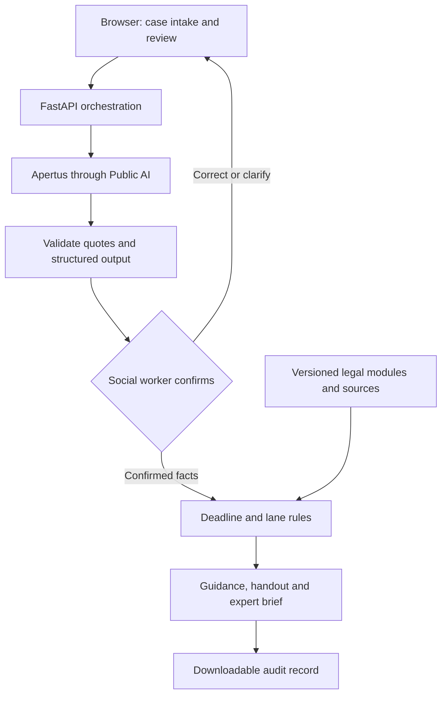

# LIITmus test — AI Tenancy Assistant for Social Workers

**Technical report and README — draft 0.5 | 8 November 2026**  
**Version:** v4 limited scope, powered by Apertus through Public AI  
**Demo:** https://liit.bouveng.org/  
**Repository:** [pink-carp/lextec-tenancy-assistant](https://github.com/pink-carp/lextec-tenancy-assistant)  
**Release commit:** [TEAM TO COMPLETE]  
**Team:** Benjamin Bouveng, Shanaya Harjai, Malin Da Ros and Dong Hui Ryu

> Hackathon prototype for fictional cases only. LIITmus test supports social workers with initial legal information, clarification and referral. The social worker confirms the facts and assesses vulnerability. Legal accuracy, evaluation limits and deployment requirements are discussed in Sections 6–9.

## 1. Purpose and legal problem

Social workers regularly encounter legal problems embedded in wider difficulties: a client cannot pay rent after losing employment, receives a notice they do not understand, or lives with unresolved defects. Effective assistance requires identifying the relevant facts, preserving documents, recognising urgency and knowing when specialist support is needed. Social-work expertise does not necessarily include the detailed legal knowledge needed to distinguish a payment warning from a termination or to identify the appropriate legal procedure.

Our project supports this first encounter. It helps the social worker structure the client's account, ask relevant questions, identify possible deadlines, explain supported next steps and prepare a referral where necessary. The social worker remains the operator and confirms the information on which the system acts. The client receives an accessible handout; a specialist can receive a structured case brief.

The broader ambition is an adaptable assistant for different social-work situations. The implemented prototype deliberately focuses on **residential tenancy problems in the canton of Zurich**. Swiss tenancy law provides a useful testing ground because factual distinctions, formal requirements and deadlines can determine the outcome of a case. Support for other legal fields is a future objective.

The intended function is initial legal information and triage. The tool does not represent clients, file applications, contact a lawyer automatically, determine benefit eligibility or make binding decisions.

## 2. Scope and current capabilities

V4 covers nine tenancy situations:

| Module | Situation covered |
|---|---|
| `payment_demand.json` | Unpaid rent and a payment demand |
| `termination_by_landlord.json` | Termination by the landlord |
| `tenant_notice.json` | Tenant notice or early departure |
| `defects.json` | Defects such as mould, failed heating or damp |
| `rent_increase.json` | A rent-increase notice |
| `pets_house_rules.json` | Pets and house rules |
| `deposit_return.json` | Return of the rent deposit |
| `co_tenant_leaves.json` | A co-tenant leaves or stops paying |
| `family_home_protection.json` | Protection of a marital family home |

Cases without a confirmed module receive no module-based legal guidance and are assigned at least Lane 2. Adding a new situation requires its own legal content, selection rules and tests.

| Capability | Current status |
|---|---|
| Narrative intake and structured fact extraction | Implemented |
| Human confirmation of facts, situation and deciding events | Implemented |
| Targeted questions and three-lane routing | Implemented |
| Selected deadline calculations with explanation | Implemented, with material receipt-rule limitations |
| Client handout, optional translation and expert brief | Implemented |
| Downloadable JSON audit trail | Implemented |
| Document text extraction and photo transcription | Implemented; photo privacy remains unresolved |
| Independent lawyer validation of all modules | Not documented |
| Unseen-case and professional user evaluation | Not demonstrated |
| Support across multiple legal fields | Future objective |
| Swiss hosting and revDSG compliance | Stated by Public AI Switzerland; scope for the API account and the whole application remains to be confirmed |
| Complete deletion across browser, hosting and inference services | Not established |

## 3. Key design decisions

### 3.1 From OpenJustice to a custom harness

We initially tried to build our legal-reasoning workflow in OpenJustice. The workflow we used required all questions to be written in advance. This meant anticipating the questions needed for clients whose circumstances could vary considerably. We chose to build our own harness so we could control how the client's account, interview questions, legal rules and referral decisions work together.

The **harness** is the software surrounding the language model. It manages intake, model calls, validation, human confirmation, legal modules, deadlines, referrals and outputs. We built this application around Apertus, an existing foundation model.

We can maintain legal modules separately from model calls, inspect referral rules and reuse case information across the social worker's screen, client handout and expert brief. This makes it easier to add new legal modules.

Our decision reflects our experience with the OpenJustice workflow we used. OpenJustice also offers model flexibility, source-linked reasoning protocols and evaluation tools [S3]. We have not compared all of its capabilities with our implementation.

Our experiments later led us to retain prewritten questions within v4's legal modules. The benefit of our harness is therefore control over how questions are selected, combined and reused within the wider workflow. We sought greater adaptability while keeping the prototype's legal content limited to situations we could define and test.

### 3.2 Apertus and Public AI

We use `swiss-ai/apertus-v1.5-70b` through Public AI's OpenAI-compatible endpoint at `https://api.publicai.co/v1`, with an older Apertus model as a fallback. Apertus processes the model requests, Public AI hosts inference, and our harness manages the workflow.

We chose Apertus for its open model foundation and transparency. The 1.5 70B release is available under Apache 2.0 [S4]. Public AI gives us hosted access without having to operate model-serving infrastructure during the hackathon [S5]. Public AI Switzerland's cooperative model also fits our interest in publicly accessible AI infrastructure [S6].

Public AI Switzerland's privacy notice states that services and data are hosted in Switzerland and that personal data is processed in accordance with the revised Swiss Data Protection Act [S6a]. This supports our preference for Swiss-hosted AI infrastructure. Our web application separately uses Vercel's Frankfurt region. Section 9 explains the remaining questions about the API account, processing arrangements and application-level compliance.

V4 uses Apertus for inference. “OpenAI-compatible” describes the API format. We used an OpenAI model in the separate v5 comparison branch.

### 3.3 Prewritten legal modules instead of generated legal guidance

We limited the model's role in writing legal guidance after earlier experiments produced persistent errors. Automated checks did not reliably remove them. Some statements described the law correctly but applied it to the wrong facts.

V4 therefore assembles legal points, actions and questions from prewritten modules. AI still interprets the narrative, suggests classifications, prefills some answers, writes a short neutral summary and translates text. It does not freely draft the main legal guidance.

This reduces one source of variability but transfers substantial responsibility to module design, correct fact confirmation and selection logic. AI-cross-checked text can still be legally wrong. A correct paragraph can still be inappropriate if its display conditions are incomplete.

### 3.4 Trade-offs

| Choice | Intended benefit | Cost or remaining risk |
|---|---|---|
| Custom harness | Direct control over workflow, rules and outputs | More engineering and maintenance responsibility |
| Hosted Apertus | Open model foundation without operating inference hardware | External processing, availability and provider dependence |
| Narrow tenancy scope | More manageable legal coverage and evaluation | Many social-work issues remain unsupported |
| Prewritten legal modules | More consistent, inspectable guidance | Requires substantive review and updates for every module |
| Human confirmation | Corrects model misunderstandings before assessment | Adds workload and can create confirmation bias |
| Social-worker-only vulnerability scoring | Places contextual professional judgment with the social worker | Requires clear criteria and consistent practice across users |
| Code-based routing and dates | Repeatable and inspectable execution | Incorrect rules or inputs produce repeatable errors |
| Browser-held case state | Avoids an intended central case database | Does not eliminate hosting, inference or export retention |
| Structured handouts and briefs | Supports accessible communication and handover | Translation and summary errors remain possible |

Our architecture is designed to accommodate additional modules and workflows. We have not established its capacity under concurrent use, operating costs at scale or performance in other legal fields.

## 4. User workflow

1. **Describe the situation.** The social worker enters a fictional or appropriately authorised case account, selects the client's language and acknowledges AI use. The interface asks users to avoid identifying information.
2. **Check what the system understood.** The social worker reviews extracted facts, source quotations, dates, suggested modules, warning signs and deciding events. The social worker independently assesses vulnerability and assigns its score; the AI does not propose the score.
3. **Clarify material gaps.** The system presents questions from the confirmed modules. Unknown and unobtainable answers remain possible. Document text must be confirmed after extraction.
4. **Assess.** Code calculates supported deadlines, applies the lane rules and selects contacts. The system assembles relevant module content and adds a brief AI-generated factual summary.
5. **Review and hand over.** The social worker checks the result, generates a client handout or expert brief, and may download the audit trail. A lane override requires a recorded reason.
6. **End the case.** The interface clears the case from the browser. Provider logs and downloaded files are subject to separate retention arrangements.

The expert brief supports a roughly two-minute initial review: immediate concern, client's objective, chronology and facts, preliminary legal issues, evidence and open questions, and the decision requested from the specialist. The social worker remains responsible for arranging the referral.

## 5. Technical architecture

The backend uses Python and FastAPI (`app/server.py`). The frontend is a single HTML application (`app/static/index.html`).



### 5.1 Components

| Component | Responsibility |
|---|---|
| `app/pipeline.py` | Orchestrates intake, understanding, confirmation, assessment and output |
| `app/llm.py` | Calls Public AI, handles retries and records model-call traces |
| `app/events.py` | Suggests and cross-checks legally relevant events |
| `app/modules.py` | Selects module questions and assembles conditional content |
| `app/dates.py`, `app/deadlines.py` | Parse dates and calculate supported deadlines |
| `app/scoring.py` | Applies lane-selection rules |
| `app/contacts.py` | Selects contacts from a maintained resource list |
| `app/outputs.py` | Assembles handouts and expert briefs; requests translations |
| `corpus/modules/` | Stores questions, legal points, actions and display conditions |
| `corpus/article_requirements.json` | Maps statutory provisions to deciding events |
| `corpus/law_paragraphs.jsonl` | Stores legal paragraphs, version metadata and source links |

The API endpoints are `POST /api/case`, `/api/case/questions`, `/api/case/upload`, `/api/case/document`, `/api/case/assess`, `/api/case/handout` and `/api/case/brief`.

### 5.2 Model calls and validation

The model extracts structured information from the client's account. Each extracted item must include a quotation found in the input. Events that determine which legal rules apply receive separate constrained calls, followed by code checks and human confirmation. The social worker assesses vulnerability without an AI-generated score.

The development documentation describes five parallel extraction tasks. The exact call layout for the submission version remains to be recorded, including whether it retains a task that extracts contextual vulnerability indicators.

A quotation can be genuine while the model's interpretation is wrong. For example, a warning that a landlord *will terminate* is not evidence that termination has already occurred. Checking quotations helps trace an interpretation to its source; the social worker must still check its meaning.

Deciding events may be prefilled for confirmation, but the subsequent yes/no interview questions are not prefilled. Free-text, numerical and date answers can be prefilled with a supporting sentence.

Our model client parses and validates JSON responses, stops repetitive output during streaming, retries rate-limited requests and can fall back to an older Apertus model. These measures address behaviour observed during development. Evaluation records should identify the model that actually handled each call.

### 5.3 Case storage and audit trail

The browser holds the case and sends it with each request. The application does not maintain a persistent case database. Temporary processing, infrastructure logs and provider retention are separate considerations, discussed in Section 9.

The audit export contains facts, answers, events, calculated dates, referral reasons and model traces, including prompts and responses. It allows a reviewer to trace an output back to its inputs and processing steps. The export contains sensitive case information and requires access and retention controls. Its accuracy and integrity still need to be checked.

## 6. How legal rules shape the system

### 6.1 Legal reasoning structure

Our legal framework examines the legal relationship, applicable law, relevant duties, established facts, requirements for a remedy, formalities, deadlines and legal consequences. We check urgency at intake and reassess it as new information becomes available.

V4 applies this approach to nine tenancy situations through event requirements and conditional modules. Each module item links to statutory paragraph identifiers and `show_if` conditions. An item is displayed only when its conditions hold. Unknown facts must remain unknown; they must not silently become negative answers.

The article-requirements table covers 161 paragraphs and 21 deciding events. This supports structured applicability checks but is not a complete executable representation of Swiss tenancy law.

### 6.2 Referral lanes

| Lane | Intended function |
|---|---|
| 1 — Information | Provide supported information for a sufficiently understood, lower-risk case |
| 2 — Clarification | Provide supported information while resolving material gaps |
| 3 — Human referral | Prioritise appropriate human involvement because of urgency, consequences, vulnerability or complexity |

The implementation uses five indices: urgency, severity, complexity, vulnerability and information uncertainty. The rules are applied in this order: high urgency; high complexity; specified severity combinations; specified vulnerability combinations; then information uncertainty. Higher-priority conditions lead to Lane 3; material uncertainty otherwise leads to Lane 2.

Violence or threats, exploitation or dependency, immediate danger, and migration-related indicators are hard referral triggers. We need to review the migration-related triggers to ensure they respond to relevant legal complexity rather than personal status alone.

**The social worker assesses vulnerability without an AI-generated score.** The routing rules use that professional assessment alongside the other four dimensions. The current scale and thresholds remain to be recorded for the submission version. These thresholds are project policy choices, not statutory standards or validated clinical measures.

Some example cases use a separate urgency scale that includes “Level 4.” The application has three referral lanes; the relationship between the two scales needs to be clarified.

### 6.3 Deadline calculations

The deadline calculator covers payment demands, termination challenges, certain extension requests, rent-increase challenges and the tenant's notice cut-off. Court and conciliation documents are flagged for professional verification.

For every calculation, a reviewer needs the triggering event, legally effective receipt date, applicable rule, intermediate steps and final action required. A date taken from a client's narrative is not automatically a legally established receipt date.

**Material limitation:** v4 does not fully model the different receipt rules for registered private notices. It also does not cover every tenancy deadline, procedural holiday regime or local holiday. A general “add 30 days and shift the weekend” formula is not an adequate substitute for legal classification. Backwards-calculated notice cut-offs particularly require separate treatment.

Our legal framework covers more deadline rules than v4 implements. Extending the calculator requires implementing and testing those rules separately.

### 6.4 Legal sources

Our local legal corpus contains official German-language texts from Fedlex: OR, ZPO, ZGB, VMWG and the federal Saturday legislation. It includes 6,951 paragraphs with version metadata and official links, 235 plain-English summaries and 332 court decisions obtained through OpenCaseLaw.

V4's result screen cites statutory paragraphs. We used the case-law corpus in earlier versions and evaluation work. OpenCaseLaw supplies legal data; OpenJustice was the platform we initially explored.

We used AI to draft and cross-check the modules and summaries. That process is not independent legal validation. Source versions, module revisions and review records need to remain traceable. Third-party commentary used during development is excluded from the repository; any further use requires checking access and reuse rights.

## 7. Evaluation results and limitations

We compared three versions across 11 cases: v4's module-based Apertus workflow, a generative Apertus version and an OpenAI version. We anonymised and shuffled the outputs for each case. A single Claude reviewer applied the evaluation rubric. No independent lawyer review of that comparison is documented.

Selected v4 results:

| Measure | Outcome |
|---|---|
| Mean usefulness | 4.6 / 5 |
| Main legal statements | 54 acceptable; 0 wrong law; 0 inapplicable; 1 noise item |
| Actions | 49 acceptable; 0 wrong or inapplicable |
| Lane agreement with expected labels | 11 / 11 |
| Cases judged to contain a clear error | 4 / 11 |
| Wrong statements in summary, handout or brief | 3 |
| Questions judged already answered | 11 |

The results supported our choice to use prewritten legal modules. However, errors remained in the complete outputs: four of the eleven cases contained an error identified by the reviewer, even though none of the main legal statements was classified as wrong law or inapplicable.

The evaluation has important limits. We knew the cases during development, set the expected referral lanes ourselves and used one AI reviewer. The comparison therefore does not establish performance on unseen cases or general legal reliability. The figures above come from the original evaluation recorded in [S2].

The test suite contains 400 automated tests that run without model calls: 76 date tests, 14 deadline tests and 310 tests covering modules, references, conditions and known error patterns. These tests check specific implementation properties; they cannot establish that the legal framework is complete or correct.

In the evaluation, model cost was approximately USD 0.02 per case. Initial analysis took roughly 10 seconds; later steps ranged from under one second to 25 seconds. These measurements describe the evaluation runs and may vary with model availability, input size and provider pricing.

### Proposed future validation

Freeze a release commit, corpus version, model identifiers and prompts. Run unseen synthetic cases, including ambiguous notices, contradictory dates, out-of-scope problems, failed model calls and unsupported languages. Have a qualified tenancy-law reviewer assess legal content and deadlines, and social workers assess interview usability and handover quality. Report severe missed referrals and incorrect actionable deadlines separately from average usefulness.

## 8. Installation and testing

### 8.1 Prerequisites

You will need Git, Python 3.12, the repository's `requirements.txt`, and a Public AI API key with available credit. Clone the repository and enter its directory:

```bash
git clone https://github.com/pink-carp/lextec-tenancy-assistant.git
cd lextec-tenancy-assistant
```

Record the submission commit with `git rev-parse HEAD`; for a reproducible rerun, check out the recorded commit rather than relying on a changing branch. The exact submission commit and dependency versions remain to be recorded.

From the repository root, run the following on Unix/macOS:

```bash
python3.12 -m venv .venv
.venv/bin/python -m pip install -r requirements.txt
# Create .env and add PUBLICAI_API_KEY=<your key>
.venv/bin/python -m uvicorn app.server:app --port 8000
```

Equivalent Windows PowerShell commands:

```powershell
py -3.12 -m venv .venv
.\.venv\Scripts\python.exe -m pip install -r requirements.txt
# Create .env and add PUBLICAI_API_KEY=<your key>
.\.venv\Scripts\python.exe -m uvicorn app.server:app --port 8000
```

Open `http://localhost:8000`; the evaluation page is `http://localhost:8000/benchmark`. Keep the API key server-side and out of commits, client-side code, screenshots and audit exports. Confirm the actual environment-loading behaviour against the release code.

`APP_ACCESS_CODE` provides an optional access restriction using the `X-Access-Code` header. It is not enabled on the public prototype and is not a substitute for production identity and access management.

### 8.2 Automated and end-to-end checks

Unix/macOS:

```bash
.venv/bin/python -m pip install pytest
.venv/bin/python -m pytest tests
.venv/bin/python bench/dev_run.py 1
```

Windows:

```powershell
.\.venv\Scripts\python.exe -m pip install pytest
.\.venv\Scripts\python.exe -m pytest tests
.\.venv\Scripts\python.exe bench/dev_run.py 1
```

The automated tests make no AI calls. The end-to-end case run uses the inference service and may incur charges. These setup instructions come from the development README [S2]; they have not been independently rerun while preparing this report.

The comparison branches are `main` for v4, `v2-baseline`, `v3-generative` and `v5-openai`. Preserve each branch's model and configuration. Do not assume an old benchmark command still reproduces an old version: the harness runs the checked-out pipeline.

Evaluation artefacts are stored under `bench/results/evaluation_2026-11-08/`, with case data in `bench/cases.json` and additional scenarios in `docs/scenarios.md`. Include the rubric, blinded outputs, mapping key and review files in the reproducible release.

### 8.3 Manual demonstration

Use our fictional mould case:

> A tenant in Zurich reports spreading mould, has notified the property manager by telephone, and is considering deducting 30% from the next rent payment. The manager attributes the problem to ventilation. No written notice, medical information or procedural document has been supplied.

Verify step by step:

1. The extraction preserves the disputed cause and does not treat either party's account as proven.
2. The social worker can correct facts and confirm the defects module.
3. Questions address material gaps; unknown health circumstances are not treated as absent.
4. The result does not present a universal 30% reduction or instruct an unsupported unilateral deduction.
5. Every legal point opens the relevant official source and version.
6. The handout and expert brief preserve the same facts and uncertainty.
7. Adding a termination notice or urgent safety concern causes reassessment and appropriate referral.
8. The audit record explains which inputs, rules and model calls produced the result.

This walkthrough defines checks to perform during a demonstration; a completed run should record the outcome of each check.

## 9. Responsible and ethical design

### 9.1 Privacy and confidentiality

The masking function removes selected e-mail addresses, phone numbers, IBANs and AHV numbers. It does not comprehensively remove names, addresses or identifying context. Document photographs are sent unmasked for model transcription. This is partial masking, not reliable anonymisation.

Public AI Switzerland explicitly states Swiss hosting and processing in accordance with the revDSG in its privacy notice [S6a]. The notice is labelled a draft pending formal incorporation. Separately, the publicai.co API portal links to terms identifying Metagov and allowing external-provider routing [S7]. We need to confirm which terms govern our API account and how they relate to the Swiss hosting assurance. Before real-client use, we must verify the contracting entity, inference provider, processing locations, subprocessors, retention, training use and deletion arrangements.

A browser deletion button cannot promise erasure from inference services, hosting logs or downloaded case files. A future photo-deletion feature likewise would not undo an upload already sent externally.

The applicable privacy regime depends on the deploying organisation. Federal data-protection requirements apply within their scope; Zurich cantonal and municipal public bodies require assessment under the relevant cantonal framework. Official guidance stresses transparency and assessment of AI-related processing risks [S8–S9]. A checkbox acknowledging AI use is not, by itself, a sufficient legal basis for all processing.

Before deployment, assign responsibility for lawful processing, outsourcing, access control, retention, incident response and a data-protection impact assessment where required. Determine applicable professional or official confidentiality duties; do not promise lawyer-client privilege for ordinary chatbot use.

### 9.2 Security and operational controls

The public prototype has no login. Before operational use, assess authentication, authorisation, rate limits, cost controls, transport security, secret management and logging. Validate browser-submitted case state server-side. Test malicious document instructions, forged quotations, invalid JSON, oversized uploads and provider outages.

These are deployment requirements and proposed checks, rather than a list of completed security measures. Fixed module output reduces some risks but does not prevent prompt injection from corrupting extraction, summaries or translation.

### 9.3 Fairness and human oversight

Vulnerability assessment is reserved to the social worker, without an AI-suggested score. This design avoids anchoring the professional's assessment to a model-generated rating and recognises the importance of contextual judgment. The assessment should guide support, not define legal rights or infer incapacity from identity. Clear criteria, training and review of consistency across users remain important.

Test equivalent cases across languages and personal circumstances. Review contact-selection rules for exclusion risks. Checking that numbers survive translation is useful but does not verify that obligations, negation or urgency retain their meaning. Human language review remains necessary for consequential communications.

The application allows a social worker to override a lane and records the reason. Before operational use, we need to define who may lower a referral level and whether hard referral triggers can be overridden.

### 9.4 Accountability and regulatory boundaries

Assign named owners for legal modules, technical maintenance, referral information and incident handling. Identify coverage gaps and complete the legal and operational review required for the intended real-client deployment. Describing the output as legal information does not remove responsibility for errors or settle the legal classification of the service.

An EU AI Act assessment must consider territorial scope and intended use. A legal-information assistant is not automatically a high-risk system merely because it concerns law. Expansion into public-benefit eligibility assessment or specified judicial/ADR uses could materially change the analysis under Annex III [S10]. Model openness alone does not establish application-level compliance.

### 9.5 Proposed user disclosure

> This prototype uses AI to help your social worker organise information, identify questions and prepare next steps. It can misunderstand facts or make mistakes and does not replace professional legal advice. Your social worker checks the information, assesses vulnerability themselves and can involve a specialist. For this demonstration, use fictional cases only. Information entered into the tool is sent to external services for processing; uploaded photographs are not automatically anonymised. Ending the case clears it from this browser but does not guarantee deletion from external services or downloaded files.

This is proposed disclosure text for the demonstration. Its implementation in the live interface remains to be confirmed.

## 10. Team contributions, external resources and AI disclosure

All four team members contributed to the legal work. Their additional responsibilities are listed below.

| Team member | Shared contribution | Additional area of focus |
|---|---|---|
| Benjamin Bouveng | Legal work | Technical lead, coding and implementation |
| Shanaya Harjai | Legal work | Pitch development and presentation |
| Malin Da Ros | Legal work | Swiss legal expertise and case development |
| Dong Hui Ryu | Legal work | Swiss legal expertise and legal-reasoning framework |

Our legal materials are in `legal-team-materials/` [S1a]; together with the implementation commits and review records, they provide the basis for documenting contributions. Responsibilities for maintaining the project after the hackathon remain to be assigned.

**External resources and AI use:**

- **Apertus / Swiss AI Initiative:** inference model used in v4; Apache 2.0 model licensing is identified by its publisher.
- **Public AI:** external hosted inference API; contractual terms and charges are separate from the model licence.
- **Fedlex:** official statutory sources used to construct the local legal corpus.
- **OpenCaseLaw:** court-decision data used in development and evaluation; verify applicable data and service terms before redistribution.
- **OpenJustice:** initial platform exploration; confirm whether any code, protocol or content was reused.
- **FastAPI, Uvicorn, pdfplumber and other packages:** implementation components; use the actual dependency manifest for exact versions and licences.
- **Claude:** used to draft and cross-check legal modules and review evaluation outputs. Exact model versions and review arrangements remain to be recorded.
- **OpenAI:** used in the separate v5 comparison branch. The exact API model identifier remains to be recorded; v4 uses Apertus.
- **ChatGPT/Codex:** assisted with drafting and editing this report using our project documents and public sources. We remain responsible for checking the final submission.

A project licence remains to be selected. Apertus's model licence does not determine the licence for our application.

## 11. Questions to resolve before submission

1. **Release:** Which commit in the linked repository is the submission version of LIITmus test?
2. **OpenJustice version:** Which product/version did the team use, and was any code, protocol or content reused?
3. **Contribution evidence:** Which legal documents, commits and review records should accompany team contributions?
4. **Evaluation release:** Which commit and model settings produced the evaluation results presented in Section 7?
5. **Vulnerability implementation:** What scale and routing thresholds does the current social-worker-only assessment use?
6. **Routing:** How should the three lanes relate to the urgency levels in the examples, and when may a worker override a hard referral?
7. **Deadline gaps:** Which receipt and deadline limitations remain in the submitted commit?
8. **Privacy:** What are the actual inference and hosting arrangements, and is the submitted demonstration restricted to fictional cases?
9. **Evidence:** Where are the raw evaluation artefacts, dependency versions, model settings and test records?
10. **Ownership and next steps:** Which licence will you choose, who maintains legal content and referral contacts, and which additional social-work domain would be evaluated first?

## 12. Sources and documentation

This report draws on our legal working materials [S1], development README and evaluation records [S2], and the project details set out by the team. External sources explain the models, services and regulatory context. Evaluation figures refer to the comparison recorded in [S2].

- **[S1] Team working document:** [hack the law](https://docs.google.com/document/d/1CPMh81fa_T7U3ELXTHhUgR0i6awTPp4umefUFyrn3Cg/edit). Includes examples, legal workflow, output specifications, escalation, regulatory notes and pitch notes.
- **[S1a] Team legal materials in this repository:** [`legal-team-materials/`](legal-team-materials/). `legal-workflow.md`, `escalation-indices.md`, `output-specification.md` and `deadline-calculation-rules.md` are loaded into the AI prompts; `social-service-contacts.md` is the source of the contact list (`app/data/resources.json`); `regulatory-questions-and-user-disclosure.md` contains the user-facing disclosure, liability waiver and data-protection guideline; `example-cases/case-1.md` to `case-9.md` are the team's example cases (source of `bench/cases.json`).
- **[S2] Development documentation:** [README.md — v4 limited scope](https://drive.google.com/file/d/1Fqru4TuR5_rnl2cYjV5pbPTxLEW8JCN4/view). Main source for implementation, code paths and reported evaluation.
- **Project repository:** [pink-carp/lextec-tenancy-assistant](https://github.com/pink-carp/lextec-tenancy-assistant). Source code and reproduction materials.
- **[S3] OpenJustice:** [Product description](https://openjustice.ai/). Description of the platform's current capabilities.
- **[S4] Apertus:** [Official documentation and model releases](https://www.apertus-ai.org/pages/documentation/).
- **[S5] Public AI:** [Developer documentation](https://platform.publicai.co/docs).
- **[S6] Public AI Switzerland:** [Organisation and service information](https://publicai.ch/).
- **[S6a] Public AI Switzerland:** [Privacy notice](https://publicai.ch/privacy.html), especially sections 2 and 6 on revDSG and Swiss hosting; notice labelled draft when consulted.
- **[S7] Public AI Inference Utility:** [Terms and Privacy](https://publicai.co/tc).
- **[S8] Federal Data Protection and Information Commissioner:** [AI and data protection](https://www.edoeb.admin.ch/de/ki-und-datenschutz).
- **[S9] Zurich Data Protection Commissioner:** [Guidance on AI use by public bodies](https://www.datenschutz.ch/mitteilungen/2025/neues-merkblatt-vorgehen-beim-einsatz-von-ki-bei-oeffentlichen-organen).
- **[S10] European Commission:** [AI Act, Annex III](https://ai-act-service-desk.ec.europa.eu/en/ai-act/annex-3).

Sources consulted on 8 November 2026. This report was prepared from project documentation and team input. It does not constitute an independent code audit or a fresh execution of the benchmark. Section 11 lists the release details and outstanding decisions needed to complete the submission.

