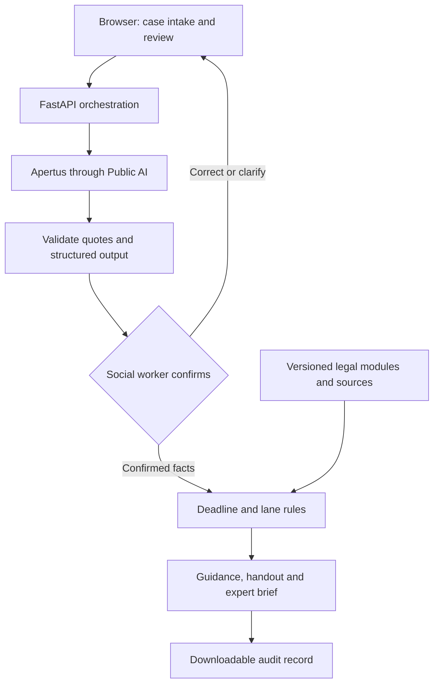

# LIITmus test — AI Tenancy Assistant for Social Workers

**Technical report and README | 8 November 2026**  
**Version:** v4, powered by Apertus through Public AI  
**Demo:** https://liit.bouveng.org/  
**Repository:** [pink-carp/lextec-tenancy-assistant](https://github.com/pink-carp/lextec-tenancy-assistant)  
**Release commit:** application code as of [`aafee91`](https://github.com/pink-carp/lextec-tenancy-assistant/commit/aafee91); later commits on `main` change this README only  
**Team:** Benjamin Bouveng, Shanaya Harjai, Malin Da Ros and Dong Hui Ryu

> Responsible AI for tenant housing rights in Switzerland: LIITmus test helps social workers identify the right next step for tenants. AI supports, social workers oversee, lawyers step in. The tool provides legal information, not legal advice.

## Contents

1. [Purpose and legal problem](#1-purpose-and-legal-problem)
2. [Scope and capabilities](#2-scope-and-capabilities)
3. [Key design decisions](#3-key-design-decisions)
4. [User workflow](#4-user-workflow)
5. [Technical architecture](#5-technical-architecture)
6. [How legal rules shape the system](#6-how-legal-rules-shape-the-system)
7. [Evaluation and lessons learned](#7-evaluation-and-lessons-learned)
8. [Installation and verification](#8-installation-and-verification)
9. [Legal, regulatory and ethical framework](#9-legal-regulatory-and-ethical-framework)
10. [Next steps](#10-next-steps)
11. [Team contributions, external resources and AI disclosure](#11-team-contributions-external-resources-and-ai-disclosure)
12. [Sources and documentation](#12-sources-and-documentation)

## 1. Purpose and legal problem

Social workers support people, but they are not legal experts. They regularly meet legal problems embedded in wider difficulties: a client cannot pay rent after losing employment, receives a notice they do not understand, or lives with unresolved defects. Effective help requires identifying the relevant facts, preserving documents, recognising urgency and knowing when a lawyer is needed, often across a language barrier.

LIITmus test supports this first encounter. It helps the social worker structure the client's account, ask the relevant questions, identify deadlines, explain next steps and prepare a referral where necessary. The social worker remains the operator and confirms the information the system acts on. The client receives an accessible handout in their own language; a specialist can receive a structured expert brief.

The prototype focuses on **residential tenancy problems in the canton of Zurich**. Swiss tenancy law is a demanding testing ground, because factual distinctions, formal requirements and deadlines often decide the outcome. The architecture is built to extend to further legal fields and social-work situations.

The intended function is initial legal information and triage. The tool does not represent clients, file applications, contact a lawyer automatically, determine benefit eligibility or make binding decisions.

## 2. Scope and capabilities

V4 covers nine tenancy situations, each with its own checked legal module:

| Module | Situation covered |
|---|---|
| `payment_demand.json` | Unpaid rent and a payment demand |
| `termination_by_landlord.json` | Termination by the landlord |
| `tenant_notice.json` | Tenant notice or early departure |
| `defects.json` | Defects such as mould, failed heating or damp |
| `rent_increase.json` | A rent-increase notice |
| `pets_house_rules.json` | Pets and house rules |
| `deposit_return.json` | Return of the rent deposit |
| `co_tenant_leaves.json` | A co-tenant leaves or stops paying |
| `family_home_protection.json` | Protection of a marital family home |

Cases outside these situations receive no module-based legal guidance and are assigned at least Lane 2, with suitable contacts.

| Capability | Status |
|---|---|
| Narrative intake and structured fact extraction, each fact linked to the client's own words | Implemented |
| Human confirmation of facts, situation and deciding events | Implemented |
| Targeted follow-up questions and three-lane routing | Implemented |
| Deadline calculations with step-by-step explanation | Implemented for the main tenancy deadlines (Section 6.3) |
| Client handout with translation into 13 languages, and expert brief | Implemented |
| Downloadable JSON audit trail of every model call | Implemented |
| Document text extraction and photo transcription | Implemented |
| Input in German, French, Italian or English | Implemented; tested with German, French and Italian accounts |

### How LIITmus test addresses the LexTec challenge

| Challenge element | Where it is addressed |
|---|---|
| Turn a plain-language question in German, French, Italian or English into a structured case | Narrative intake, fact extraction and confirmation (Sections 4, 5.1) |
| Recognise missing information instead of assuming it | Three-valued answers, where “unknown” is never treated as “no”; targeted questions; information-uncertainty index (Sections 4, 6.2) |
| Identify the area of law, extract key facts, detect missing, ambiguous or contradictory information | Situation and scope calls, quotation-checked facts, disputed points, deciding events (Section 5.1) |
| Flag urgency signals such as deadlines | Code-based deadline calculation and urgency index (Sections 6.2, 6.3) |
| Estimate complexity and risk; proceed, ask or refer | Five escalation indices and three lanes (Section 6.2) |
| Explainable recommendations with verifiable Swiss sources | Every legal point links to its official Fedlex provision (Section 6.4) |
| Two-minute expert briefing with remaining uncertainties | Expert brief with open questions (Section 4) |
| Bonus: citation checking | Every extracted fact is checked against the client's words; module legal points cite the provisions they were checked against; the AI summary is cleaned of article references not in the case (Sections 3.3, 5.1) |
| Bonus: questions that mix several legal areas | Several tenancy modules can apply to one case; other areas of law raise complexity, and migration, debt-enforcement or criminal matters lead to referral (Sections 5.1, 6.2) |
| Escalation criteria for human review | Escalation indices and hard referral triggers (Section 6.2) |
| At least 10 realistic Swiss scenarios with route and justification | 11 scenarios, each with a recommended lane and justification (Section 7) |
| Regulatory questions: revDSG, confidentiality, liability, transparency, EU AI Act | Section 9 |
| Plain-language user disclosure | Section 9.8 |

## 3. Key design decisions

### 3.1 A custom harness around an open model

We first explored OpenJustice, where the workflow required every question to be written in advance. We chose to build our own **harness**, the software around the language model, so we could control how the client's account, interview questions, legal rules and referral decisions work together. It manages intake, model calls, validation, human confirmation, legal modules, deadlines, referrals and outputs. Legal modules are maintained separately from model calls, referral rules can be inspected, and case information is reused across the social worker's screen, the client handout and the expert brief.

### 3.2 Apertus and Public AI

We use `swiss-ai/apertus-v1.5-70b` through Public AI's OpenAI-compatible endpoint, with an older Apertus model as a fallback. We chose Apertus for its open foundation and transparency: the 1.5 70B release is available under Apache 2.0 [S4]. Public AI Switzerland's cooperative model fits our interest in publicly accessible AI infrastructure [S6], and its privacy notice states that services and data are hosted in Switzerland and processed under the revised Swiss Data Protection Act [S6a].

The web application itself runs on Vercel (Frankfurt region) purely to make the hackathon demonstration easy to access. A deployment for real cases would run on Swiss infrastructure, in line with our Swiss-hosted inference.

### 3.3 Checked legal modules for reliable guidance

Our experiments showed that legal guidance written freely by the model was not reliable enough for social workers to act on. V4 therefore assembles legal points, actions and questions from checked modules, each linked to the statutory paragraphs it relies on. The AI reads the narrative, suggests the situation, prefills answers for confirmation, writes a short neutral summary and translates the handout. Deadlines and lane routing are calculated by code, so every step is repeatable and inspectable. This moves responsibility to module design, correct fact confirmation and selection logic: a correct paragraph is only appropriate if its display conditions match the confirmed facts, which is why every module item carries explicit `show_if` conditions and is covered by automated tests.

| Choice | Intended benefit | Cost we accepted |
|---|---|---|
| Custom harness | Direct control over workflow, rules and outputs | More engineering and maintenance responsibility |
| Hosted Apertus | Open, Swiss model without operating inference hardware | Dependence on an external inference provider |
| Narrow tenancy scope | Legal coverage we could define and test | Other social-work issues are referred rather than answered |
| Checked legal modules | Consistent, inspectable guidance linked to official sources | Each new situation needs its own module |
| Human confirmation | The social worker corrects misunderstandings before the assessment | Adds a step to the social worker's workload |
| Social-worker-only vulnerability rating | Professional, contextual judgement is not anchored by an AI score | Requires shared criteria across social workers |
| Code-based routing and deadlines | Repeatable, explainable results | Rules must be maintained as the law changes |
| Browser-held case state | No central case database | Retention by hosting and inference services is governed separately (Section 9) |

### 3.4 Next step: guided AI generation

Checked content gives the most reliable results today. In our blind comparison (Section 7), v4 scored a mean usefulness of 4.6 out of 5, against 2.8 for a fully generative version on a strong commercial model (OpenAI) and 1.8 for a fully generative version on Apertus. Checked content, however, only covers the situations it was written for. We are therefore developing versions in which the AI does the legal work itself inside a guided structure:

- **`v3-generative` (Apertus) and `v5-openai` (OpenAI):** the social worker confirms the deciding facts; code determines which statutory provisions can apply and calculates deadlines; the AI writes the questions and actions; every legal statement must cite an official source, and automated checks remove what the sources do not support.
- **`v6-pruefungskern` (Apertus):** built on our own legal examination framework (`LIIT_Pruefungskern_v2.0.0`, stored on that branch: core 2.0.0 with nine rule modules). The AI works through the framework's eight steps and assesses each legal requirement against the client's own sentences. Code combines the requirements with the framework's AND/OR logic, so unknown facts stay unknown and become the questions for the client. The AI writes a result for a remedy where the combined conditions support it, and a conditional “If …” result where they are still open.

Guided generation could extend the assistant to new situations, and eventually to other areas of social work, without writing new content for each one.

## 4. User workflow

1. **Describe the situation.** The social worker enters the client's account, selects the client's language and confirms that the client has been informed about the AI tool and has signed the data processing form. The interface asks users not to enter names or ID numbers.
2. **Check what the system understood.** The social worker reviews extracted facts with their source quotations, dates, the suggested situation, warning signs and deciding events, and rates the client's vulnerability from 1 to 10.
3. **Clarify gaps.** The system asks the questions from the confirmed modules. “Unknown” is always a valid answer and never treated as “no”.
4. **Assess.** Code calculates deadlines, applies the lane rules and selects contacts. The system assembles the relevant module content and a brief AI-written factual summary.
5. **Review and hand over.** The social worker checks the result, can override the lane (the reason is recorded), generates the client handout or expert brief, and can download the audit trail.
6. **End the case.** The interface clears the case from the browser.

The expert brief supports a roughly two-minute initial review by a lawyer, following our output specification (`legal-team-materials/output-specification.md`).

## 5. Technical architecture

The backend uses Python and FastAPI (`app/server.py`); the frontend is a single HTML application (`app/static/index.html`).



| Component | Responsibility |
|---|---|
| `app/pipeline.py` | Orchestrates intake, understanding, confirmation, assessment and output |
| `app/llm.py` | Calls Public AI, handles retries and records model-call traces |
| `app/events.py` | Prefills and cross-checks the legally deciding events |
| `app/modules.py` | Selects module questions and assembles conditional content |
| `app/dates.py`, `app/deadlines.py` | Parse dates and calculate deadlines |
| `app/scoring.py` | Applies the lane rules |
| `app/contacts.py` | Selects contacts from our maintained resource list |
| `app/outputs.py` | Assembles handouts and expert briefs; requests translations |
| `corpus/modules/` | Questions, legal points, actions and display conditions |
| `corpus/article_requirements.json` | Maps 161 statutory paragraphs to 21 deciding events |
| `corpus/law_paragraphs.jsonl` | Official legal paragraphs with version metadata and source links |

### 5.1 Model calls and validation

Every model call goes to `swiss-ai/apertus-v1.5-70b` at temperature 0 with a fixed seed; failed calls are retried, finally with the fallback model. The model answers in JSON, which code parses and checks.

| Call | What the AI does | What code does with the answer |
|---|---|---|
| **Facts** (reading, in parallel with the next four) | Lists up to ten facts and any disputed points, each with the client's exact words | Keeps a fact as “reported” only if its quotation is found in the account |
| **Documents** | Finds letters and notices mentioned, picks their type from a fixed list, and notes the household and the client's plans | Drops documents whose words are not in the account; code turns phrases such as “last week” into dates |
| **Situation and scope** | Identifies the tenancy situations, whether the client cannot pay, whether the case is residential and in Zurich, and other areas of law | Same quotation check; other areas of law raise complexity |
| **Safety signs** | Lists the vulnerability indicators of our escalation framework that the account explicitly states, and whether anyone is in immediate danger | Keeps only violence or threats and exploitation or dependency, as warning signs that count only while the social worker keeps them ticked; immediate danger leads to Lane 3 |
| **Legal issues** | Reads the tenancy provisions (Art. 253–274g OR) and names the relevant articles | Adds a fixed set of core articles per situation and sets aside articles whose triggering event has not occurred |
| **Deciding events** (one small call each) | Answers yes, no or not stated for statements such as “the landlord has terminated the lease”, citing a sentence | Without a valid sentence the answer becomes “not stated”; a threat (“will terminate”) is never read as a termination |
| **Situation pick** | Chooses the matching situation modules, each pick citing a sentence | Rule-based triggers take over if the call fails |
| **Answer prefill** (one per question) | Checks whether the account already answers a date, number or free-text question | Yes/no questions are never prefilled; the social worker confirms every prefilled answer |
| **Situation summary** | Writes two neutral sentences about the situation and the client's goal | Removes article references and dates that are not in the case |
| **Translation** (if needed) | Translates the handout into the client's language | Checks that every number and date survives; the English version stays alongside |
| **Transcription** (uploads) | Transcribes a photographed document | Text PDFs are read by code; the social worker confirms the text |

A typical case needs 15–20 calls and costs about USD 0.02. Accounts in German, French or Italian are processed the same way. The model writes extracted facts in English, so a fact whose quotation cannot be matched to the original wording is marked “inferred – please check” for the social worker.

A genuine quotation does not guarantee a correct reading: “the landlord will terminate the lease” is a warning, not a termination. That is why threat wording is checked in code and the social worker confirms every deciding event before the assessment.

### 5.2 Case storage and audit trail

The browser holds the case and sends it with each request; the application keeps no case database. The audit export contains facts, answers, events, calculated dates, referral reasons and every model call with its prompt and response, so a reviewer can trace each output back to its inputs.

## 6. How legal rules shape the system

### 6.1 Legal reasoning structure

The system follows our legal workflow (`legal-team-materials/legal-workflow.md`): the applicable protections, each party's obligations, the legally relevant event, the requirements for a remedy, form and deadlines, and the legal consequences, with urgent deadlines checked first. Each module item links to its statutory paragraphs and is shown only when its `show_if` conditions hold on the confirmed facts.

### 6.2 Referral lanes

| Lane | Function |
|---|---|
| 1 | AI information may be sufficient to proceed |
| 2 | Further clarification and information is required |
| 3 | Urgent human legal referral is necessary |

The lane follows from five indices defined in our escalation framework (`legal-team-materials/escalation-indices.md`): urgency, severity, complexity, vulnerability and information uncertainty. Code checks them in order: high urgency, high complexity, high severity together with medium urgency or vulnerability, and high vulnerability together with medium urgency or severity each lead to Lane 3; open or disputed information leads to Lane 2 (`app/scoring.py`). Violence or threats, exploitation or dependency, immediate danger and migration-law matters always lead to Lane 3.

**The social worker rates vulnerability, without an AI-suggested score.** A rating of 7–10 counts as high and 4–6 as medium. This keeps a contextual, professional judgement with the professional. These thresholds are project policy choices, not statutory standards.

The framework's assessment rules also shape the code: a statement is attributed to the person it concerns, current events are distinguished from threatened or past ones, missing information is never treated as proof that no risk exists, and vulnerability lowers the threshold for support without determining legal rights.

### 6.3 Deadline calculations

The calculator covers the payment period after a payment demand (Art. 257d OR), challenging a termination and requesting an extension (Art. 273 OR), challenging a rent increase (Art. 270b OR) and the tenant's own notice cut-off, counted backwards from the chosen end date. Final days are moved past weekends and Zurich public holidays. A date from the client's account is not automatically the legally effective receipt date, so vague dates produce a labelled estimate and a question about when and how the document arrived. Every deadline shows the triggering event, the rule and each calculation step. Court and conciliation documents are flagged for same-day professional review. Our full deadline rules are in `legal-team-materials/deadline-calculation-rules.md`.

### 6.4 Legal sources

Our local corpus contains official German-language texts from Fedlex: OR, ZPO, ZGB, VMWG and the federal Saturday legislation, with 6,951 paragraphs, version metadata and official links, plus 235 plain-English paragraph summaries. Every legal point on the result screen opens its official source.

## 7. Evaluation and lessons learned

We compared three versions on 11 cases: our nine example cases (`legal-team-materials/example-cases/`) and two further scenarios (`docs/scenarios.md`), each with a recommended lane and justification. The outputs were anonymised and shuffled per case and assessed by a blind AI reviewer (Claude Opus 5.5) against the official law texts, using a fixed rubric (`bench/results/evaluation_2026-11-08/three_way_review_instructions.md`). An AI reviewer allowed a consistent, repeatable comparison within the hackathon; review by tenancy-law experts is the next step (Section 10). The v4 runs used the code on branch `v4-scoped` (commit `eedebb1`); since then, vulnerability rating has moved fully to the social worker.

| Measure | v4 (checked modules, Apertus) | Generative, OpenAI | Generative, Apertus |
|---|---|---|---|
| Mean usefulness (1–5) | **4.6** | 2.8 | 1.8 |
| Cases with a clear error | **4 / 11** | 10 / 11 | 11 / 11 |
| Legal statements wrong or inapplicable | **0 of 55** | 3 of 65 | not shown |
| Actions wrong or inapplicable | **0 of 49** | 0 of 26 | 5 of 49 |
| Appropriate lane | **11 / 11** | 10 / 11 | 9 / 11 |
| Model cost per case | **~USD 0.02** | ~USD 0.30 | ~USD 0.03 |

The results support our use of checked legal modules. Because these cases were developed alongside the tool, the next stage is testing on new cases with social workers and tenancy-law experts (Section 10). The evaluation artefacts (rubric, blinded outputs, mapping key and reviews) are in `bench/results/evaluation_2026-11-08/`, and the results page is at `/benchmark`. In addition, 400 automated tests check dates, deadlines, module structure, references and conditions without model calls; all pass.

### 7.1 What we learned about the risks of legal automation

| Finding | Our response |
|---|---|
| **Freely generated legal text is unreliable.** Even with confirmed facts, rule filters and two automatic checks, about one in four legal sentences that Apertus wrote freely was wrong. | Legal guidance comes from checked modules; guided generation continues on separate branches (Section 3.4). |
| **Automatic verification cuts both ways.** On 174 AI-written legal sentences, our two automatic checks removed about two thirds of the harmful sentences, but also about half of the correct ones (`writer_levels_after_checks.json`). | We do not rely on AI checking AI for the legal content shown to social workers. |
| **A genuine quotation can still be misread.** “The landlord will terminate the lease” is a warning, not a termination. | Code flags threat wording, and the social worker confirms every deciding event. |
| **Missing facts tempt a system to assume.** An unanswered question can silently become a “no”. | Answers are three-valued; “unknown” keeps conditions open and raises information uncertainty. |
| **AI scores can anchor professional judgement** (automation bias). | Vulnerability is rated only by the social worker; AI warning signs count only while the social worker keeps them ticked. |
| **Reliability and reach pull in opposite directions.** Checked content covers only the situations it was written for. | Cases outside the modules go to at least Lane 2 with suitable contacts; guided generation aims to extend reach. |
| **Translation can shift meaning.** | Code checks that numbers and dates survive, the English version stays alongside, and consequential communications call for human language review. |

## 8. Installation and verification

### 8.1 Setup

You need Git, Python 3.12 and a Public AI API key.

```bash
git clone https://github.com/pink-carp/lextec-tenancy-assistant.git
cd lextec-tenancy-assistant
python3.12 -m venv .venv
.venv/bin/python -m pip install -r requirements.txt
# Create .env containing PUBLICAI_API_KEY=<your key>
.venv/bin/python -m uvicorn app.server:app --port 8000
```

On Windows, use `py -3.12 -m venv .venv` and `.\.venv\Scripts\python.exe` in place of `.venv/bin/python`. Open `http://localhost:8000`; the evaluation page is `http://localhost:8000/benchmark`. The key is read from the environment or from `.env` and stays server-side. The release was tested with Python 3.12.2, FastAPI 0.162.2, Uvicorn 0.54.0, Pydantic 2.14.3, httpx 0.27.0, pdfplumber 0.11.10 and Pillow 11.3.0.

### 8.2 Automated tests

```bash
.venv/bin/python -m pip install pytest
.venv/bin/python -m pytest tests
```

The tests make no AI calls. The comparison versions are on the branches `v3-generative`, `v5-openai` (set `LLM_PROVIDER=openai` and `OPENAI_API_KEY`) and `v6-pruefungskern`.

### 8.3 Verifying a result step by step

Load example case 1 from the drop-down on the start page (mould in a Zurich flat; the property manager blames ventilation; the client is considering paying 30% less rent) and check:

1. Each extracted fact shows the client's own words, and the disputed cause of the mould is recorded as disputed, not as fact.
2. The social worker can correct the facts and confirm the defects module.
3. The questions address the open points, and “unknown” remains a valid answer.
4. The result does not recommend a unilateral rent deduction.
5. Every legal point opens its official source.
6. The handout and expert brief show the same facts.
7. Adding a termination notice to the account raises urgency and leads to a referral.
8. The downloaded audit trail shows the model calls and rules behind the result.

### 8.4 Auditing a result

| To check | Where to look |
|---|---|
| A legal point | Click its provision: the official German text opens, with its version date and a link to Fedlex |
| A deadline | “How this was calculated” under the deadline: triggering event, rule and each step |
| The lane | The index table on the result screen: the level of each of the five indices and the reasons behind it, plus the lane rule that applied |
| The whole case | “Download audit trail”: a JSON file with the facts and their quotations, the confirmed events and answers, the deadlines with their steps, the lane rule and any override reason, and every model call with its prompt, reply, model, tokens and cost |
| The evaluation | `bench/results/evaluation_2026-11-08/`: reviewer instructions, blinded inputs, mapping key and review |

## 9. Legal, regulatory and ethical framework

Our regulatory analysis takes the perspective of a Zurich state social service using the tool supplied by LexTec, a private start-up. It distinguishes the authority's responsibilities from the supplier's obligations, and treats the proposed safeguards as internal operating rules rather than implying that every safeguard is expressly required by statute. The full guideline is in `legal-team-materials/regulatory-questions-and-user-disclosure.md`.

### 9.1 Purpose and permitted use

The tool is a **decision-support system, not a decision-maker**. It supports social workers in collecting relevant facts, identifying questions and recommending a referral lane. It must not determine entitlement to social assistance, deny access to services, close a case or issue a legally binding decision. Cases that require legal interpretation are referred to a qualified person. A disclaimer does not replace lawful data processing, effective human oversight or quality assurance.

### 9.2 Data protection and confidentiality

- **Legal basis.** The social service's processing is governed principally by Zurich's Information and Data Protection Act (IDG): § 8 on lawful processing, § 6 on outsourcing, § 7 on information security and § 10 on impact assessment and prior review. The authority remains responsible even where the supplier processes data on its behalf. Federal data protection law (revDSG) applies to the supplier's processing where relevant, particularly for any processing for its own purposes. Official guidance stresses transparency and the assessment of AI-related risks [S7–S8].
- **Special personal data.** Information about health, mental health and social-assistance measures is special personal data. Its processing requires a sufficiently specific basis in a formal statute; a signed consent form is not a substitute. Where consent is relied on for an optional activity, it must be informed, specific and genuinely voluntary, taking the person's dependence on the social service into account, and refusal must not disadvantage them.
- **Official secrecy.** Disclosure to the supplier must be legally permissible and limited to the approved purpose; confidentiality clauses alone do not make an otherwise prohibited disclosure lawful. Ordinary chatbot use does not attract lawyer–client privilege, and the tool does not promise it.
- **Supplier role.** Whether LexTec is a processor depends on the actual deployment: supplying software without access to case data differs from hosting the tool or accessing data through support and logs, which the authority must regulate as outsourcing. Case data must not be used for the supplier's product development or model training.
- **Data minimisation.** Social workers use a case reference rather than a name, omit addresses, identification numbers and other identifiers unless necessary, and avoid unnecessary intimate or medical detail. Pseudonymised information remains personal data while the person can still be identified.
- **Records and retention.** The official case record, temporary AI inputs and outputs, access logs, diagnostic records, caches and backups are distinguished. The final referral decision and its reasons belong in the official record; AI output is labelled as such and is not stored as established fact. Temporary AI data is deleted on an approved schedule that also covers the supplier's logs, caches and backups.

**How the prototype applies this.** Code masks e-mail addresses, phone numbers, IBANs and AHV numbers in the typed account before it is sent to the model. The interface asks users not to enter names or ID numbers and to give the municipality instead of the street address. The case lives in the browser, with no case database, and is cleared when the case ends. Inference runs through Public AI, whose privacy notice states Swiss hosting and processing under the revDSG [S6a]; Vercel is used only for the hackathon demonstration (Section 3.2).

### 9.3 Conditions before use with real cases

1. The intended purpose, permitted functions and prohibited uses are documented.
2. The statutory basis for processing, including any special personal data, is identified.
3. A data protection impact assessment is completed, with any required prior review by the supervisory authority.
4. Hosting, data flows, external interfaces, remote access, logs and subprocessors are documented and approved, in an environment with access controls, secure authentication and protection of data in storage and transmission.
5. The authority and the supplier agree contractual safeguards: processing instructions, a ban on unauthorised training or reuse, subprocessor approval, security controls, incident notification, audit rights, change control, and retention, deletion and exit arrangements.
6. Triage rules and legally relevant outputs are tested and approved by qualified reviewers.
7. Users are trained and have an escalation route.
8. Information notices, record-keeping rules and incident procedures are ready.

### 9.4 Human oversight and escalation

Every referral recommendation receives **substantive human review before it affects a person's access to support**. The social worker checks the factual summary, assesses whether the suggested lane matches the person's circumstances, checks for urgency, vulnerability and missing facts, overrides an unsuitable recommendation and records the final decision. A final confirmation click is not meaningful review.

Because social workers may lack legal training, escalation to a qualified reviewer is mandatory where the recommendation depends on a disputed legal interpretation, a deadline or eviction risk is involved, the recommendation would restrict or delay support, the facts are incomplete or outside the validated scope, or the social worker cannot assess the recommendation independently. Urgent protective action is never delayed while waiting for the tool. The tool does not infer emotions from voice, facial expressions or similar signals.

In the prototype, the social worker confirms the facts, situation and deciding events, rates vulnerability, reviews the result and can override the lane with a recorded reason. A provisional lane is shown before the follow-up questions, so an urgent referral does not have to wait for them.

### 9.5 Quality assurance and fairness

The tool is tested before launch and after any material change to the model, prompts, legal sources or triage rules. Testing covers typical and borderline cases, urgent and incomplete cases, incorrect or fabricated legal references, inappropriate reassurance, missed deadlines, discriminatory or inconsistent outcomes, and the risk of a person being placed in a lower-support lane. Staff training covers the tool's scope, hallucinations, automation bias, confidentiality, data minimisation, verification and escalation, and how to continue the service without the tool. Serious confidentiality risks or repeated harmful triage errors lead to suspension of the affected function, with a manual pathway always available.

Vulnerability is rated by the social worker, not inferred by the AI, and guides support rather than legal rights. Warning signs require the client's explicit words; the model is instructed never to infer them from a name, nationality or tone. The handout is offered in 13 languages. Code checks that numbers and dates survive translation; because meaning, negation and urgency can still shift, consequential communications call for human language review.

### 9.6 Liability and transparency

Describing the output as legal information does not remove responsibility for errors or settle the legal classification of the service. Outsourcing does not transfer the authority's statutory responsibility to the supplier; the supplier agreement allocates service continuity, liability and responsibility for defects.

Before personal information is entered, the social worker explains, in language adapted to the person: the use and purpose of AI-assisted triage, the categories of information processed, the responsible authority, which providers can access the information and where it is hosted, the limits of the tool and the human review process, retention, and how to request access, correction or review. A general legal disclaimer is not a substitute for a privacy notice, and the interface identifies AI-generated content to staff.

### 9.7 EU AI Act

For a tool used solely by a Zurich social service, with no relevant EU market or output-use connection, the EU AI Act will generally not be the directly applicable framework; the territorial assessment is documented and reassessed if deployment changes. A legal-information assistant is not high-risk merely because it concerns law. For an EU deployment, the assessment examines whether the tool evaluates eligibility for, or materially affects access to, essential public assistance benefits or services (Annex III) [S9]; describing the tool as “triage” or adding human approval does not by itself exclude high-risk classification. Prohibited practices, including exploitation of vulnerability, are assessed separately, and model openness alone does not establish application-level compliance. Regardless of direct applicability, transparency, staff competence, human oversight and documented risk management are mandatory internal safeguards.

### 9.8 User-facing disclosure

Our plain-language disclosure for clients:

> **What does the AI do?** We have created an AI-supported tenancy information tool designed to help social workers assist people experiencing residential housing problems in Switzerland. It can help to understand and organise the information you provide about your housing situation; identify possible tenancy-law issues and relevant Swiss legal rules; ask questions to clarify important facts; identify possible deadlines and explain why they may matter; prepare a summary of your situation and suggest possible next steps; identify when legal advice or other specialist support may be needed; and find relevant legal, social and support services. The tool is designed primarily for private residential tenancy matters in the Canton of Zurich.
>
> It places your case into one of three lanes:
> - **Lane 1 — AI information may be sufficient to proceed:** if your situation is relatively straightforward and there is enough information, the tool provides relevant tenancy information and potential next steps.
> - **Lane 2 — Further clarification and information is required:** if important details are missing or unclear, the tool identifies what further information is needed, and the social worker relays it.
> - **Lane 3 — Urgent human legal referral is necessary:** if your situation is urgent, particularly serious, or requires specialist legal judgement, the tool highlights that referral to a qualified lawyer or specialist service may be appropriate.
>
> The social worker oversees the process, reviews the tool's assessment and helps determine the next steps. If your situation requires urgent human support, the referral is not delayed while the tool gathers more information.
>
> **Disclaimer:** AI-generated information can contain inaccurate or outdated content, omit relevant legal requirements, or fail to identify important deadlines. LIITmus test is not a lawyer, law firm, court or public authority. It cannot provide legal representation or advice, and it cannot make binding legal decisions.
>
> **When does a human become involved?** A social worker uses the tool, reviews what it produces and gives their own vulnerability assessment (a score from 1 to 10). If your case involves a serious legal risk, an important deadline, a possible loss of your home or a complicated legal issue, the tool may recommend a qualified legal professional or specialist service. In an emergency, you should not wait for an AI-generated response. You can ask for human assistance at any time, even if the tool has not recommended it.

In the prototype, the social worker confirms before analysis that the client knows an AI tool is used and has signed the data processing form. Every client handout carries a short notice: the sheet was made with a computer tool and checked by the social worker, its legal texts were checked in advance and AI wrote the summary, it is general legal information rather than legal advice, and the information was sent to an AI service (Public AI).

## 10. Next steps

- **Test lane selection with social workers.**
- **Benchmark accuracy** on new cases, with review by tenancy-law experts.
- **Develop a secure social-worker app**, hosted in Switzerland, with login and access control.
- **Connect the prototype to legal platforms** for referral and handover.
- **Guided AI generation** (Section 3.4), to extend the assistant to further situations and legal fields.

## 11. Team contributions, external resources and AI disclosure

All four team members contributed to the legal work.

| Team member | Shared contribution | Additional area of focus |
|---|---|---|
| Benjamin Bouveng | Legal work | Technical lead, coding and implementation |
| Shanaya Harjai | Legal work | Pitch development and presentation |
| Malin Da Ros | Legal work | Swiss legal expertise and case development |
| Dong Hui Ryu | Legal work | Swiss legal expertise and legal-reasoning framework |

Our legal materials are in `legal-team-materials/` [S1a].

**External resources and AI use:**

- **Apertus / Swiss AI Initiative:** inference model used in v4, under Apache 2.0.
- **Public AI:** hosted inference API.
- **Fedlex:** official statutory sources for our legal corpus.
- **OpenCaseLaw:** court-decision data used during development and evaluation.
- **OpenJustice:** platform explored at the start of the project; no OpenJustice code or content is used.
- **FastAPI, Uvicorn, pdfplumber and other packages:** see `requirements.txt`.
- **Claude (Anthropic), through Claude Code:** wrote the application code under the technical lead's direction; drafted the legal modules and the article-requirements table from the official German texts and cross-checked them in a separate pass; reviewed the paragraph summaries; and acted as the blind reviewer in the evaluation. These tasks used Claude Opus 5.5; bounded tasks such as source research and the first versions of the date and deadline code with their tests used Claude Sonnet 5.5.
- **OpenAI:** `gpt-5.6-sol`, used only in the `v5-openai` comparison branch.
- **ChatGPT/Codex:** assisted with drafting and editing this report using our project documents and public sources. We remain responsible for the final submission.

## 12. Sources and documentation

- **[S1] Team working document:** [hack the law](https://docs.google.com/document/d/1CPMh81fa_T7U3ELXTHhUgR0i6awTPp4umefUFyrn3Cg/edit): examples, legal workflow, output specifications, escalation, regulatory notes and pitch notes.
- **[S1a] Team legal materials in this repository:** [`legal-team-materials/`](legal-team-materials/). `legal-workflow.md`, `escalation-indices.md`, `output-specification.md` and `deadline-calculation-rules.md` are loaded into the AI prompts; `social-service-contacts.md` is the source of the contact list (`app/data/resources.json`); `regulatory-questions-and-user-disclosure.md` contains the user-facing disclosure, liability waiver and data-protection guideline; `example-cases/case-1.md` to `case-9.md` are our example cases (source of `bench/cases.json`).
- **[S2] Development documentation:** [README.md — v4 limited scope](https://drive.google.com/file/d/1Fqru4TuR5_rnl2cYjV5pbPTxLEW8JCN4/view).
- **[S3] OpenJustice:** [Product description](https://openjustice.ai/).
- **[S4] Apertus:** [Official documentation and model releases](https://www.apertus-ai.org/pages/documentation/).
- **[S5] Public AI:** [Developer documentation](https://platform.publicai.co/docs).
- **[S6] Public AI Switzerland:** [Organisation and service information](https://publicai.ch/).
- **[S6a] Public AI Switzerland:** [Privacy notice](https://publicai.ch/privacy.html), sections 2 and 6 on revDSG and Swiss hosting.
- **[S7] Federal Data Protection and Information Commissioner:** [AI and data protection](https://www.edoeb.admin.ch/de/ki-und-datenschutz).
- **[S8] Zurich Data Protection Commissioner:** [Guidance on AI use by public bodies](https://www.datenschutz.ch/mitteilungen/2025/neues-merkblatt-vorgehen-beim-einsatz-von-ki-bei-oeffentlichen-organen).
- **[S9] European Commission:** [AI Act, Annex III](https://ai-act-service-desk.ec.europa.eu/en/ai-act/annex-3).

Sources consulted on 8 November 2026.
