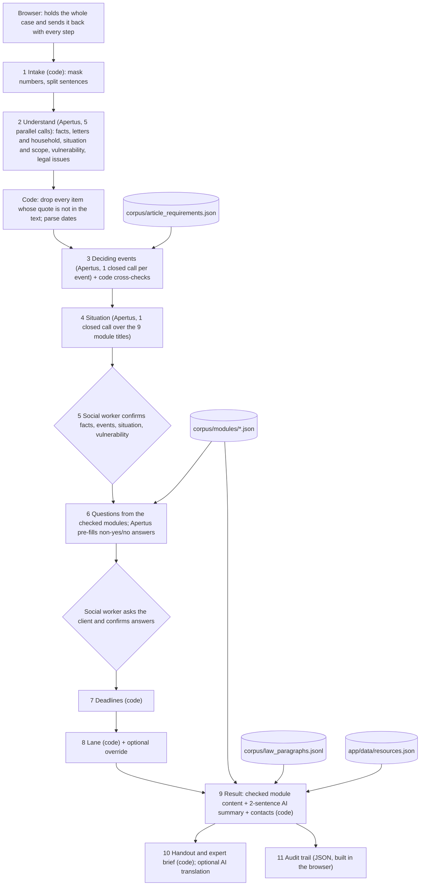

# Tenancy information assistant for social workers (LexTec challenge, HSG Hackathon 2026)

## 1. What it is

**Live:** https://liit.bouveng.org (no login) · **Status:** hackathon prototype, state of 8 November 2026 ·
**Legal content:** checked by AI, **not reviewed by a lawyer** · Use invented cases only.

The tool helps a social worker in the canton of Zurich deal with a client's residential tenancy problem. The social
worker types the client's story in their own words. The tool reads it, asks the social worker to confirm the facts
that decide the case, and then asks only the follow-up questions that matter. It calculates deadlines and suggests a
lane: 1 information, 2 information with open questions, or 3 referral to a specialist. It then shows action
recommendations, a neutral case summary with clickable sources, a client handout and an expert brief for a lawyer.
The legal content comes from pre-written, checked texts for nine common situations. The AI model (Apertus 1.5 70B,
run through Public AI) reads the description, suggests and pre-fills answers for the social worker to confirm,
writes a two-sentence neutral summary and translates the handout. Code does the dates, the lane and the contacts.
Everything the tool produces is **legal information, not legal advice**.

Contents: [2 Problem and users](#2-the-legal-problem-and-the-users) · [3 How to use it](#3-how-to-use-it-step-by-step) ·
[4 How it works](#4-how-it-works-under-the-hood) · [5 Sources and data](#5-legal-sources-and-data) ·
[6 Design decisions and evaluation](#6-design-decisions-and-the-evidence-behind-them) · [7 Versions](#7-the-four-versions-and-how-to-compare-them) ·
[8 Verify results](#8-how-to-verify-results-step-by-step) · [9 Run and deploy](#9-running-locally-and-deploying) ·
[10 Repository map](#10-repository-map) · [11 Limitations](#11-limitations-risks-and-open-points) · [12 Credits and licence](#12-credits-licence-and-ai-assistance)

---

## 2. The legal problem and the users

**Users.** Social workers in the canton of Zurich. They are not lawyers, but clients bring them tenancy problems: a
payment demand, a termination, mould, a rent increase, a deposit that is not returned.

**The problem.** Swiss tenancy law (Art. 253–273c of the Code of Obligations, OR) has short, strict time limits.
A termination must be challenged within 30 days of receipt (Art. 273 OR). A payment demand gives at least 30 days to
pay before the landlord may terminate (Art. 257d OR). Small mistakes have large effects. For example, a tenant who
simply pays less rent because of mould risks a payment demand and termination; the lawful route is to deposit the
rent (Art. 259g OR). A social worker needs to know which facts matter, which deadline may be running, and when a
case must go to a specialist.

**Scope.**

| In scope | Out of scope |
|---|---|
| Residential tenancy, canton of Zurich (federal law applies everywhere, but contacts are for Zurich) | Business premises, other cantons' contacts, other areas of law |
| Legal information for the social worker and the client | Legal advice, deciding disputes, replacing professional judgement |
| Nine common situations with checked guidance (see [4.4](#44-situation-modules)) | Other situations: the tool gives no legal guidance and suggests a referral |

**The challenge it answers.** LexTec challenge, HSG Hackathon 2026:

| Sub-challenge | What was asked | Where it is answered |
|---|---|---|
| 1 (technical) | When to ask, when to refer, an expert brief, citation checking | Deciding events and questions ([4.5](#45-deciding-events-and-the-article-requirements-table)), lanes ([4.7](#47-lanes-and-hard-triggers)), expert brief ([3](#3-how-to-use-it-step-by-step)), clickable official sources ([8](#8-how-to-verify-results-step-by-step)) |
| 2 (framework) | A framework, 10+ scenarios, regulatory notes, disclosure | `docs/versions/v4-scoped-live/framework.md`, `docs/scenarios.md`, `docs/versions/<version>/regulatory.md`, `docs/versions/v4-scoped-live/disclosure.md` |

The legal team's inputs drive the tool: `output.md` (output format and lanes), `escalation.md` (five indices),
`deadlines.md` (deadline rules), `legal_workflow.md` (method), `resources.md` (contacts), and nine example cases in
`Example cases/`.

---

## 3. How to use it, step by step

| Screen | What the social worker does | What the tool does |
|---|---|---|
| **1 Describe** | Types the client's situation in their own words (no names or ID numbers; the municipality instead of the street). Picks the client's language. Ticks that the client knows an AI tool is used. Clicks **Analyse**. | Masks phone numbers, e-mails, IBAN and AHV numbers, then reads the text (about 10 seconds). An example case from the legal team can be loaded from a menu. |
| **2 Check what was understood** | Corrects the **facts** (each shows the client's sentence it came from), checks the **dates** that may start a deadline, confirms or changes the **situation** (the AI's suggestion is ticked; untick all if none fits), checks each **deciding fact** (yes / no / unknown, pre-filled with the sentence the AI relied on), unticks wrong **warning signs**, and sets **personal vulnerability** from 1 to 10 (a suggestion is pre-set). Clicks **Confirm and show questions**. | Shows a provisional lane and, if a letter was received, a banner: "A deadline may be running". This confirmation step is the main safeguard: a wrong answer here changes everything that follows. |
| **3 Ask your client** | Asks the questions (at most 8, urgent ones first, 5 shown before "Show more questions"). Confirms or corrects pre-filled answers. "I don't know" and "Can't get this" are always allowed; unknown never counts as "no". Can upload a document where a question asks for one, and must confirm the extracted text. Clicks **Assess**. | Questions come from the checked situation texts. Free-text, date and number answers that the description already gives are pre-filled, with the sentence. Yes/no questions are never pre-filled. |
| **4 Result** | Reads the result. | **A. Action recommendations**, **deadlines** (with "How this was calculated"), **contacts**; **B. Case summary**: two neutral AI sentences plus the checked legal points for the confirmed situation, each with clickable paragraph references; **C. Lane assessment** with the rule applied and the reasons. |

Buttons on the result screen:

- **Client handout**: the checked client texts, deadlines, contacts and a disclosure, in English. If another language
  was chosen, an AI translation is shown next to it; code warns if any number differs from the English version.
- **Expert brief**: a six-part brief for a lawyer (immediate concern, client's objective, facts and chronology with
  the confirmed deciding facts, preliminary legal points, evidence and open questions, decision needed). It is
  marked "Draft from the tool - please check before sending".
- **Download audit trail**: a JSON file with the whole case, including every AI prompt and reply. It contains client
  information: handle it like a case note.
- **Change lane**: the social worker overrides the lane and gives a reason; the reason is recorded.
- **Update answers and reassess**.
- **End case (delete data)**: clears the case in the browser. Nothing is stored on the server.

---

## 4. How it works under the hood

### 4.1 Architecture



The server is a FastAPI app (`app/server.py`) with one endpoint per step: `POST /api/case`, `/api/case/questions`,
`/api/case/upload`, `/api/case/document`, `/api/case/assess`, `/api/case/handout`, `/api/case/brief`. The front end
is one HTML file (`app/static/index.html`).

### 4.2 Pipeline (live version)

| # | Step | Done by | Code file |
|---|---|---|---|
| 1 | Intake: masking, sentence split | code | `app/pipeline.py` (`mask`, `new_case`) |
| 2 | Understand: 5 single-job calls in parallel. Every extracted item must carry the client's exact words; code drops items whose quote is not in the text. Dates are parsed by code. | Apertus + code | `app/pipeline.py` (`understand`), `app/dates.py` |
| 3 | Deciding events: only the events relevant to the articles in question, one closed call per event | Apertus + code | `app/events.py` |
| 4 | Situation: pick the matching module(s) or none, each pick citing a sentence | Apertus | `app/modules.py` (`suggest_ai`) |
| 5 | Confirmation of facts, warning signs, vulnerability, events and situation | social worker | `app/pipeline.py` (`confirm`) |
| 6 | Questions from the confirmed modules; pre-fill of free-text, date and number answers | modules + Apertus | `app/modules.py` (`questions`) |
| 7 | Deadlines | code | `app/pipeline.py` (`deadlines`), `app/deadlines.py` |
| 8 | Lane from five indices, hard triggers, override | code + social worker | `app/pipeline.py` (`score`), `app/scoring.py` |
| 9 | Result: module points and actions whose conditions hold; 2-sentence situation summary; contacts | modules + Apertus + code | `app/modules.py` (`assemble`), `app/pipeline.py` (`write`, `verify`), `app/contacts.py` |
| 10 | Handout, translation, expert brief | code (+ Apertus for translation) | `app/outputs.py` |
| 11 | Audit trail | code (browser) | `app/llm.py` (records each call), `app/static/index.html` |

### 4.3 Which parts are AI and which are code

| AI (Apertus) does | Code does | The social worker does |
|---|---|---|
| Extracts facts, letters, household, situation, scope, vulnerability indicators and legal issues, each with a quote | Masks numbers; checks every quote against the text; parses dates | Confirms or corrects facts and warning signs |
| Pre-fills deciding events (A yes / B no / C unknown + sentence number) | Cross-checks events (see 4.5); decides E10 from dates | Confirms every deciding event |
| Suggests the situation from the module menu | Shows only module items whose conditions hold | Confirms the situation |
| Pre-fills free-text, date and number answers | Never pre-fills yes/no; converts dates | Confirms answers with the client |
| Writes a 2-sentence neutral summary | Removes sentences naming articles or dates that are not in the case | — |
| Translates the handout (on request) | Checks that all numbers survive the translation | — |
| Transcribes photos of documents | Reads PDF text layers itself; warns on low resolution | Confirms the extracted text |
| — | Deadlines, lane, contacts, handout and brief assembly | Rates vulnerability; may override the lane |

The AI never writes legal statements, actions or questions in the live version. Those come from the checked modules.

### 4.4 Situation modules

Nine modules in `corpus/modules/*.json`, format in `corpus/modules/SPEC.md`:

| Module file | Title |
|---|---|
| `payment_demand.json` | Unpaid rent and a payment demand |
| `termination_by_landlord.json` | The landlord has terminated the lease |
| `tenant_notice.json` | The tenant wants to end the lease or leave early |
| `defects.json` | Defects in the flat (mould, heating, hot water, damp); warns against unilateral rent cuts and explains the deposit procedure of Art. 259g |
| `rent_increase.json` | A rent-increase notice |
| `pets_house_rules.json` | Pets and house rules |
| `deposit_return.json` | Getting the rent deposit back after moving out |
| `co_tenant_leaves.json` | A co-tenant moves out or stops paying |
| `family_home_protection.json` | Protecting the family home when the lease is in the other spouse's name |

Each module has up to 6 questions, 5–6 legal points, 5 actions, lawyer questions for the brief, and the deadline kinds
code may calculate. Every item has a `basis` (paragraph ids such as `OR Art. 257d Abs. 1`) and `show_if` conditions
on confirmed facts (for example `E3=A`, `q:<question>=yes`, `deadline:payment_demand`). An item is shown only when all
its conditions hold, so each item must be correct whenever its conditions are met. Each point has a social-worker text
and a separate client text for the handout. The first confirmed module shows all its visible questions; secondary
modules show at most 3 each.

### 4.5 Deciding events and the article-requirements table

Many rules apply only once something has happened: the landlord has terminated, a payment demand was sent, the tenant
is married. `corpus/article_requirements.json` lists 21 such events (E1–E21) and, for 161 paragraphs of OR Art.
253–273c (plus Art. 143 and 544), which events each paragraph needs (`needs_all`, `needs_any`) and what it excludes.
It was built from the German text by Claude and checked in a second Claude pass; every change is listed in its
`review_log`. It is not lawyer-reviewed.

How the events are filled:

1. The events relevant to the articles in question are selected from the table (plus the basic ones E1, E2, E3, E4,
   E8, E9).
2. Apertus answers one closed question per event: A yes, B no (also for threats, plans, fears), C not said, plus the
   number of the sentence that decides it.
3. Code cross-checks: an A or B without a valid sentence becomes C; a termination (E1, E2) cannot be "yes" if its
   sentence contains words like "if", "otherwise" or "will"; if the letter type from step 2 disagrees with the answer,
   the event becomes C with a note; the same happens if two readings of the marital status disagree. E10 (payment
   deadline passed) is decided by code from the receipt date, never asked.
4. The social worker confirms every event in step 2. Answers to later questions can set events too (`sets_event`).

Code then uses the confirmed events to remove articles whose event has clearly not happened (for example, the rules
on challenging a termination when no termination has happened), and to decide which module items are shown.

### 4.6 Deadlines

All deadlines are calculated by code (`app/deadlines.py`, 14 tests; `app/dates.py`, 76 tests), from the legal team's
table in `deadlines.md`:

| Trigger | Deadline | Basis |
|---|---|---|
| Payment demand with termination warning | Pay within the period in the letter (for flats at least 30 days; the date in the letter governs) | OR Art. 257d Abs. 1 |
| Termination by the landlord | Challenge at the conciliation authority within 30 days of receipt | OR Art. 273 Abs. 1 |
| Termination by the landlord | Request an extension within 30 days (not after a termination for unpaid rent) | OR Art. 273 Abs. 2 |
| Rent-increase notice | Challenge within 30 days of receipt | OR Art. 270b Abs. 1 |
| Tenant wants to leave | Latest day the signed notice must reach the landlord: counted back from the desired end date by the notice period in months | OR Art. 266a, 266l (as cited in `app/modules.py`) |
| Court or conciliation document | Not calculated: "have a professional check it today" | — |

Rules applied: a final day on a Saturday, Sunday or Zurich public holiday moves to the next working day (Art. 77–78
OR, the federal Saturday law SR 173.110.3; the nine statutory Zurich holidays, with Easter computed). Vague dates
("last week") become an estimate range, labelled as such, and the deadline is then shown as a range; the handout says
"this date is an estimate: act earlier". An unknown receipt date gives no date, a question, and at least medium
urgency: an unknown date is never proof that there is time left. Each deadline lists its calculation steps.

### 4.7 Lanes and hard triggers

Five indices, each with its reasons (`app/scoring.py`, `app/pipeline.py`):

| Index | Set by | High when |
|---|---|---|
| Urgency | code | Termination or court step received; a client deadline within 10 days or possibly passed |
| Severity | code | Landlord termination or court step; immediate danger; no heating, water or power; payment demand and the client cannot pay |
| Complexity | code | Another area of law needing a specialist (migration, debt enforcement, criminal), or a deadline that cannot be determined |
| Vulnerability | social worker (1–10; 7+ is high) | Suggested from the indicators in `escalation.md`: 0 → 2, 1 → 4, 2 → 7, 3+ → 8, violence or exploitation → 9 |
| Information | code | An urgent question unanswered, or a deadline that cannot be dated |

`decide_lane` checks, in order: urgency high → 3; complexity high → 3; severity high and urgency or vulnerability at
least medium → 3; vulnerability high and urgency or severity at least medium → 3; information at least medium → 2;
otherwise 1.

On top of that:

- **Hard lane-3 triggers:** violence or threats, exploitation or dependency, immediate danger, migration status. These
  always go to a human.
- **No module confirmed:** at least lane 2 ("this tool has no checked guidance for this situation").
- **Confirmed urgent answers:** a module question can raise urgency and severity to high when answered "yes"
  (currently one question in `defects.json`: heating out in winter, or children in the flat).
- **Override:** the social worker can set any lane with a reason, which is recorded.

### 4.8 Contacts

Contacts are never written by the AI. `app/build_resources.py` turns the legal team's `resources.md` into
`app/data/resources.json` (23 entries) with explicit tagging rules. `app/contacts.py` then selects by rule:

- immediate danger: police (117) and victim support (142);
- tenancy-law advice when the lane is 2 or 3, or urgency or complexity is not low;
- a place filter (city of Zurich, Winterthur, rest of the canton; if the place is unknown, only canton-wide and
  national services);
- women-only services only when the description says the client is a woman, or violence was stated;
- at most 2 other-support services (one per topic, such as debt or language).

The screen asks the social worker to verify contact details before passing them on.

### 4.9 Masking and stateless design

- **Masking by code** before any text is sent to the model: e-mail addresses, Swiss IBANs, AHV numbers and Swiss
  phone numbers. It also applies to edited facts, answers and uploaded document text. Names and addresses in free text
  are not masked; the screen asks the social worker not to type names or ID numbers.
- **Photos of documents are sent to the model as images and are not masked.** Text PDFs are read by code
  (`pdfplumber`) and are not sent as images.
- **Stateless server:** the browser holds the case and sends it back with each step. Nothing is stored on the
  server. "End case" discards the case in the browser.
- **Optional access code:** if the environment variable `APP_ACCESS_CODE` is set, every case endpoint needs the
  header `X-Access-Code`. The live site does not set it.

### 4.10 The Apertus / Public AI client and its observed quirks

`app/llm.py` calls the Public AI inference service (`https://api.publicai.co/v1`, OpenAI-compatible) with
`swiss-ai/apertus-v1.5-70b`, falling back to `swiss-ai/apertus-70b-instruct`. Every call is recorded with prompt,
reply, tokens, seconds and cost (USD 0.82 input / 2.92 output per million tokens, read from the provider's model list
on 7 November 2026).

Workarounds for behaviour observed during development (each is commented in the code):

| Observed | Workaround |
|---|---|
| Requests with a system message were rejected about 1 in 3 times (HTTP 400/500); without one, 0 of 8 failed | Instructions travel in the first user message |
| In forced JSON-schema mode the model stalled in whitespace and was pushed into wrong categories; free JSON was valid in 8 of 8 probes at 2–5 s per call | The model writes free JSON; code extracts and validates it (`ask_json`, `extract_json`) |
| Degenerate output: endless blank lines or a repeated short chunk | Replies are streamed and cut early; a retry changes the seed and temperature |
| HTTP 429 rate limits under parallel load | Wait and retry after 5, 15 and 30 seconds |
| Intermittent server errors | One retry, then the older Apertus model |

Speed and cost on the 11 test cases: about 10 seconds for the first step, under 1 to 25 seconds for later steps,
about USD 0.02 per case.

---

## 5. Legal sources and data

| Source | File(s) | Notes |
|---|---|---|
| Official federal law from Fedlex: OR (SR 220, version 2026-10-01), ZPO (SR 272, 2026-07-01), ZGB (SR 210, 2026-07-01), VMWG (SR 221.213.11, 2025-10-01), Saturday law (SR 173.110.3) | `corpus/fedlex/*.xml`, split by `corpus/build_law_corpus.py` into `corpus/law_paragraphs.jsonl` | 6,951 paragraphs in German, each with its version date and an official Fedlex link |
| Plain-English summaries of 235 paragraphs | `corpus/paragraph_summaries.json`, `corpus/build_summaries.py` | Drafted by Apertus from the German text; each reviewed by Claude against the German text; 109 of 235 drafts needed a correction. Shown in step 2 next to the legal issues |
| Article-requirements table | `corpus/article_requirements.json` | 161 paragraphs, 21 events; see [4.5](#45-deciding-events-and-the-article-requirements-table) |
| Situation modules | `corpus/modules/*.json` | Drafted by Claude from the official German text, checked in a separate second pass; fixes logged in each file's `review` array. **Not reviewed by a lawyer** (the legal team was not available for it) |
| Court decisions | `corpus/decisions/*.json` (332), `corpus/leading_cases_index.json` | From the public OpenCaseLaw API (data CC0): the decisions cited by the legal team plus the most-cited decisions per tenancy and procedure article (`corpus/fetch_decisions.py`, `corpus/fetch_leading_cases.py`). Used by earlier versions and the benchmark; the live result screen cites statute paragraphs only |
| Contacts | `resources.md` → `app/data/resources.json` | Written by the legal team; details to be verified before passing on |
| Commentary extracts supplied by the legal team | not in the repository | Third-party copyright; kept out by `.gitignore` |

The legal team's documents (`output.md`, `escalation.md`, `deadlines.md`, `legal_workflow.md`, `resources.md`) are
loaded verbatim where prompts need them (`app/guidance.py`) and define the rules in code.

---

## 6. Design decisions and the evidence behind them

### 6.1 The three main decisions

**Checked content instead of AI-written law.** On 8 November 2026 every generative option was measured with
Apertus. Even with confirmed facts, code gating and two AI checks, about a quarter of the AI-written legal sentences
shown were harmful (see 6.3). A much stronger model (OpenAI gpt-5.6-sol) wrote the law correctly with the same
safeguards, but asked ill-fitting questions and is not a Swiss sovereign model. Checked content for common situations
gave the best accuracy, at the cost of coverage: situations without a module get a referral, not guidance.

**Yes/no answers are not pre-filled.** In tests Apertus answered "yes" where the text only implied it (for example a
payment demand read as a termination). A wrong "yes" on a deciding question changes which rules are shown, so the
social worker asks these questions directly. Free-text, date and number answers are pre-filled with the sentence they
come from, and the social worker confirms them.

**The social worker confirms the deciding events.** According to the note in `app/events.py`, Apertus misread
deciding events in 15–30% of test cases, mostly a threat read as a termination, and every such error came with a
genuine quote. Quote checks therefore cannot catch these errors. Human confirmation is the real safeguard.

### 6.2 Final three-way blind comparison

Same reviewer, same rubric, the three outputs labelled P/Q/R and shuffled per case, 11 cases (the legal team's 9
cases plus 2 extra scenarios). The reviewer was a Claude agent. This is a single reviewer on known cases, and the
review was not checked by a lawyer.

| | v4 live (checked content, Apertus) | v5 OpenAI gpt-5.6-sol, no pre-written text | v3 Apertus, no pre-written text |
|---|---|---|---|
| Usefulness (1-5, mean) | 4.6 | 2.8 | 1.8 |
| Cases where a lawyer would spot a clear error | 4/11 | 10/11 | 11/11 |
| Legal statements ok / wrong law / inapplicable / noise | 54 / 0 / 0 / 1 | 55 / 0 / 3 / 7 | 0 shown (off) |
| Actions ok / wrong or inapplicable | 49 / 0 | 23 / 0 (3 unhelpful) | 40 / 7 |
| Questions relevant / irrelevant / already answered / legally wrong | 46 / 4 / 11 / 0 | 46 / 19 / 1 / 0 | 28 / 14 / 10 / 6 |
| Obvious questions missing | 2 | 17 | 23 |
| Wrong statements in summary, handout, brief | 3 | 6 | 34 |
| Lanes appropriate | 11/11 | 10/11 | 9/11 |
| Cost per case | ~USD 0.02 | ~USD 0.30 (third-party price estimate) | ~USD 0.03 |

Remaining v4 issues found: 11 questions about facts the client had already stated; one wrong pre-fill ("since ~2
years"); one raw question text in a risk line (fixed since). Lanes v4 vs the legal team's expectation: 11/11 (cases
1–9: team lanes 2, 3, 2, 2, 2, 3, 2/3, 3, 2; case 10: 1; case 11: 3). The team notes that its own analysis may
contain errors. Not yet tested: unseen cases.

### 6.3 History of the experiments

All judges were Claude agents unless stated; one reviewer each; known cases; nothing was checked by a lawyer.

| # | Experiment | Result |
|---|---|---|
| 1 | Early benchmark (v1), 9 team cases, judge Nemotron 120B; the harness was tuned on the same cases | Harness: lanes 5/9, claims supported 79%. Plain Apertus: lanes 3/9, claims 52%. Plain Nemotron: answered 7/8, claims 57% (`bench/results/summary.json`) |
| 2 | Apertus plain-English article summaries, reviewed against the German text | 109 of 235 drafts (46%) needed a correction |
| 3 | Structure-first writing with a round-trip check (Apertus) | Of the statements kept: 13% legally false, 26% true but inapplicable. The round trip wrongly dropped 39% of correct statements |
| 4 | AI verifiers on a labelled set of 44 items, then 174 fresh sentences | Best combination on the labelled set: precision 0.78, recall 0.88. On the fresh sentences the two Apertus checks caught 16 of 24 harmful (67%) and removed 21 of 45 correct (47%) |
| 5 | Gated writer, 11 cases, blind judge | Lawyer-level notes 29/90 harmful (32%); practical guidance 24/84 (29%). After both checks still 26% / 23% of shown sentences harmful |
| 6 | Full generative Apertus version (v3), 11 cases | 63 questions, only 25 relevant (40%), 8 legally wrong; 49 actions, 37 ok; handout 10 wrong or misleading statements; brief 11 |
| 7 | v4 first review | Legal points 54, 0 wrong law; actions 48, 0 wrong law; questions 64: 45 relevant, 14 already answered |
| 8 | Final three-way blind comparison | Table in 6.2 |

Interpretation: with Apertus, AI-written legal statements fail a lawyer's check even with confirmed facts, code
gating and two checks. A strong model with the same safeguards wrote the law correctly but still asked ill-fitting
questions. Checked content for common situations gives the best accuracy, at the cost of coverage.

---

## 7. The four versions and how to compare them

| Version | Git branch | Where | AI model at runtime | Pre-written legal text | Docs |
|---|---|---|---|---|---|
| **v4 limited scope (live, recommended)** | `main` (= `v4-scoped` plus one later fix) | https://liit.bouveng.org | Apertus 1.5 70B via Public AI only | Yes: 9 checked situation modules | `docs/versions/v4-scoped-live/` |
| v2 baseline (earlier) | `v2-baseline` | Vercel preview (login) | Apertus 70B | Partly: checked paragraph summaries, some fixed checklist questions and warnings | `docs/versions/v2-baseline/` |
| v3 generative | `v3-generative` | Vercel preview (login) | Apertus 70B | None (AI per-issue legal notes switched off after measurement) | `docs/versions/v3-generative/` |
| v5 OpenAI comparison | `v5-openai` | Vercel preview (login) | OpenAI gpt-5.6-sol (reasoning effort low) | None; AI per-issue legal notes on | `docs/versions/v5-openai/` |

All versions send the masked description to the model provider: Public AI for v2–v4, OpenAI for v5. v5 is for
comparison and testing with invented cases only: OpenAI is a US provider and the data transfer has not been assessed.

**Run a version locally.** Check out its branch (for example `git switch v3-generative`, or
`git worktree add ../v3 v3-generative` to keep `main` open), then start the server as in [9](#9-running-locally-and-deploying).

- v2, v3, v4: `PUBLICAI_API_KEY` in `.env`.
- v5: `OPENAI_API_KEY` in `.env` (or the environment), and `LLM_PROVIDER=openai` in the environment (it is not read
  from `.env`). `LLM_MODEL` defaults to `gpt-5.6-sol` and `LLM_REASONING` to `low`:

  ```bash
  LLM_PROVIDER=openai LLM_MODEL=gpt-5.6-sol .venv/bin/uvicorn app.server:app --port 8000
  ```

**Preview links.** Each branch push creates a Vercel preview deployment. Previews are behind the Vercel login, so
their URLs are not listed here. Team members with access to the Vercel project `lextec-tenancy-assistant` find them
under *Deployments*, filtered by branch, or with the Vercel CLI (`vercel ls`, filtered by branch, for example
`vercel ls -m githubCommitRef=v3-generative`). The v5 preview uses branch-specific environment variables
(`LLM_PROVIDER`, `LLM_MODEL`, `OPENAI_API_KEY`).

---

## 8. How to verify results, step by step

1. **Citations.** Every legal point and action shows its paragraph ids as chips. Clicking one opens the official
   German text, its version date, and a link to the paragraph on Fedlex. The same texts are in
   `corpus/law_paragraphs.jsonl` (field `url`).
2. **Deadlines.** Each deadline has "How this was calculated": the receipt date and where it came from (the
   description or the client's answer), the period and its basis, and any shift for a weekend or holiday. To check by
   hand: receipt date + 30 days; if that day is a Saturday, Sunday or Zurich public holiday, the next working day. The
   arithmetic is in `app/deadlines.py` and tested in `tests/test_deadlines.py`.
3. **Lane.** The result shows the rule applied and the reasons for each index. The expert brief repeats the rule.
4. **Audit trail.** "Download audit trail" saves `audit_<case id>.json`: the full case state (facts, events with
   their source and sentence, answers, deadlines with steps, lane and reasons, an internal log of what code removed)
   and `trace`, a list of every AI call with step name, model, prompt, reply, tokens, seconds, cost and attempts.
5. **Module content.** Each module file has a `review` array (item, paragraphs checked against, note) and a `status`
   line. `corpus/article_requirements.json` has a `review_log` of every change from the second pass.
6. **Automatic tests.** `.venv/bin/python -m pytest tests` runs 400 tests without calling any AI: dates (76),
   deadlines (14), and module format, paragraph references, conditions and known error phrases (310), for example that
   no module text tells a tenant to withhold rent or to use the landlord's official form.
7. **Evaluation.** The saved files of the 8 November evaluation are in `bench/results/evaluation_2026-11-08/`: the
   blind inputs (`*_blind_input.json`), the reviews (`three_way_blind_review.json`, `v3_generative_review.json`,
   `v4_first_review.json`, `writer_levels_*.json`) and the keys that map the letters P/Q/R to versions
   (`three_way_key.json`, `writer_levels_key.json`). `bench/build_report.py` rebuilds the page at `/benchmark` from
   these files.

**Reproducing the evaluation.**

- *Blind-review method:* run each version on the 11 cases (`bench/cases.json` holds the team's 9; cases 10 and 11
  are in `docs/scenarios.md`); collect lane, deadlines, questions, summary, legal statements, actions, handout and brief
  per case; label the versions P/Q/R in a shuffled order per case and keep the key separately; give the blind file to
  a fresh reviewer that has not seen the development. The rubric counts questions (relevant, irrelevant, duplicate,
  already answered, legally wrong) and missing questions, legal statements (ok, wrong law, inapplicable, misleading,
  noise) and missing key points, actions (ok, wrong law, inapplicable, unsupported, unhelpful), wrong statements in
  summary, handout and brief, lane appropriateness, usefulness 1–5, and whether a lawyer would spot a clear error.
  Then unblind with the key. The review itself was done by Claude agents, not by a script.
- *Early benchmark:* `.venv/bin/python bench/run_bench.py run [systems...]` writes raw outputs to
  `bench/results/<system>/`, and `.venv/bin/python bench/run_bench.py score` writes `bench/results/summary.json`.
  The harness systems run the pipeline of the branch that is checked out, so on `main` they now run v4.
- *One case end to end:* `.venv/bin/python bench/dev_run.py 1` (case number 1–9) prints each step's time, the cost
  and the result.
- `bench/extract_cases.py` rebuilds `bench/cases.json` from `Example cases/` with its selection rules in code.

---

## 9. Running locally and deploying

Requirements: Python 3.12 and an API key for Public AI.

```bash
python3.12 -m venv .venv
.venv/bin/pip install -r requirements.txt
echo "PUBLICAI_API_KEY=your_key" > .env          # add OPENAI_API_KEY=... only for the v5 branch
.venv/bin/uvicorn app.server:app --port 8000
# open http://localhost:8000  (evaluation page: http://localhost:8000/benchmark)
```

Tests (pytest is not in `requirements.txt`):

```bash
.venv/bin/pip install pytest
.venv/bin/python -m pytest tests
```

| Environment variable | Needed for | Default |
|---|---|---|
| `PUBLICAI_API_KEY` | v2–v4 (read from the environment or `.env`) | — |
| `OPENAI_API_KEY` | v5 only | — |
| `LLM_PROVIDER`, `LLM_MODEL`, `LLM_REASONING` | v5 only (environment) | `publicai`, `gpt-5.6-sol`, `low` |
| `APP_ACCESS_CODE` | optional access code for the API | not set |

**Deploying (Vercel).** The repository is linked to the Vercel project `lextec-tenancy-assistant`. A push to `main`
deploys production to https://liit.bouveng.org; a push to any other branch creates a preview. Vercel finds the app
through `[tool.vercel] entrypoint = "app.server:app"` in `pyproject.toml`; `vercel.json` sets the region to `fra1`
(Frankfurt). `.vercelignore` keeps tests, the raw Fedlex files, PDFs and Word files, and local secrets out of the
deployment. Set `PUBLICAI_API_KEY` in the Vercel project's environment variables; the v5 variables are set for the
`v5-openai` branch only.

---

## 10. Repository map

```
app/
  server.py            FastAPI endpoints (one per step); stateless
  pipeline.py          intake, understanding, issue assembly, deadlines table, lane scoring, result
  events.py            deciding events: pre-fill, cross-checks, confirmation
  modules.py           situation modules: conditions, suggestion, questions, pre-fill, result, tenant-notice deadline
  deadlines.py         deadline arithmetic, Zurich holidays, court holidays
  dates.py             client's "when" words -> exact date, estimate range or unknown
  scoring.py           urgency, information, vulnerability levels; lane rules
  contacts.py          contact selection by rule
  checks.py            removes AI sentences naming law, decisions or dates outside the case
  outputs.py           answers, uploads, client handout, translation, expert brief
  llm.py               Public AI client, retries, cost and audit records
  corpus.py            statute and decision corpus, cross-reference expansion
  guidance.py          loads the legal team's documents
  writer.py            AI writer used by the generative versions (v3, v5); not used for the live result
  build_resources.py   resources.md -> data/resources.json
  data/resources.json  structured contacts
  static/index.html    the user interface
  static/benchmark.html evaluation page (/benchmark)
corpus/
  modules/             9 situation modules + SPEC.md
  article_requirements.json  events per paragraph, with review_log
  law_paragraphs.jsonl official law, one paragraph per line
  paragraph_summaries.json   reviewed plain-English summaries
  decisions/, leading_cases_index.json   court decisions (OpenCaseLaw, CC0)
  fedlex/              raw Fedlex XML/HTML
  build_law_corpus.py, build_summaries.py, fetch_decisions.py, fetch_leading_cases.py
bench/
  cases.json           the legal team's 9 cases with expected lanes and articles
  run_bench.py, dev_run.py, extract_cases.py, build_report.py
  results/             benchmark outputs, summary.json, evaluation_2026-11-08/
tests/                 test_dates.py, test_deadlines.py, test_modules.py
docs/                  scenarios.md (test scenarios incl. cases 10 and 11)
  versions/<version>/  framework, disclosure and regulatory notes per version
                       (v4-scoped-live, v2-baseline, v3-generative, v5-openai)
Example cases/         the legal team's example cases (hack the law-9.md ... -17.md)
output.md, escalation.md, deadlines.md, legal_workflow.md, resources.md   the legal team's specifications
requirements.txt, pyproject.toml, vercel.json, .vercelignore
```

---

## 11. Limitations, risks and open points

**Legal content**
- Only 9 situations have guidance. Everything else gets a referral and no legal information.
- The modules, the article-requirements table and the summaries were written and checked by AI (Claude). **No lawyer
  has reviewed them.** The legal team was not available for this review.
- Known routing error: subletting was routed to the co-tenant module in testing.
- Questions may ask for facts the client has already stated (11 cases of this in the final review). Yes/no questions
  are deliberately never pre-filled, which adds questions.
- Deadlines are calculated only for the four triggers in the table and for the tenant's own notice. The receipt date
  is taken as the client gives it. The finer receipt rules in `deadlines.md` (absolute vs relative receipt principle,
  registered mail not collected) are not modelled. Court documents are not calculated. Only the nine statutory
  Zurich holidays are used; local municipal holidays are not.

**Evaluation**
- All reviews used one AI reviewer (a Claude agent) on known cases; none was checked by a lawyer. The early benchmark
  harness was tuned on the same cases it was scored on.
- The team's expected lanes come from its own analysis, which the team says may contain errors.
- Generalisation to unseen cases has not been tested.

**Data protection and safety** (details: `docs/versions/<version>/regulatory.md` for `v4-scoped-live`,
`v2-baseline`, `v3-generative`, `v5-openai`; `docs/versions/v4-scoped-live/disclosure.md`)
- The masked description is sent to Public AI. Where Public AI processes data and how long it keeps it has not been
  verified.
- Masking covers only e-mails, IBANs, AHV numbers and phone numbers. Names and other details typed in free text are
  sent as typed. Document photos are sent unmasked.
- The live site is hosted on Vercel (region Frankfurt; Vercel is a US company).
- The downloaded audit trail contains client information and must be handled like a case note.
- v5 sends data to OpenAI (US); the transfer has not been assessed. Use invented cases only.
- Contact details come from the legal team's `resources.md` and must be verified before passing on. The victim-support
  number 142 is still to be verified.
- The live site has no login. Anyone with the link can use it and spend API credit.

---

## 12. Credits, licence and AI assistance

- **Team:** HSG Hackathon 2026 team. The legal team wrote `output.md`, `escalation.md`, `deadlines.md`,
  `legal_workflow.md`, `resources.md` and the example cases. *(Team member names to be added by the team.)*
- **Challenge:** LexTec challenge, HSG Hackathon 2026.
- **Model:** Apertus, by the Swiss AI Initiative; inference by Public AI.
- **Data:** Swiss federal law from Fedlex; court decisions from OpenCaseLaw (CC0).
- **Licence:** to be decided by the team. There is no LICENSE file yet.
- **AI assistance:** the code, the situation modules, the article-requirements table, the reviews of the summaries,
  the evaluations and this README were produced with the help of Claude Code (Anthropic). The runtime model of the
  live version is Apertus only.
